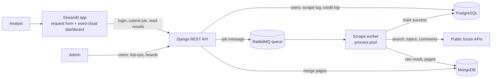

## Summary
### Resume bullets
- Built an internal forum-scraping service: a Django REST API queues keyword jobs on RabbitMQ,
  a multi-process worker collects topics and comments, and MongoDB stores the raw results.
- Rewrote an ad hoc forum scraper as a functional-style Python library, chaining requests and
  parsing through Either monads so failed pages return errors as values instead of stopping a scrape.
- Built a Streamlit front end to submit scrape jobs and turn results into Thai n-gram word
  clouds, using PyThaiNLP tokenisation with user keywords and gensim phrase detection.
- Added per-user accounts and usage tracking: JWT bearer sessions, argon2 password hashing,
  password-reset tokens, and scrape, credit and top-up logs that admins manage.
- Split each scrape result across paged MongoDB documents to stay under the document size
  limit, merging the pages back when a user reads the result.
### Remarks
- B1: traces to the scraping-service, worker and Docker Compose bullets · end-to-end ownership,
  sole author in git · no deployment, user count or job volume found; outcome to confirm ·
  roles: backend, data.
- B2: traces to the scraper-library and monad bullets · a clear design pattern with a reason ·
  the library targets one forum only; do not claim a multi-site scraper in this repo ·
  roles: backend, data.
- B3: traces to the Streamlit and text-processing bullets · Thai NLP preprocessing · word
  clouds are a descriptive output, not a model; the text cleaner, tokeniser and n-gram helpers
  arrived in one commit, possibly reused from earlier work (Open question) · roles: data, ML.
- B4: traces to the accounts-and-credit bullet · credit usage is counted, not enforced: a scrape
  request is not blocked at zero credit, so do not claim quota enforcement · roles: backend.
- B5: traces to the MongoDB paging bullet · a fix for a real failure (oversized documents) ·
  small change; could merge into B1 on a short resume · roles: backend, data.
- `up to 500 topics / 500 comments per topic`, `4 worker processes`, `20 topics per document`,
  `38 forum boards`: configured values, not results. Describe them without figures, or as
  "designed for" if a figure is needed.
- Scope caveat: status wip. The service is merged to main and starts with Docker Compose, but
  git shows no production deployment and no usage data. The worker acknowledges messages on
  receipt (auto-ack): do not claim at-least-once delivery or retries.
- Scope caveat: Jira shows earlier on-demand scraping and word-cloud work for other teams
  (2022-11 ~ 2024-02) that led to this app; that work has no repo here and is not in What I Did.

## Context
An internal tool for a data and marketing consultancy. Other teams often asked for public
posts and comments about a brand or keyword from a large Thai discussion forum, then for word
clouds of the text. Until late 2023 these requests were met by running scraper scripts by hand.
Tickets from 2022–2023 record the plan to turn the scripts into a self-service app with a
database, keyword queries, usage counts and possible billing [POCS-27] [POCS-102] [POCS-197].
This repo is that app, built under an "internal scraping app" epic from 2023-12 to 2024-03, with
small fixes up to 2024-08 [POCS-208] [POCS-218] [POCS-219] [POCS-220] [POCS-228] [POCS-233]
[POCS-235]. Git shows one author (me) for every commit [scraper:. 100%].

## What I Did
- **Rewrote the forum scraper as a library** with three layers: low-level functions for the
  forum's search API, topic page and comment API; client classes (`SearchClient`,
  `TopicClient`, `CommentClient`) that page through results up to a configured maximum; and a
  preprocessing package that turns raw JSON into pandas tables of topics, comments and replies.
  Requests send a rotating user-agent and a timeout. [scraper:utils/scraper 100%]
  [scraper:utils/scraper_client 100%] [scraper@c13baaf] [scraper@f6d97c5] [scraper@2ca32d7]
  [POCS-208] [POCS-218]
- **Chose a functional error-handling style**: every request and parse step returns an
  `Either` (`Left` error or `Right` value) from an extended PyMonad wrapper that adds `>>` and
  `|` as bind and an `.error` accessor, so a failed page or missing key is logged and skipped
  and the rest of the scrape continues. [scraper:utils/monad 100%] [scraper@10e9455]
  [scraper@6b0d053] [scraper@cecdfaa]
- **Built the scraping service on Django REST Framework and RabbitMQ**: `POST /api/scrape`
  validates the user's bearer token, writes a scrape log and a credit log to PostgreSQL, and
  publishes the job (keyword, boards, sort order, topic and comment limits) to a RabbitMQ queue.
  `GET` endpoints list a user's successful scrapes and return one result, checking that the
  requester owns it. [scraper:src/api 100%] [scraper@5ce150e] [scraper@3ea90af]
  [scraper@686e640] [scraper@8d4feef] [POCS-220]
- **Wrote the scrape worker**: a pika consumer that runs the search, removes duplicate topic
  IDs, then fetches topic bodies and comments in parallel with a `multiprocessing` pool, saves
  the raw result to MongoDB keyed by the job's UUID, and marks the job successful in PostgreSQL.
  [scraper:worker 100%] [scraper@34e8146] [scraper@59772da] [scraper@6e93863] [scraper@22bb533]
- **Fixed oversized results by paging them in MongoDB**: the worker splits each result into
  documents of a fixed number of topics, and the API merges the pages back on read, so large
  scrapes no longer exceed the document size limit. [scraper@2dd249b] [scraper@2584760]
- **Built user accounts and credit tracking**: a user app with argon2-hashed passwords,
  JWT bearer sessions with an expiry check, password-reset tokens that expire and mask earlier
  tokens, and a profile endpoint reporting top-up credit, usage and remaining credit.
  An admin side (separate admin login) manages users, top-up ("redeem") logs, credit logs that
  can be excluded from the count, and the catalogue of forum boards.
  [scraper:src/admin 100%] [scraper:src/authentication 100%] [scraper@4c72155]
  [scraper@1338c62] [scraper@bb9b5a8] [scraper@67b4b7b] [scraper@46006fc] [POCS-233]
- **Built a Streamlit front end** with a login, a scrape-request form (keyword, up to three
  boards, sort by time, topic and comment limits) and a dashboard that lists past scrapes, pulls
  one from the API, cleans and tokenises the text, and draws word clouds from single words up to
  five-word phrases, downloadable together as a ZIP. A checkbox limits the text to posts that
  contain the search keyword. [scraper:streamlit_app 100%] [scraper@2b92a16] [scraper@ecc0ce3]
  [scraper@3390924] [POCS-235]
- **Wrote the Thai text pipeline used by the dashboard**: a forum-specific cleaner (removes
  spoiler and edit markers and the forum's spacing tokens, unescapes HTML, strips tags), a
  PyThaiNLP tokeniser that first matches user-supplied keywords from a custom dictionary, and an
  n-gram helper built on stacked gensim `Phrases` models with Thai stopwords removed.
  [scraper:utils/preprocessing 100%] [scraper@b91270e] [scraper@fc04799] [POCS-219] [POCS-228]
- **Containerised the stack with Docker Compose**: PostgreSQL, Django, MongoDB, RabbitMQ, the
  worker and Streamlit, configured from `.env`, with seed scripts for an admin, test users and
  the forum's board list. [scraper@26409ec] [scraper@10c2d80] [scraper:seed-data 100%]
- **Documented the library in notebooks and a Postman collection**: step-by-step examples from
  keyword search to the merged, cleaned tables, and a saved collection of the API's requests.
  [scraper@6ff9eeb] [scraper@ade150a] [scraper@5de4783]

## Numbers
| Value | Scope | Source |
| ----- | ----- | ------ |
| up to 500 topics and 500 comments per topic | per scrape request, limits of the request form (configured) | [scraper:streamlit_app 100%] |
| 4 worker processes | multiprocessing pool for topic and comment fetches (configured) | [scraper:worker 100%] |
| 20 topics per MongoDB document | page size used to split large results (configured) | [scraper@2dd249b] |
| 38 forum boards | board catalogue seeded for the request form (configured) | [scraper:seed-data 100%] |

No measured outcome (jobs run, users, data volume, run time) was found in git or Jira.

## Tools
tools: Python 3.11, requests, BeautifulSoup, PyMonad, multiprocessing, tqdm, pandas, NumPy,
Django 4.2, Django REST Framework, PyJWT, argon2-cffi, PostgreSQL (psycopg2), MongoDB (pymongo),
RabbitMQ (pika), Streamlit (streamlit-tags), PyThaiNLP, gensim, wordcloud, Matplotlib, Docker
Compose, Jupyter, pytest, Postman
Studied, not used: none found (Celery and Redis are in requirements from the template but unused)

## Architecture

A user submits a keyword job from Streamlit. The API logs it against the user's credit and
queues it. The worker runs the scraper library: search pages, then topic bodies and comment
pages in parallel, and stores the raw JSON in MongoDB in pages. The dashboard fetches a finished
job through the API, cleans and tokenises the Thai text, and renders n-gram word clouds.

## Not mine
- The Django project scaffolding came from a company starter template in one commit: settings,
  base models and test helpers, an address app with Thai province data, storage helpers, Nginx
  and Let's Encrypt config, and the self-hosted CI pipeline. It is authored under my identity but
  was not built for this project. [scraper@42566d4]
- An earlier proof of concept of the forum scraper by a teammate, which I studied before
  writing my own version in 2022 (ticket only). [RES-33]
- The forum's own search, topic and comment endpoints, which the scraper calls.

## Open questions
- Was the app deployed and used by other teams? How many users or scrape jobs, and for how long?
  The status is `wip` until this is known.
- Did the credit and top-up logic support real billing or internal quotas, or was it a design
  for a product that did not launch? [POCS-197] mentions usage counts and pricing.
- The text cleaner, tokeniser, n-gram helper, an RFM processor and a tweet cleaner all arrived in
  one commit [scraper@b91270e]. Were they written for this project or reused from your earlier
  analytics work? (The RFM and tweet code is not used here.)
- Google Trends was in the app's original design [POCS-197] and was later rebuilt as a separate
  Streamlit app [RES-116]. Is that app in another repo, and should it join this project?
- The 2022–2023 on-demand scraping work (forum, Twitter, YouTube, TikTok, Google Trends;
  42 request tickets, 2022-11 ~ 2024-02) has no repo. Should it extend this project or become its own?
- The 2022 version of the forum scraper lived in a personal repo named in [RES-33]. Is it worth
  ingesting?
