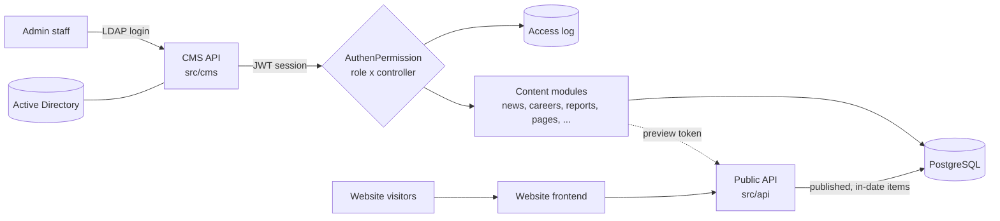

## Summary
### Resume bullets
- Built the content APIs of a life-insurance company's corporate website CMS in Django REST
  Framework: news, articles, careers, investor reports and policy pages, each with admin CRUD and
  public read endpoints.
- Designed the CMS's role-based access control: per-controller none/read/write permissions checked
  by a DRF permission class from the JWT session, per-request access logs and role-filtered admin
  navigation.
- Built reusable base models and viewsets for drag-and-drop ordering, soft delete with restore and
  static pages, shared by the content modules of the CMS.
- Added editor workflows: expiring JWT preview links for unpublished content, product drafts with
  history, and a rich-text image upload API with HTML sanitising against script injection.
- Diagnosed a production LDAP login failure for new staff accounts with reproduction scripts,
  fixed an over-strict Active Directory filter that returned HTTP 500, and recorded the decision.
- Wrote the code tests first with pytest and shared base test classes, and wrote the seed scripts
  that loaded content, roles and permissions for UAT and production.
### Remarks
- B1: traces to the content-modules and public-API bullets · breadth and clear majority ownership
  of these modules · shared with three teammates; the product, FAQ, history, contact and board
  modules are mostly theirs, so claim only the modules named · no traffic or content-volume figure ·
  roles: backend.
- B2: traces to the RBAC bullet · a design decision (permission keyed by controller name) ·
  the LDAP login and register flow on top of it is a teammate's; do not claim LDAP login · roles:
  backend.
- B3: traces to the base-layer bullet · reusable engineering · no measured outcome; outcome to
  confirm · roles: backend.
- B4: traces to the preview/draft and rich-text bullets · two editor-facing features · draft
  system covers products only · roles: backend.
- B5: traces to the 2026 LDAP incident bullet · a real production fix with a written decision
  record · only Fix 1 shipped; Fix 2 (role auto-creation) was committed and reverted on an
  unmerged branch, so do not claim it · roles: backend.
- B6: traces to the testing and seeding bullets · process evidence (tests and code written
  together, per ticket) · CI pipeline came from a company template; do not claim building CI or
  a coverage figure · roles: backend.
- `5 active banners`, `1 active splash`, `3 highlighted / related products`, `25 MB`, `24 h`:
  configured limits, not results. Describe the rules without the figures.
- Scope caveat: shipped to production (ticket 2024-05) and still in use in 2026-05; the frontend
  and infrastructure are not in this repo. Business scale (visitors, content items, admin users)
  is unknown.
- Scope caveat: `main` stops at 2023-12. All later work, including the production fixes, lives on
  `origin/dev`, the branch the CI pipeline deploys. Four proof-of-concept commits (permission
  bypass, image upload, multi-file upload) and the reverted Fix 2 live only on unmerged branches.

## Context
Jira citations write the project's own key as `PRJ` (the real key carries the client name); ticket numbers are real.

The backend of a corporate website and its content-management system (CMS) for a Thai
life-insurance company. Admin staff edit the site's content (home banners and menus, news,
articles, careers, investor reports, policy pages, services, products) through the CMS, and the
public website reads it through public APIs. Staff log in with the company's Active Directory
(LDAP). The backend is Django and Django REST Framework on PostgreSQL, with Celery and Redis,
deployed with Docker Compose; a Bitbucket pipeline on the `dev` branch runs pytest and deploys to
a test server. The project started from a company Django template [backend@714639df9]. A team of
three to four backend developers built it from 2023-08; I was the largest committer up to 2024-02
(525 of about 875 non-merge commits in that window), then worked on it occasionally while
teammates carried on. Production deployment was ticketed in 2024-05 [PRJ-1098], and client staff
were still using the CMS in 2026-05 [TT-1041].

The checked-out `main` stops at 2023-12-18. The live line of work is `origin/dev`, which holds all
my commits except a few proof-of-concept branches and one reverted hotfix (see Open questions).
Blame shares below are read at `origin/dev`, ignoring whitespace and one bulk line-ending commit by
a teammate that touched 394 files.

## What I Did
- **Built the core content modules, admin side and public side**: splash screen, home menu and
  submenu, banner carousel, news (categories, tags, gallery, view count), articles, careers
  (departments, seniority, job positions, job submissions), investor reports (annual, quarterly
  and monthly revenue, annual summary), about pages (mission, vision, values) and policy pages.
  Each has a CMS CRUD viewset and a public read API filtered to published, in-date items.
  [backend:src/cms/news 65%] [backend:src/cms/home_menu 79%] [backend:src/cms/work_with_us 61%]
  [backend:src/cms/report 90%] [backend:src/cms/about 67%] [backend:src/cms/article 89%]
  [backend:src/cms/splash 56%] [backend:src/cms/carousel 52%] [backend:src/api/api_news 83%]
  [backend:src/api/api_report 86%] [backend:src/api/api_about 76%]
  [backend:src/api/api_work_with_us 71%] [backend:src/api/api_article 78%] [PRJ-59] [PRJ-88]
  [PRJ-247] [PRJ-255] [PRJ-309] [PRJ-378]
- **Contributed to the service page**: overall content, service items, service highlights and
  downloadable form categories with PDF upload, and their public API; teammates extended the
  module later. [backend:src/cms/service 30%] [backend@3c527cf] [backend@05a32c1]
  [backend@19d3e5a] [PRJ-332] [PRJ-335]
- **Wrote a shared base layer used across the content modules**:
  - `PositionModel` keeps a gapless `meta_position`: new items append at the end, a move shifts
    the items in between with one `F()` update, then the positions are renumbered;
    `MoveableViewset` exposes `move` and `reset-position` actions on any model that uses it.
  - `SoftDeleteModel` with a default manager that hides deleted rows, plus `RestoreViewSet`.
  - An abstract static-page model and controller for single-page content (about, policy, report
    pages).

  The ordering rules came from client acceptance-test defects (new items go last, sort order).
  [backend:src/base 86%] [backend@020d943] [backend@e0b590b] [backend@eb2c4c7] [backend@9033230]
  [backend@8b2fef8] [PRJ-80] [PRJ-527] [PRJ-605] [PRJ-616] [PRJ-254]
- **Designed the admin role-based access control (RBAC)**: an ER design for admin
  authentication and permissions, then the models (`AdminRole`, `AdminResource` keyed by
  controller name, `AdminRolePermission` with none/read/write, `NavSection`, `AccessLog`). A DRF
  `AuthenPermission` class validates the JWT session, rejects revoked accounts and allows a
  request by the role's level for that viewset (write needed for unsafe methods); a
  `LogPermission` class writes an access-log row per request. Added the role-filtered admin
  navigation tree, permission-by-role and by-group APIs, and a permission-matrix export pivoted
  with pandas. [backend:src/cms/authentication 99%] [backend:src/cms/auth_system/models 86%]
  [backend@178f44c] [backend@6991cf2] [backend@7b15985] [backend@b998ca1] [backend@66162c3]
  [backend@91eaf2a] [PRJ-65] [PRJ-72] [PRJ-719] [PRJ-738] [PRJ-1037]
- **Built preview links for unpublished content**: an admin endpoint issues a signed JWT with an
  expiry, and public detail endpoints accept it to return content not yet published; both sides
  are base viewsets reused by news, articles and products. [backend@59992d2] [backend@898e22a]
  [backend@8dfcc4f] [backend:src/base/controllers 98%] [PRJ-707]
- **Built a draft system for products**: saving a draft stores a history copy linked to the
  product, which editors can list and load back; the default manager hides history rows.
  [backend@67f5217] [PRJ-840]
- **Secured rich-text content**: a separate image-upload API for the rich-text editor with a size
  limit, and an HTML cleaner (BeautifulSoup) that strips `script` and `style` tags and inline
  event-handler attributes, applied by a rich-text serializer field.
  [backend:src/cms/richtext_upload 98%] [backend@c818257] [backend@aa8aad4] [backend@77ab28b]
  [backend@69aeff7] [PRJ-313] [PRJ-523]
- **Wrote code and tests together with pytest**: tickets were split into "test" and "dev" pairs;
  shared base test classes (base case, CRUD, static page), mock image and PDF fixtures, and a patch
  to bypass the permission class in unit tests. Adapted the template's Bitbucket pipeline, which
  runs pytest on the `dev` branch before deploying to the test server.
  [backend:src/base/tests 93%] [backend@930fa9e] [backend@f3f5b39] [backend@4afd148]
  [backend@71c30ac] [backend@a772ea7] [PT-54] [PRJ-31] [PRJ-143]
- **Wrote the seed scripts** that load content (home page, about, reports, policies, board,
  products, banks, hospitals) and the admin setup (resources, roles, permission groups,
  navigation) for UAT and production, with a small loader library.
  [backend:seed-data/lib 100%] [backend@65fc341] [backend@5bae823] [backend@27c6ce3]
  [backend@a524983] [PRJ-428] [PRJ-756] [PRJ-1037]
- **Added address lookups**: a GraphQL read endpoint (graphene) over the province, district and
  subdistrict data beside the REST API, and a district search API returning its subdistricts.
  [backend@2f875de] [backend@5335c86] [backend@fd35129]
- **Worked on deployment**: proved an LDAP connection from the Django container, added the
  production Compose file and static-path settings, and handled the production deployment and
  reverse-proxy tasks. [backend@9dc736e] [backend@96ad237] [backend@bf6c3a8] [PRJ-293]
  [PRJ-1098] [RES-92]
- **Maintained the live system (2025)**: fixed the hospital CSV import so district names in the
  client's file match the address table, and added duplicate reporting; wrote a seed script that
  adds navigation and permissions for a new dashboard page. [backend@6c6eb96] [backend@5ee0d32]
  [backend@40e2c05] [backend@c2b410d] [PRJ-1169]
- **Diagnosed and fixed a production LDAP login failure (2026-05)**: new staff accounts could not
  log in. Wrote reproduction scripts (LDAP bind, user search, filter-bug reproduction, API login)
  and a developer guide, and found two bugs: an over-strict Active Directory filter (a required
  `department` attribute and wrong `sAMAccountName` casing) that raised HTTP 500, and role
  auto-creation disabled since 2024-03, giving HTTP 401. Shipped the filter fix (verified on an
  affected account) and wrote a decision record. The role fix was committed and then reverted on
  the unmerged hotfix branch. [backend@0299806] [backend@fe528d7] [backend@1f8db2b]
  [backend:scripts/ldap-login-bug 100%] [backend:docs/decisions 100%] [backend@e014883]
  [backend@e73ddb2] [TT-1041]

## Numbers
| Value | Scope | Source |
| ----- | ----- | ------ |
| 5 active banners, 1 active splash | CMS limits on published home-page items (configured, from a client change request) | [PRJ-623] [backend@3011593] [backend@b29a90d] |
| 3 highlighted / 3 related products | CMS limits per product (configured) | [backend@69d7043] |
| 25 MB | maximum rich-text image upload (configured) | [backend@69aeff7] |
| 24 h | admin session and preview-token lifetime (configured) | [backend@178f44c] |

## Tools
tools: Python, Django 4.1, Django REST Framework, drf-nested-routers, drf-yasg (Swagger), PyJWT,
graphene-django (GraphQL), ldap3 / django-python3-ldap, BeautifulSoup, pandas, Pillow,
PostgreSQL, pytest, pytest-django, pytest-cov, Docker Compose, Bitbucket Pipelines, termcolor
Studied, not used: Go Fiber as an alternative CMS stack (research ticket only) [RES-99]

## Architecture

Admin and public code live in separate Django app trees (`src/cms`, `src/api`) over shared models.
Every CMS viewset carries the permission and log classes, so access is decided per controller name
and role. Content models inherit base classes for ordering, soft delete and static pages; editors
can share a time-limited preview link before publishing.

## Not mine
- The starter Django template in the first commit (address data and SQL, storage helpers, JWT
  helper, pipeline skeleton, Nginx/Let's Encrypt setup), authored under my identity but reused
  from a company template. [backend@714639df9]
- The LDAP login and register flow, resource groups and most admin-account APIs: a teammate,
  2023-12 ~ 2025-01. [backend@f7b3f4e] [backend@4a22621]
- Most of the product, FAQ, history, contact, board-member and hospital-contact modules, and the
  later product index-link work with Celery tasks: teammates.
  [backend@228dc8a]
- QR-code landing module and HTTP range media serving (2026), from a shared deploy account.
  [backend@21c34db] [backend@239bde1]
- A 2025-10 board-member change committed under my identity on a teammate's behalf.
  [backend@164c762]
- The website frontend, not in this repo.

## Open questions
- Is `origin/dev` what runs in production? `main` stops at 2023-12, and the pipeline deploys `dev`
  to a test server; how did production get its code?
- Unmerged work: the proof branches for permission bypass (7 commits), image upload (5) and
  multi-file upload (1), and the reverted role auto-creation fix on the LDAP hotfix branch. Were
  the proofs folded into `dev` by other commits, and was the role fix ever deployed?
- Your role: were you the backend lead for the 2023-08 ~ 2024-02 build, or one of equal
  developers? Did you also set the code conventions (the template's Convention-over-Configuration
  guide)?
- Scale and outcome: site visitors, content items, admin users or roles in production?
- Did you design the RBAC alone, or with a teammate? The ER-design tickets are yours, the LDAP
  register flow is a teammate's.
- Production deployment and reverse proxy: tickets only, little git trace. What did you do (server,
  Nginx, Docker), and when did the site go live?
- GraphQL endpoint: was it used by the frontend, or only a trial?
- Jira tickets prove assignment only: tickets for the hospital-table merge and ebook HTML upload
  proof have no clear git trace; confirm what you built there.
