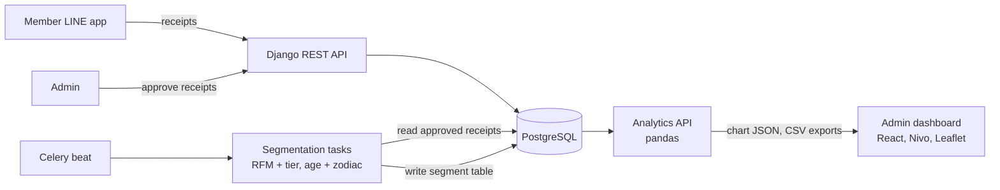

## Summary
### Resume bullets
- Built an RFM customer-segmentation module for a LINE loyalty platform: quintile scoring of
  approved receipts, 125 score codes mapped to 11 segments, and spend-based tiers, run as a
  scheduled Celery task.
- Built Django REST analytics APIs in pandas for the admin dashboard: revenue time series by
  shop type, member demographics, RFM value distributions per segment, and member and revenue
  totals by province.
- Built the admin analytics dashboard in React with Nivo and Leaflet: daily and monthly
  revenue lines, gender-age and RFM segment bar charts, spend and frequency histograms, and a
  province map.
- Added date-range CSV exports of members, receipts and shipping addresses for the admin team,
  and a public shop-ranking API that ranks onsite shops by approved revenue.
- Built a dev-only data-seeding app that loads mock members, receipts and the client's shop
  list through SQL migrations, and wrote Django tests for the analytics and member APIs.
### Remarks
- B1: traces to the RFM scoring, segment mapping, tier and Celery bullets · the core
  data-science piece, designed and coded alone · no figure on how marketing used the segments;
  outcome to confirm · roles: data, backend, ML.
- B2: traces to the analytics API and pandas helper bullets · analytics controller is 100% mine
  on main · dashboard traffic unknown · roles: backend, data.
- B3: traces to the admin dashboard bullet · front-end work on a teammate's React app; my share
  is the chart components, not the app · roles: data, full stack.
- B4: traces to the CSV export and shop-ranking bullets · later export work (2024–2025) was
  extended by a teammate, so claim only the first version · roles: backend.
- B5: traces to the seeding and testing bullets · supporting work; tests are few, so do not
  claim test coverage · roles: backend.
- `125 codes → 11 segments`, `5 score groups` and the tier thresholds are configured values: B1
  describes the design, not a result.
- `280+ shops`: size of the client's shop list seeded for development; it shows scale but is
  not a measured outcome. Use only as "the client's 280+ partner shops" if the user confirms
  it reflects production.
- `1,000 members / 3,400 receipts`: mock data size; leave out.
- `~2 s per 1,000 members`: an informal code comment on mock data; leave out.
- Scope caveat: I joined a team project; the member app, receipt approval, points,
  redemption and campaigns were built by teammates. The project was later extended by others
  into 2025 on unmerged branches. My work is the analytics layer.

## Context
A LINE-based membership and loyalty platform for a pet-food brand in Thailand. Members sign up
through LINE, register their pets, and upload purchase receipts from partner shops (online
marketplaces and physical pet shops). Admins approve receipts; approved spend earns points,
tiers and rewards, and later campaigns and lucky draws. The brand wanted to understand its
customers from this data: who buys, where, how often and how much, segmented by RFM
(Recency, Frequency, Monetary). The backend is Django REST Framework on PostgreSQL with Celery
and Redis; the admin site is a React app. Several developers worked across the two repos; I
owned the analytics and segmentation module and its dashboard.

Jira citations write the project's own key as `PRJ` (the real key carries the client name);
the ticket number is unchanged. Tickets from 2023-01 show earlier RFM and association-rule
exploration before the repos start [PRJ-1] [PRJ-3] [PRJ-5].

Branches: main stops at 2023-08; teammates continued on deploy and feature branches to 2025-12.
The newest branch, `feature/messaging-api`, contains main and my later commits (Swagger
2024-09, campaign spending log 2025-03). Three of my 2024-10 commits (member de-duplication,
an RFM to-do) live only on the unmerged `feature/check-dashboard` branch. Blame for my 2023
work is read on main, where a later teammate reformat has not moved the authorship.

## What I Did
- **Designed the analytics code structure** in an `analytics_scripts` workspace: notebooks
  explored mock data first, then each analysis became a pure function that takes and returns a
  pandas DataFrame, with the API layer owning the queries and the JSON formatting.
  [backend:analytics_scripts 100%] [backend@83a5ac84a] [backend@17a7d4fb8] [PRJ-40]
- **Wrote an RFM processor** (`RFMProcessor`): per customer, recency in days since the last
  purchase, frequency as receipt count and monetary as total spend, each scored 1–5 by quintile
  (`pd.qcut`). A safe-qcut wrapper drops duplicate bin edges and still assigns scores when the
  data has few distinct values (fixed under [PRJ-72]).
  [backend@7a5b94759] [backend@83f133c3f] [backend:analytics_scripts/analytics 100%]
- **Mapped the 125 RFM score codes to 11 named segments** (Champion, Loyal, At Risk, Lost, …)
  with a YAML threshold config on recency and the averaged frequency-monetary score; a
  generator resolves overlaps by config order and writes the label table seeded into the
  database. Alternative Thai-language segment sets were kept as configs.
  [backend@841554dac] [backend@c79f685e3] [backend@aefacfde7] [PRJ-3] [PRJ-52]
- **Ran segmentation as scheduled Celery tasks**: an RFM task scores approved receipts and
  writes each member's recency, frequency, monetary, segment and spend tier (four tiers by
  total spend); a second task assigns age group and zodiac segments from birth dates.
  [backend@95a9fe694] [backend@044fb4122] [backend@3e748ed1c] [PRJ-77] [PRJ-88]
- **Built the admin analytics API** in Django REST Framework with pandas: monthly and daily
  revenue by shop type with missing dates filled, top shops, revenue by pet type, member
  demographics (province, gender, age), RFM segment counts, top spenders, frequency and spend
  histograms, and descriptive statistics per segment. Every endpoint returns chart-ready JSON
  and an empty list, not an error, when a query has no data.
  [backend:src/api 38%] [backend@8a65359cc] [backend@9e2cfaa70] [backend@0ba0f72db]
  [backend@5204b049e] [backend@599433573] [PRJ-61] [PRJ-87]
- **Wrote a `groupby` wrapper and date-fill helpers** so each analysis reuses one aggregation
  path instead of repeating pandas code. [backend@ecae250cc] [PRJ-42]
- **Built geographic analytics**: matched Thai province names to English GeoJSON names, added
  English names to the province table, and served member counts and revenue per province.
  [backend@f3d3d945e] [backend@f2e4e4269] [backend@e1c0d7d64] [PRJ-65] [PRJ-66]
- **Built the admin analytics dashboard** in the teammates' React admin app: Nivo line, pie,
  stacked-bar, bar and histogram charts, a Leaflet province map, RFM statistics tooltips per
  segment, shared colour definitions and data-preprocessing functions, plus a Docker setup for
  the app. [admin@d4bab556d] [admin@b040558d4] [admin@624cb8a3c] [admin@2074bd8af]
  [admin@2fe97ef00] [admin@cd3fe7adf] [admin:src/functions/data_preprocessing.js 100%]
  [PRJ-121] [PRJ-122]
- **Added CSV exports** for the admin team: members with pets and segments, and receipts and
  shipping addresses by date range, behind a date-range validator.
  [backend@02b2cc604] [backend@4d1975d33] [backend@4edf4e2d5] [backend@92841fcbe] [PRJ-68]
  [PRJ-84] [PRJ-85]
- **Built a public shop-ranking API** that ranks onsite shops by total approved revenue for
  the member app. [backend@99f9409f7] [backend@491aa4a1a] [PRJ-172]
- **Built a dev-only seeding app**: mock members, addresses, pets, receipts, points and
  segments loaded through Django data migrations. Seeding moved from model-based migrations to
  SQL to fix migration-dependency errors and auto-increment clashes; later the client's real
  shop list was cleaned and seeded. [backend@e8cd0bfad] [backend@3788b03bd]
  [backend@9e4f16faf] [backend@b9df4961f] [backend@447ce9d43] [PRJ-55] [PRJ-57] [PRJ-79]
- **Wrote Django and pytest tests** for the analytics API, user registration, login, receipt
  upload and admin endpoints. [backend@06e4c34d0] [backend@eecd50fd1] [backend@f3a91298b]
  [backend:tests/admin 100%]
- **Later maintenance**: added Swagger API docs (2024-09), removed duplicate members caused by
  multiple addresses in the analytics queries (2024-10, unmerged branch), and made receipt
  approval update the campaign spending log (2025-03). [backend@51a82a730]
  [backend@9cd3ef727] [backend@8f04afddf] [PRJ-248] [PRJ-249]

## Numbers
| Value | Scope | Source |
| ----- | ----- | ------ |
| 125 RFM codes → 11 segments | segment mapping (configured) | [backend@841554dac] |
| 5 score groups per RFM dimension | quintile scoring (configured) | [backend@7a5b94759] |
| 4 spend tiers | tier thresholds by total spend (configured) | [backend@044fb4122] |
| 280+ shops | client shop list seeded for development (client data, production use unconfirmed) | [backend@447ce9d43] |
| 1,000 members, ~3,400 receipts | mock development dataset (configured) | [backend@3788b03bd] |
| ~2 s per 1,000 members | age and zodiac task on mock data (informal code comment) | [backend@95a9fe694] |

## Tools
tools: Python, pandas, NumPy, PyYAML, Jupyter, Django, Django REST Framework, Celery
(django-celery-beat), Redis, PostgreSQL, pytest, pytest-django, Swagger (drf-yasg), Docker,
React, Nivo, Leaflet, GeoJSON, Ant Design
Studied, not used: visx (listed in the analytics README as a chart option), association rules
on POS data (ticket only, 2023-01)

## Architecture

Members upload receipts; admins approve them. Celery beat runs the segmentation tasks, which
score approved receipts with the RFM processor, look up the segment label for each score
code, and write the member's segment and tier. The analytics API reads members, receipts and
segments into pandas, aggregates them and returns chart-ready JSON or CSV to the admin
dashboard.

## Not mine
- The member app API (registration, LINE identity, pets, receipts, points, redemption), the
  receipt auto-approval Celery task, and nginx with certbot: teammates.
  [backend@c9bba3d9] [backend@2252b34]
- The React admin app shell, receipt and product pages, and later dashboard changes: teammates.
  [admin:src/pages 4%]
- Campaign credits, lucky draws, extended exports and new dashboard APIs on the deploy and
  feature branches (2024–2025): teammates.

## Open questions
- Did the analytics dashboard and segmentation run in production for the brand, and were the
  segments used for marketing (campaigns, messages)? A 2023-04 ticket reads "test on
  production" [PRJ-178].
- How many real members, receipts or shops did the production system hold? Only the mock and
  seeded figures are in git.
- 2023-01 tickets show RFM and association-rule work on POS data before the repos, and a
  cross-platform RFM exploration for another brand [PRJ-2] [PRJ-5]. Is that code somewhere,
  and does it belong here?
- 2023-09 ~ 2024-01 tickets (image download, member-ID similarity mapping, export of unmapped
  users) [PRJ-221] [PRJ-223] [PRJ-232] [PRJ-233] have no commits of mine. What was that work?
- 2025-01 ticket on planning an RFM notification feature [PRJ-256]: was it built?
- Team: how many developers worked on the project, and was I the only one on analytics?
- The 2024-10 member de-duplication fix sits only on an unmerged branch: was it deployed?
