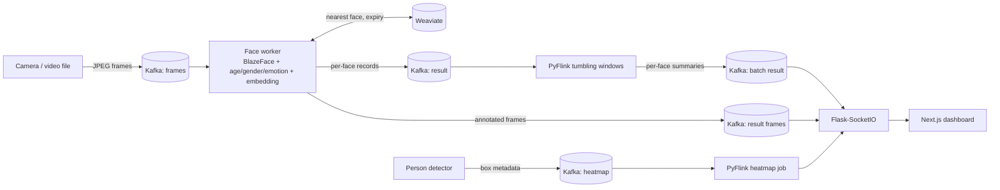

## Summary
### Resume bullets
- Built a real-time audience-analytics demo for a marketing event: Kafka topics carried face
  results, a pandas analyser aggregated age, gender and emotion, and Flask-SocketIO pushed them
  to a Next.js dashboard.
- Prototyped camera-frame streaming through Kafka to a face-analysis worker running MediaPipe
  detection and ONNX age, gender and emotion models, switching frames from PNG to JPEG for about
  10x smaller messages.
- Prototyped short-term visitor re-identification with face embeddings in Weaviate and per-face
  attribute counts in PyFlink tumbling windows, giving one age, gender and emotion label per
  visitor on the dashboard.
- Prototyped crowd heatmaps from person detections, accumulated as bounding-box masks over the
  video and a top-view, batched per minute in PyFlink and replayed on a React dashboard.
- Built a crowd-flow visualisation prototype with YOLOv8 and supervision: tracked-people
  heatmaps, per-zone activity over time, and zone-to-zone Sankey charts in a Streamlit video
  replay app.
### Remarks
- B1: traces to the phase-1 pipeline, analyser and Next.js dashboard bullets · end-to-end and
  sole author of the three phase-1 repos · the event demo date is ticket-backed only; the
  model producer that fed the demo topic is not in the ingested repos; audience size unknown ·
  roles: data, backend.
- B2: traces to the frame-streaming and face-model-bundle bullets · a measured payload change
  (commit message) · the age/gender/emotion model wrappers were partly written by a teammate,
  so claim the bundle and pipeline, not the models · roles: ML, AI infra.
- B3: traces to the Weaviate re-identification and Flink windowing bullets · stream processing
  plus vector search · prototype only; no accuracy figure for re-identification · roles: ML,
  data, AI infra.
- B4: traces to the heatmap and heatmap-dashboard bullets · the dashboard heatmap work lives
  only on an unmerged feature branch; read as prototyped · roles: ML, data.
- B5: traces to the 2024 crowd-flow bullets · the zone-transition tracking script was written
  by a teammate and committed by me; the bullet claims the heatmaps, activity charts, Sankey
  and Streamlit app only · roles: data, ML.
- `~90 ms Kafka poll vs ~15 ms processing per frame`, `~50 ms per frame on an A100`, `3
  streams ≈ 3x frame time`, `5-min video ≈ 1,200 s to render a heatmap`: ticket logs only, no
  git trace; left out of bullets. Say "profiled the Kafka consumer loop and GPU throughput"
  only after the user confirms.
- `5-second windows`, `60-second heatmap windows`, `cosine distance ≤ 0.2`, `5-second
  expiry`, `5-minute retention`: configured values; B3 and B4 describe them without figures.
- Scope caveat: status wip, an internal PoC for event demos and showcase material. Not used in
  production as far as git and Jira show. Work in Jira for 2023-10 ~ 2023-12 (heatmap and
  direction-flow renders on mall footage) sits in a repo not ingested, so no bullet claims it.

## Context
An internal research PoC for a marketing-event showcase: a camera watches an audience and a
dashboard shows who is there (age group, gender, emotion) and, later, where crowds gather and
how they move. It ran in three bursts:
- **Phase 1 (2023-04 ~ 2023-05)**: a live demo dashboard for an event demo on 2023-05-09,
  fed by face-model results streamed through Kafka on a DigitalOcean droplet, with a mock
  stream kept running beside the demo stream. [POCS-126] [POCS-139] [kafka-pipeline:src 100%]
  [frontend:src 100%]
- **Phase 2 (2023-05 ~ 2023-07)**: a fuller streaming PoC: video frames over Kafka, a
  face-analysis worker, face re-identification in a vector database, Flink windowed
  aggregation, multi-camera producers and a crowd heatmap, with a second dashboard.
  [face-tracking:. 89%] [tracking-dashboard:frontend/src 100%] [AHH-23] [AHH-42] [AHH-74]
- **Phase 3 (2024-07)**: crowd-flow visualisations for the event's next edition, built for
  marketers on footage recorded by an earlier mall PoC (that repo is not ingested).
  [dashboard:. 99%] [RES-111] [RES-113]

The heatmap dashboard work (6 commits) lives only on the unmerged `feature/heatmap` branch of
the tracking-dashboard repo; a perspective-transform notebook lives only on an unmerged branch
of the face-tracking repo. Both read as unshipped.

## What I Did
- **Built the phase-1 analytics pipeline on Kafka** (Confluent images, ZooKeeper, Docker
  Compose): a mock producer of face records, an analyser that reads the last N messages of the
  raw topic by watermark offsets, skips unchanged offsets, handles out-of-range offsets, and
  produces aggregates by gender, age group, emotion and time to a result topic.
  [kafka-pipeline:src 100%] [kafka-pipeline@fca5c26eb] [kafka-pipeline@2d0fb9ddc]
  [kafka-pipeline@36e97c682] [POCS-128]
- **Bridged Kafka to the browser with Flask-SocketIO**: background tasks consume the result
  topics, always seek to the latest offset, and emit to per-stream Socket.IO namespaces; random
  consumer-group IDs let every socket server read the full stream, and consumer start-up retries
  until the broker is reachable. [kafka-pipeline@b0e62df44] [kafka-pipeline@c3289c98a]
  [kafka-pipeline@d787ba933] [kafka-pipeline@2c1a17f5e] [POCS-136]
- **Split mock and demo streams** with their own topics, analysers and socket namespaces, so a
  mock feed ran continuously without mixing with live demo data. [kafka-pipeline@b2d489c76]
  [kafka-pipeline@5382de91c] [POCS-139]
- **Built the phase-1 Next.js dashboard**: Socket.IO client, nivo swarm plot (emotion by age),
  stacked bar (age group by gender), pie and time-series charts, and a recommendation panel
  that shows content suggestions for the dominant emotion in the window.
  [frontend:src 100%] [frontend@12bed3d88] [frontend@3e7320d2a] [frontend@8399be71a]
  [frontend@69d346a48] [frontend@d49665ad0]
- **Streamed video frames through Kafka** from a file, webcam or several cameras: frames
  resized, JPEG-encoded and base64-wrapped (the commit records JPEG as about 10x less data than
  PNG), with message-size limits raised and short topic retention.
  [face-tracking@a34e61afe] [face-tracking@2b47851ab] [face-tracking@81987ff3b]
  [face-tracking@60a2f7469] [face-tracking@dce41ceec] [AHH-24] [AHH-61]
- **Designed the face-model bundle**: an abstract model class (preprocess, predict,
  postprocess) and a bundle that runs a MediaPipe BlazeFace detector, then every attached model
  on each face crop (age, gender, emotion, embedding). ONNX Runtime sessions try TensorRT, then
  CUDA, then CPU. [face-tracking:face_models 83%] [face-tracking@9ca6ace56]
  [face-tracking@aba0abe09] [face-tracking@5eeccbe58] [face-tracking@71e204bb1]
- **Built the Kafka face-analysis worker**: consumes frames, runs the bundle, publishes one
  record per face to a result topic and an annotated frame to a frame topic, and paces itself to
  the stream frame rate. [face-tracking@a261c100a] [face-tracking@8e7b33229] [AHH-32]
- **Prototyped short-term face re-identification in a vector database**: compared Chroma and
  Weaviate, then stored each face embedding in Weaviate with a cosine index, reused the ID of
  the nearest face within a distance threshold, and deleted objects older than a few seconds so
  matches stay local in time. [face-tracking:utils 69%] [face-tracking@a0a5b8733]
  [face-tracking@b18dca8f1] [face-tracking@50973e864] [AHH-36] [AHH-46]
- **Added Apache Flink (PyFlink 1.17) to the stack** with a custom job-manager image and the
  Kafka connector: event-time tumbling windows keyed by face ID, with bounded out-of-orderness
  watermarks, count each face's age, gender and emotion labels per window and write the
  summaries back to Kafka. [face-tracking:flink/apps 100%] [face-tracking@c5be11644]
  [face-tracking@80e503d07] [face-tracking@e6e3f53b2] [face-tracking@99077d4a3] [AHH-47]
  [AHH-60]
- **Built the phase-2 dashboard** (Flask-SocketIO blueprints + Next.js, Docker Compose on the
  Kafka network): a backend takes the majority age, gender and emotion per face from the Flink
  summaries and streams annotated frames; the frontend has a live player page and a chart page.
  [tracking-dashboard:backend/src 100%] [tracking-dashboard@7c7a8b54e]
  [tracking-dashboard@bc791c2f1] [tracking-dashboard@d989a69af] [tracking-dashboard@c73ae6fa1]
  [AHH-64]
- **Prototyped crowd heatmaps**: person detection with MediaPipe EfficientDet-Lite0, each
  bounding box added as a thresholded, Gaussian-blurred mask to an accumulator, coloured and
  blended onto the frame, plus a top-view variant that publishes box metadata to Kafka and a
  PyFlink job that renders one heatmap per 60-second window. Also tried Lucas-Kanade optical
  flow for movement direction. [face-tracking@96be199a0] [face-tracking@64d43ef28]
  [face-tracking@ef6b62463] [face-tracking@68446eae8] [face-tracking@5282d33a8] [AHH-73]
  [AHH-75]
- **Added a heatmap player to the phase-2 dashboard** (unmerged branch): a Socket.IO namespace
  that cycles rendered heatmap images as base64, a file-query API, and a frontend player.
  [tracking-dashboard@08ff5426d] [tracking-dashboard@14332a4ee] [tracking-dashboard@388870d36]
  [tracking-dashboard@538a8692a]
- **Tested a perspective transform** from the camera view to a floor-plan view, so heatmaps
  could be drawn on a plan (notebook on an unmerged branch). [face-tracking@3c46d4b92] [AHH-94]
- **Tried named face recognition with DeepFace (ArcFace)** against a small enrolled face
  folder, and profiled repeated calls with cProfile. [face-tracking@3b53e06b0]
  [face-tracking@2738cc44d]
- **Built the 2024 crowd-flow visualisations** for marketers: YOLOv8 + supervision ByteTrack
  detection with a heatmap annotator, people counts in polygon zones exported to CSV, per-zone
  activity over time with seaborn, zone-to-zone transitions as a Sankey chart (vendored
  pySankey), and a Streamlit app that replays the video beside a Sankey chart updated by frame.
  [dashboard:. 99%] [dashboard@b2af0e626] [dashboard@c33ba60cf] [dashboard@cc7da653b]
  [dashboard@2dd644901] [dashboard@edc16c80f] [dashboard@a304708cd] [RES-113]

## Numbers
| Value | Scope | Source |
| ----- | ----- | ------ |
| ~10x less data per frame | JPEG vs PNG frame encoding over Kafka (measured, informal; commit message and ticket) | [face-tracking@2b47851ab] [AHH-24] |
| ~85–96 ms poll vs ~15 ms processing per frame | Kafka consumer loop on a laptop, about 125 ms per loop (measured; ticket log only) | [AHH-31] |
| ~50 ms per frame (~20 fps) | worker on a rented A100 GPU, including file read and Kafka (measured; ticket only) | [AHH-55] |
| 3 streams ≈ 3x frame time | multi-camera test on the A100, CPU-bound (measured; ticket only) | [AHH-62] |
| ~1,200 s per 5-min video, ~20,000 boxes | heatmap render of one video, 2023-10 (measured; ticket only; repo not ingested) | [AHH-106] |
| 5 s / 60 s windows | Flink tumbling windows for face summaries / heatmaps (configured) | [face-tracking:flink/apps 100%] |
| cosine distance ≤ 0.2, 5 s expiry | face re-identification match threshold and object lifetime (configured) | [face-tracking@b18dca8f1] [face-tracking@50973e864] |
| 5 min | Kafka log retention for frame topics (configured) | [face-tracking:. 89%] |

## Tools
tools: Python, Kafka (Confluent images, confluent-kafka), ZooKeeper, Docker Compose, Flask,
Flask-SocketIO (eventlet), pandas, Next.js, React, nivo, Socket.IO client, Bootstrap,
MediaPipe (BlazeFace, EfficientDet-Lite0, image embedder), ONNX Runtime (TensorRT/CUDA/CPU
providers), Weaviate, Chroma, Apache Flink (PyFlink), OpenCV, DeepFace (ArcFace), cProfile,
DigitalOcean, Ultralytics YOLOv8, supervision (ByteTrack, PolygonZone, HeatMapAnnotator),
seaborn, matplotlib, Streamlit
Studied, not used: Google Cloud Pub/Sub, Dataflow and Vertex AI for a managed streaming
architecture [AHH-63] [AHH-66]; Apache Spark [AHH-47]; OpenVINO (listed in requirements, no use
found)

## Architecture

Phase 1 was simpler: model results arrived on a raw topic, a pandas analyser aggregated the
latest messages into chart data, and Flask-SocketIO pushed it to the phase-1 Next.js dashboard.
Phase 2 (above) moved the face models behind Kafka, added re-identification in Weaviate and
Flink windowing. Phase 3 (2024) was offline: YOLOv8 + supervision over recorded footage, CSV
outputs, and a Streamlit app for the visualisations.

## Not mine
- Age, gender and emotion ONNX model wrappers and their initial notebooks, the face-crop
  notebook, and an RTSP/ffmpeg service in Compose: a teammate.
  [face-tracking:face_models 83%] [face-tracking@62d7dc153] [face-tracking@54119ba4d]
  [face-tracking@d2adadc95]
- `utils/analyse.py` in the face-tracking repo: a teammate. [face-tracking:utils 69%]
- The 2024 zone-transition tracking script (`ultralytics_example.py`) and its result CSVs:
  written by a teammate, committed under my identity as "code from" that teammate, then
  edited by the teammate. [dashboard@05311537a] [dashboard@3bbeeebb3]
- The phase-1 dashboard page layout: commit message credits a colleague. [frontend@90efd83ef]
- `scripts/sankey.py`: vendored open-source pySankey. [dashboard@edc16c80f]

## Open questions
- Which code produced the real (non-mock) face results for the 2023-05-09 demo topic? Ticket
  POCS-130 says "set model as a Kafka producer", but no producer for the demo topic is in the
  ingested repos.
- Was the phase-1 demo shown live at the event, and to roughly how many visitors? Was the
  phase-2 or the 2024 work shown at an event too?
- Who wrote the content suggestions in the recommendation panel (marketing team or you)?
- Status: is "wip" right, or should these PoCs read as "dropped" (ended after the demos)?
- The ticket-only measurements (Kafka poll ~90 ms vs ~15 ms processing; ~50 ms per frame on an
  A100; 3 streams ≈ 3x frame time): did you run them, and can they be quoted?
- Did the Kafka consumer tuning (offset reset, no sleep between frames) fix the low FPS in
  AHH-31? Is there an after figure?
- The heatmap and direction-flow work in 2023-10 ~ 2023-12 (AHH-104 ~ AHH-125: renders over
  about 20 mall-camera videos, supervision re-run, contour heatmaps) and the earlier mall PoC
  repo whose footage the 2024 work reused: same project or a separate one? Its repo is not in
  `mapping.yml`.
- Face verification benchmarking in 2023-09 (POCS-191, RES-84): part of this project?
- The 2024 "AI explain graph" ticket (RES-114): what was built? No trace in git.
- Did the A100 and cloud-GPU tests (AHH-55, RES-76) lead to a deployment, or stay as
  benchmarks?
