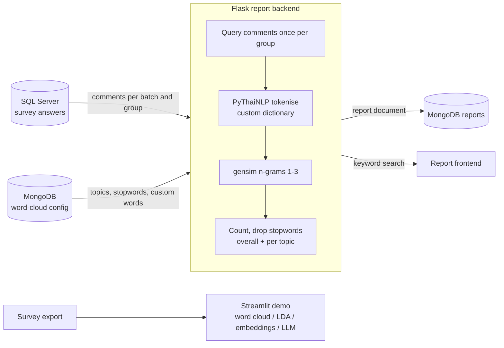

## Summary
### Resume bullets
- Built the Thai free-text word-cloud engine for an employee-survey reporting backend: PyThaiNLP
  tokenising with a custom dictionary, gensim phrase detection for bigrams and trigrams, and
  stopword filtering.
- Extended survey word clouds to per-topic views: per-survey topic keywords, stopwords and custom
  terms stored in MongoDB, comments filtered by keyword group, and a keyword-search API for the
  matching comments.
- Prototyped a Streamlit app comparing four ways to group 500+ open-ended survey comments by
  topic: tunable n-gram word clouds, LDA, thai2fit embedding similarity and local-LLM scoring.
- Extracted survey responses from SQL Server with pandas and pivoted them into a
  responder-by-question table for analysing scale and demographic answers.
### Remarks
- B1: traces to the tokenisation service and the n-gram word-cloud bullets · core NLP work,
  still in the report backend at HEAD (2026), where teammates later wrapped it in unit tests ·
  "the" engine is fair for the word-cloud path only; report calculations, PDF export and queueing
  are teammates' · roles: ML, data, backend.
- B2: traces to the per-topic word-cloud, MongoDB config and keyword-search bullets · merged
  through a series of pull requests to main (2025-01~02) · no usage or adoption figure · roles:
  backend, data.
- B3: traces to the demo-app bullets · breadth of methods · a prototype: no accuracy comparison
  between the four methods exists in git, so do not claim one beat another; the LLM scores are
  from a local model (gemma3 via Ollama) · roles: ML, AI, data.
- B4: traces to the data-extraction bullet · small, early (2023-05~06), notebook-only work ·
  weakest bullet; drop it for ML roles · roles: data.
- `500+ comments` (305 "best" + 231 "improve" lines in the demo's data files, rounded): quoted in
  B3 as dataset scale; it is one survey's export, not a production volume.
- `9 default topics`, `10 LLM topics`, `n-grams up to 3`: configured values; B2 and B3 describe
  them without the figures.
- Scope caveat: the Locust load test (2023-12) and the Excel-vs-report mismatch check (2025-05)
  are backed only by Jira tickets, so no bullet claims them.
- Scope caveat: four tokeniser commits (2023-09) sit only on an unmerged branch; they read as
  unshipped.

## Context
An HR-consultancy product: employees answer a workplace survey (scale questions, demographics
and open-ended "what is best" / "what should improve" comments), and the system builds a report
per survey batch: response rates, an engagement index, percent-favourable scores and word clouds
of the free text. Survey data lives in SQL Server; generated reports and configuration live in
MongoDB; a Flask backend computes the report, and a web frontend (not in the evidence) renders it.
Several developers built the report backend over 2023–2026. My part was the Thai text analytics:
first a tokenisation and word-count service (2023), later n-gram and per-topic word clouds and a
topic-grouping demo app (2025). The backend's README states it runs in production on a Windows
IIS server with a RabbitMQ consumer. [wordcloud-api@2df8c1aef] [EN-249] [EN-355]

Four of my commits (2023-09, a word-cloud filter that counts only listed words) live only on the
unmerged branch `feature/wordcloud/filter`; blame at `main` does not see them.
[wordcloud-api@0783fbe55] [wordcloud-api@83d9d65a7]

## What I Did
- **Extracted and reshaped survey data for analysis (2023-05~06).** Queried the survey database
  (SQL Server) for answers and demographics, then joined question, answer and category tables in
  pandas notebooks and pivoted them into one responder-by-question table, dropping incomplete
  responders. [analysis:. 100%] [analysis:data 83%] [analysis@86eb26a5b] [analysis@46cbfd753]
  [analysis@d041e9a67] [EN-50]
- **Started the word-cloud backend as a Flask tokenisation service (2023-06).** One endpoint takes
  a list of comments and returns tokens and word counts; I brought in a reusable text-processing
  package (text cleaners, a two-pass PyThaiNLP `newmm` tokeniser that keeps custom-dictionary
  words whole, a vocabulary helper) and a Dockerfile. [wordcloud-api@2df8c1aef]
  [wordcloud-api:text 100%] [EN-249]
- **Added n-gram extraction** with gensim `Phrases`: models chained from bigram to n-gram, an
  option to keep only true n-grams, and a filter that drops phrases made only of stopwords; a
  `process_texts` pipeline cleans, tokenises and builds n-grams for a batch of comments.
  [wordcloud-api@9f233d69c] [wordcloud-api@c2c2e5523] [wordcloud-api@fa86318db]
  [wordcloud-api:text 100%]
- **Rebuilt the report's word-cloud step (2025-01).** Split querying from counting so each group's
  comments (overall, best, improve) are queried once and reused, then generated unigram, bigram
  and trigram word clouds per group, with PyThaiNLP stopwords merged with a custom list.
  [wordcloud-api@8b7d0e5cc] [wordcloud-api@2dfef8d28] [wordcloud-api@59621377f]
  [wordcloud-api@5494a9c2b] [EN-355]
- **Added per-topic word clouds.** Each topic is a name plus a keyword group; comments containing
  any keyword in the group are counted separately, per n-gram and per comment group, with the
  comment count stored beside each cloud. Fixed a misconfiguration that gave every topic the same
  word frequencies. [wordcloud-api@0fae8f489] [wordcloud-api@d1b0b012b]
  [wordcloud-api@2f0e650e8] [wordcloud-api@565c5c8fa] [EN-355] [EN-356] [EN-359]
- **Moved word-cloud settings into MongoDB per survey batch**: topics, extra stopwords and custom
  dictionary words load from a config collection; a missing config is created from a default set
  (9 topics, such as supervisor, welfare, salary and training), later extracted to its own module.
  [wordcloud-api@86f9e885d] [wordcloud-api@4a3a71256] [wordcloud-api@2f0e650e8]
  [wordcloud-api@49570cd4e] [wordcloud-api@609677991]
- **Built a keyword-search endpoint** that returns the comments containing any of a set of
  keywords for a batch and comment group, so users can read the comments behind a word cloud;
  added the "speeder" filter (exclude responders who finished too fast) to the word-cloud and
  search paths. [wordcloud-api@cc4d5de59] [wordcloud-api@fb523c0cd] [wordcloud-api@8a5f67e85]
  [wordcloud-api@ff4a393f7] [wordcloud-api:routes 24%] [wordcloud-api:controllers 26%]
- **Built a Streamlit demo app to explore topic grouping of comments (2025-01~05)**, on one
  survey's open-ended export: [wordcloud-demo:pages 100%] [wordcloud-demo:lib 100%] [EN-357]
  - a word-cloud page with sliders for n-gram min count, threshold and max n, comment-group
    filters, and an editable stopword list saved between runs; [wordcloud-demo@9cead8ba2]
    [wordcloud-demo@1f2c8c483] [wordcloud-demo@27bed5b1b] [EN-358] [EN-372]
  - an LDA page: gensim TF-IDF + `LdaModel` with a tunable topic count, charted per topic;
    [wordcloud-demo@895e531e6] [wordcloud-demo@d319b9310] [EN-371]
  - an embedding page: each comment's mean thai2fit word vector scored against each topic word by
    cosine similarity; [wordcloud-demo@d67f74072] [EN-373]
  - an LLM page: a local model (gemma3 via Ollama and LangChain, JSON output, temperature 0)
    scores each comment against 10 topics from 0 to 1; a batch script stored the scores, and the
    page sums them per topic and draws word clouds of the comments above a chosen confidence. I
    also tried a Thai-tuned Llama 3.1 8B model. [wordcloud-demo@e51515741]
    [wordcloud-demo@a526b02fb] [wordcloud-demo@5fa49407d] [wordcloud-demo@f4e6c1220] [EN-374]
- **Set up tooling for the demo app**: moved it to uv and added ruff linting and formatting.
  [wordcloud-demo@be7d0620e] [wordcloud-demo@9ff1a0d13] [wordcloud-demo@f93afaf35]

## Numbers
| Value | Scope | Source |
| ----- | ----- | ------ |
| 500+ open-ended comments (305 "best" + 231 "improve") | one survey's export used by the demo app (measured, line counts of its data files) | [wordcloud-demo:. 100%] |
| 9 default topics | keyword groups in the backend's default word-cloud config (configured) | [wordcloud-api@49570cd4e] |
| 10 topics | labels the LLM scored each comment against (configured) | [wordcloud-demo@e51515741] |
| n-grams up to 3 | max n-gram in the report's word clouds (configured) | [wordcloud-api@2dfef8d28] |

## Tools
tools: Python, pandas, Jupyter, SQL Server (pyodbc), MongoDB (pymongo), Flask, PyThaiNLP (newmm
tokeniser, Thai stopwords, thai2fit word vectors), gensim (Phrases, TF-IDF, LdaModel), NumPy,
Streamlit, wordcloud, matplotlib, seaborn, LangChain, Ollama (gemma3, Llama 3.1 8B Thai-tuned),
Docker, Postman, uv, ruff
Studied, not used: an OpenAI chat model via LangChain (dependency added, call commented out)

## Architecture

The report job queries each comment group once, tokenises with a custom dictionary, builds
n-grams, counts words for the whole group and for each topic's keyword-filtered subset, and
stores the clouds in the report document. The demo app runs on an exported spreadsheet and is
separate from production.

## Not mine
- Report calculations (response rate, engagement index, percent favourable, antecedents), the
  comment query, PDF export, the RabbitMQ consumer, MongoDB models, deployment, the pytest suite
  and the 2026 responder-exclusion feature: teammates.
  [wordcloud-api:models 0%] [wordcloud-api:tests 0%] [wordcloud-api:utils 1%]
- Some data snapshots and file renames in the analysis repo: a teammate. [analysis:data 83%]

## Open questions
- Locust load testing (2023-12): only a ticket shows it ([POCS-205], done 2023-12-25); no Locust
  file is on any branch of the three repos. What did you load-test (the word-cloud API, the report
  job?), with how many users, and what did you find?
- Excel-vs-report mismatch (2025-05, [EN-376]): no commit of yours matches it. What was the root
  cause, and did you fix it?
- Report visual design and a Next.js template (2023-02~05, [EN-1], [EN-34]): no repo for this is
  ingested. Did you design the report's charts and palette? Is that repo available?
- The unmerged `feature/wordcloud/filter` branch (2023-09): was this include-list filter
  replaced by the 2025 topic filtering, or dropped?
- Was the Streamlit demo shown to the client or used to choose the production topics? Which
  method won, if any?
- Scale: how many survey batches, client companies or comments has the word-cloud step processed
  in production?
- The analysis notebooks: what was the wide table used for (validating report numbers, a client
  deliverable)?
