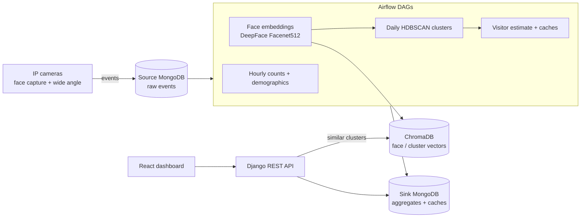

## Summary
### Resume bullets
- Built an Apache Airflow ETL pipeline that turned IP camera face-capture events from 12 booth
  camera zones into hourly visitor-count and age/gender aggregates for an exhibition analytics
  dashboard.
- Designed a unique-visitor estimate from face embeddings: Facenet512 vectors via DeepFace,
  daily HDBSCAN clustering on cosine distance, and rules that drop staff, screen images, noise
  and oversized clusters.
- Built repeat-visitor search over ChromaDB: each face cluster's average embedding queries
  similar clusters from other days, giving a per-visitor visit frequency and dwell time.
- Developed the Django REST dashboard API over MongoDB: visitor, demographic, wide-angle camera
  and cluster endpoints with filters, pagination, Swagger docs and Excel export.
- Precomputed dashboard data as Airflow cache collections, so API requests read daily and
  per-cluster summaries instead of recomputing clusters.
### Remarks
- B1: traces to the hourly ETL and Airflow deployment bullets · real event data, timezone-aware
  hourly windows · no data-volume figure (detections, visitors) in git; scale to confirm ·
  roles: data, backend.
- B2: traces to the face-embedding and clustering bullets · the strongest ML piece · no accuracy
  figure for the visitor estimate (no ground truth in git); the staff-labelling tool itself is
  not in the repos (see Open questions) · roles: ML, data.
- B3: traces to the similar-cluster search bullet · vector search in production code · the job
  that writes per-cluster average embeddings to ChromaDB is not in the repos; the 0.25 distance
  cut-off is configured, not tuned in git · roles: ML, backend, AI infra.
- B4: traces to the dashboard API bullet · breadth; built on a company Django starter template ·
  roles: backend.
- B5: traces to the cache-collection bullet · a design choice for read speed · no latency
  figure; outcome to confirm · roles: data, backend.
- `12 camera zones`, `1 wide-angle camera`: configured; B1 quotes the 12 zones as scale.
  `13 cameras`: the user's camera list confirms one camera per zone plus the wide-angle one, so
  "13 cameras" is the physical count a bullet can quote [me: 2026-11-24].
- `~17-day event window`: configured DAG start/end dates; left out of bullets, can be phrased as
  "a two-week exhibition".
- `100 detections` (bucket size), `÷5` (noise divider), `0.25` (cosine distance cut-off),
  `4 age bands`: configured heuristics; B2 and B3 describe them without the figures.
- Scope caveat: the work on `origin/dev` in all three repos (Jan–Feb 2025: clustering, similar
  search, caches, new age bands, exports) never merged to `main`; the CI pipeline deploys `dev`,
  so it reads as deployed, but confirm. Frontend pages for visitors, staff and clusters were
  built by teammates; only early charts and the API wiring are mine.
- Scope caveat: the event-ingestion server (camera events → MongoDB/S3), the Go Fiber event API
  server and the labelling tool appear only in Jira; no bullet claims them.

## Context
An analytics system for an automotive brand's booth at a motor show in Thailand. IP cameras
around the booth ran on-device face capture and sent events (timestamp, camera channel, face
crop, age, age group, gender, expression); a wide-angle camera sent region-entrance events.
The booth's equipment list shows 13 IP cameras on a local network with a 16-channel network
video recorder (NVR), a PoE switch and a 4G Wi-Fi router [me: 2026-11-24]; who installed and
configured it is not recorded. Models, from the same list (serial numbers and IPs left out):

| Equipment | Model | Count |
| --------- | ----- | ----- |
| Face-capture IP camera (Hikvision DeepinView) | iDS-2CD7146G0-IZS | 10 (cameras 01–10) |
| IP camera, model not given in the list | — | 3 (cameras 11–13) |
| Network video recorder, 16 channels, 16 PoE ports (Hikvision DeepinView) | iDS-7716NXI-I4/16P/X | 1 |
| PoE switch (Hikvision) | DS-3E1518P-SI | 1 |
| 4G LTE Wi-Fi router (TP-Link) | Archer MR400 | 1 |
The raw events landed in MongoDB. The system's job was to turn them into a dashboard of hourly
visitor counts, demographics per zone, and, in a later phase, a unique-visitor estimate and
repeat-visitor lookup from face embeddings, separating booth staff from visitors. The event
data covers about two weeks (late November to mid-December 2024); analysis and dashboard work
continued to February 2025. A small team: I built the ETL and backend, teammates built most of
the dashboard frontend. [airflow:airflow/dags 94%] [backend@36d6fda15] [IPCAM-12] [IPCAM-35]

## What I Did
- **Designed the system** (ticketed 2024-10-31 → 2024-11-06): raw events in a source MongoDB,
  Airflow DAGs that aggregate them into a separate sink MongoDB, a Django API over the sink, a
  React dashboard. [IPCAM-12] [airflow@1dffd86] [backend@de4a568]
- **Built hourly ETL DAGs in Apache Airflow** for detection counts per zone, age group and
  gender per zone, and wide-angle region-entrance counts: TaskFlow extract → transform
  (pandas) → load, idempotent by delete-then-insert per hour, run hourly over booth hours
  (10:00–23:00 local) with catch-up over the event dates.
  [airflow:airflow/dags 94%] [airflow@9da462b] [airflow@ed05c1e] [airflow@26deac6] [IPCAM-18]
  [IPCAM-57]
- **Fixed timezone handling** in the scheduled windows: execution dates converted from UTC to
  local time before computing the `[lower, upper)` hour boundary, then the DAGs were rerun.
  [airflow@dd2ea2f] [airflow@40d5d3c] [IPCAM-30] [IPCAM-38]
- **Containerised and deployed Airflow** (custom image on Airflow 2.10 / Python 3.12,
  LocalExecutor with PostgreSQL metadata DB, production compose file) with a Bitbucket
  Pipelines job that pulls and rebuilds on the deploy server; added a log-cleaning DAG for logs
  older than 14 days. [airflow@dc13735] [airflow@fe72059] [airflow@48d36ee] [IPCAM-36]
- **Computed face embeddings** in an Airflow DAG: decode each face crop, embed it with DeepFace
  (Facenet512), and store the vector with its metadata in ChromaDB (cosine HNSW) and in a
  MongoDB vector collection, with `is_staff` / `is_monitor_image` flags defaulting to false.
  [airflow@deea090] [airflow@20dff6b] [airflow@97c800b] [IPCAM-51]
- **Clustered faces into visitors per day** with scikit-learn HDBSCAN on cosine distance;
  embeddings are streamed from MongoDB in batches of 1,000 and staged to CSV to stay under the
  worker's memory limit, with a task timeout. [airflow@4287b45] [airflow@d319e3e]
  [airflow@d68fef0] [IPCAM-52]
- **Designed the visitor-count estimate**: drop staff and screen-image detections, count each
  regular cluster as one visitor, treat noise and oversized "bucket" clusters (≥ 100
  detections, many faces merged) as noise, and add noise detections divided by a configured
  factor; computed per hour and zone, and summarised per day with outer joins so empty groups
  read as zero. [airflow@982b39f] [airflow@b122a0f] [airflow@592770e] [IPCAM-58] [IPCAM-70]
- **Precomputed dashboard caches** in Airflow: per-cluster detection rows, per-cluster
  summaries (mean and median age, modal age group and gender, thumbnail, staff flag) and daily
  demographics, so the API reads ready summaries. Later added user-configured age bands
  (`pd.cut` into four bands) and reran the DAGs.
  [airflow@bc656c3] [airflow@300c142] [airflow@8122a9f] [airflow@224d27f] [airflow@8149e8b]
  [IPCAM-67] [IPCAM-68] [IPCAM-71] [IPCAM-73] [IPCAM-74]
- **Built the dashboard API in Django REST Framework** over MongoDB (pymongo repositories):
  v1 endpoints for hourly and total visitors per zone with day-on-day change, demographics and
  wide-angle counts; v2 endpoints for clusters (list with filters on staff, date, age range and
  gender, pagination, summary), detections, vector detail by ID or batch, and Excel export of
  lists, cluster detail and the overall dashboard; Swagger-documented, bearer-token protected.
  [backend:src/api/dashboard 95%] [backend@1a11046] [backend@e6451fd] [backend@ea03e62]
  [backend@4648f49] [backend@143889e] [backend@2c8c94b] [backend@95b8b49] [IPCAM-60] [IPCAM-66]
  [IPCAM-76]
- **Built repeat-visitor search**: a cluster's average embedding queries a ChromaDB collection
  of cluster embeddings for the nearest clusters on other days; matches within cosine distance
  0.25 are returned with their detections, and the API derives visit frequency (distinct
  dates) and dwell time per cluster. [backend@3e26846] [backend@df8965b] [backend@d16eec9]
  [IPCAM-72]
- **Started the dashboard frontend**: set up the React + Vite + shadcn/ui template with Docker
  and a deploy pipeline, built the first Recharts charts (hourly, stacked-bar, total, line),
  wired the demographic API, and built a Leaflet map component for picking zone coordinates
  on a floor plan. [frontend@ea0072f] [frontend@485bf7c] [frontend@1493a8e] [frontend@cdec3bf]
  [frontend@ee7bfdb] [IPCAM-21] [IPCAM-29]
- **Prototyped a floor-plan heatmap** (Leaflet image overlay, zone polygons coloured by a
  colour scale, visx legend) on a branch that was not merged. [frontend@1467c48]
  [frontend@1f084ed] [IPCAM-29]

## Numbers
| Value | Scope | Source |
| ----- | ----- | ------ |
| 12 camera zones | face-capture cameras around the booth (configured zone list) | [airflow@02dcc44] |
| 1 wide-angle camera | region-entrance counting, separate DAG and API (configured) | [airflow@26deac6] [IPCAM-57] |
| 13 cameras | IP cameras at the motor-show booth: the 12 face-capture zones plus the 1 wide-angle camera (user-reported from the booth's camera list; 10 of 13 share one face-capture model) | [me: 2026-11-24] |
| ~17-day event window | DAG start/end dates for the embedding and visitor-count runs (configured) | [airflow@deea090] |
| ≥ 100 detections | cluster size treated as a noise "bucket" (configured) | [airflow@02dcc44] |
| noise ÷ 5 | estimate of visitors among noise detections (configured) | [airflow@982b39f] |
| cosine distance ≤ 0.25 | similar-cluster match cut-off (configured) | [backend@df8965b] |
| 4 age bands | user-configured bands replacing the camera's age groups (configured) | [airflow@8149e8b] |

## Tools
tools: Python, Apache Airflow 2.10 (TaskFlow, LocalExecutor), pandas, NumPy, DeepFace
(Facenet512), scikit-learn (HDBSCAN, PCA), ChromaDB, MongoDB (pymongo), PostgreSQL (Airflow
metadata), Django + Django REST Framework, drf-yasg (Swagger), XlsxWriter, Docker Compose,
Bitbucket Pipelines, React, TypeScript, Vite, shadcn/ui, Recharts, React Leaflet, visx
Studied, not used: none recorded

## Architecture

Phase 1 counted raw detections: hourly DAGs aggregate counts and demographics per zone into the
sink database, and the API serves them. Phase 2 estimated unique visitors: each face crop is
embedded, faces are clustered per day, staff and screen images are excluded by flags, and the
visitor estimate, per-cluster summaries and daily demographics are written as cache
collections. The API reads those caches and queries ChromaDB for the same person on other days.

## Not mine
- The backend's first commit is a company Django starter template (auth, address, echo apps,
  Nginx/Let's Encrypt, Prometheus config), committed under my identity but not built for this
  project. [backend@c3d9bab]
- A teammate wrote an ETL template and mock data for the first dashboard API. [airflow@33649f7]
  [backend@54c655f]
- A teammate added the zone-polygon position API and a data export endpoint in the backend.
  [backend@53cbf19] [backend@85eba8c]
- Teammates built most of the dashboard frontend on `dev`: the heatmap, the wide-angle camera
  charts, the visitor and staff list and detail pages, the cluster ("model 4") page and its
  charts. [frontend@25e0374] [frontend@b2bee73] [frontend@a8a2a31] [frontend@065af90]
- The dashboard template's 266-file import is attributed to me in blame, so the frontend's
  blame share overstates my part.

## Open questions
- Booth network: did you install or configure the cameras, NVR, PoE switch and 4G router, or
  only consume their events? [me: 2026-11-24] gives the equipment, not who set it up.
- Event server: Jira assigns me "Refactor the camera event server code" (FastAPI, save to MongoDB
  and S3 separately; the ticket names the camera vendor, Hikvision) [IPCAM-75] and "implement
  event API server via Go Fiber" (2025-03) [IPCAM-78]. Neither repo was ingested. Did you write
  them? (The cameras are Hikvision: the equipment list in Context settles it [me: 2026-11-24].)
  Which model are cameras 11–13; is one of them the wide-angle camera?
- Manual staff/visitor labelling: Jira [IPCAM-54] says I built a system to label staff vs
  visitors. Git shows only the `is_staff` / `is_monitor_image` flags, their defaults and their
  use downstream. What was the labelling tool (notebook, script, UI), and who labelled?
- Cluster embeddings: the API queries a ChromaDB `cluster_embeddings` collection and a MongoDB
  average-embedding collection, but no job in the repos writes them. Was it a notebook or
  script of yours? [RES-135] "cluster faces by searching past detections" is related.
- Status: the final work lives on `origin/dev`, which the CI pipeline deploys. Was the dashboard
  delivered to and used by the client, and until when?
- Scale: how many face detections, unique-visitor estimates or event days were processed?
- Accuracy: was the visitor estimate checked against any ground truth (a manual count, the
  booth's own figures)? [IPCAM-39] compared detection counts between old and new data.
- Jira-only work: MongoDB export/import scripts to move data to a smaller managed cluster to cut
  cost [IPCAM-37] [IPCAM-79], and recovering the managed DB cluster with the cloud provider's
  support [IPCAM-53]. Confirm and say whether to include.
- Data analysis for a stakeholder (export, count and group clusters) [IPCAM-46] [IPCAM-55]: what
  was delivered?
- [POCS-242] "Design IP camera system to analyse competitors store" (2025-01 → 2025-04) looks
  like a follow-on design; is it part of this project?
