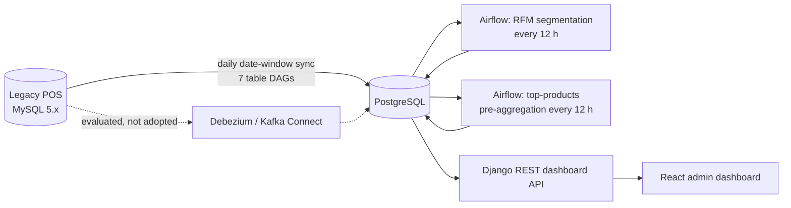

## Summary
### Resume bullets
- Built Airflow ELT that copies 7 sales and payment tables daily from a legacy MySQL 5.5
  point-of-sale database into PostgreSQL, after Debezium change data capture proved unworkable
  on the old MySQL version.
- Built an Airflow Recency, Frequency, Monetary (RFM) segmentation pipeline that identifies
  customers by payment card, scores them into quantile segments every 12 hours and stores the
  cut-offs for the dashboard.
- Moved a slow top-products dashboard query into a 12-hourly Airflow pre-aggregation table with
  indexes, serving daily or monthly rankings by product group and by delivery or dine-in sales.
- Built Django REST dashboard APIs for revenue by payment type and bank, average customers per
  bill and spend per customer, with gap-filled daily and monthly time series.
- Deployed the backend with Docker Compose on the client's server and added a self-hosted CI
  deploy pipeline for the admin frontend.
### Remarks
- B1: traces to the MySQL-to-PostgreSQL sync, CDC trial and DAG factory bullets · a real
  trade-off with a reason (old MySQL version) · a teammate set up the first Debezium stack, so
  the CDC part is "evaluated", not "built"; the shipped path is the Airflow batch sync; whether
  it ran in production is to confirm · roles: data, backend.
- B2: traces to the RFM pipeline and safe-quantile bullets · design choice (card number as the
  customer key in a system with no member IDs) · no figure for customers segmented or for use
  of the segments; outcome to confirm · roles: data, ML-adjacent analytics, backend.
- B3: traces to the top-products pre-aggregation bullet · a performance fix with a pattern · no
  before/after latency recorded; do not claim a speed-up figure · roles: backend, data.
- B4: traces to the dashboard API and customer-count bullets · breadth · shared file with a
  teammate for the first dashboard version; v2–v4 are mine · roles: backend, data.
- B5: traces to the deployment and CI bullets · supporting work; frontend charts are a mock
  only, so do not claim frontend work · roles: backend, DevOps.
- `7 tables`, `12 hours`, `5 segments`, `3-day window`, `30-day log TTL`: configured values,
  not results; B1–B3 quote the first two as design facts, the rest are left out as detail.
- Scope caveat: the association-rule analysis (2024-08) is backed only by Jira tickets; no
  code is in the ingested repos, so no bullet claims it.
- Scope caveat: the membership and points features (member app, point posting from the sync
  DAG) were built by teammates; the "membership analytics" in the title is the RFM work only.

## Context
Jira citations write the project's own key as `PRJ` (the real key carries the client name); ticket numbers are real.

A restaurant-chain client ran a legacy point-of-sale system on an old MySQL server (5.x). The
project built a new backend beside it: copy the sales and payment data into PostgreSQL, run
analytics on it (customer segmentation, top products, revenue by payment channel), serve the
results to an admin dashboard, and feed a member points app. A Django REST backend, Airflow
DAGs and a React admin frontend, built by a small team; I owned the data sync, the analytics
pipelines and the dashboard APIs. Work started with exploratory analysis in 2024-08 and ended
with production fixes in 2025-02. [PRJ-1] [backend:airflow/dags 81%] [backend:src/analytics 79%]

## What I Did
- **Explored the client's sales data for analytics (2024-08)**: checked whether RFM could be
  computed with the payment card number as the customer key, and wrote analysis scripts for
  members by card, order lists and revenue by bank. Ticket-backed; the scripts are not in the
  repos. [PRJ-1] [PRJ-2] [PRJ-8]
- **Reverse-engineered the legacy schema**: exported the source MySQL structure and generated
  Django models from it, the base for the new PostgreSQL tables.
  [backend@8d1539efa] [backend@685978621] [backend:raw_data 100%]
- **Built a proof of concept for extracting the source database with Airflow** (2024-08/09):
  repository classes for source and sink databases, an ETL example DAG and a uniqueness check.
  [backend@7cfbf8cf5] [backend@60bb977ac] [backend@57500b5cd] [PRJ-9]
- **Evaluated change data capture for the sync** (2024-09 to 2024-12): continued a teammate's
  Debezium stack (ZooKeeper, Kafka, Kafka Connect with a MySQL source and a JDBC upsert sink to
  PostgreSQL), tested it against mock MySQL 5.5 and 8.0 sources, and tried Maxwell. The tickets
  record that the client's MySQL version blocked it. [backend@22f0dc132] [backend@d364fef8a]
  [backend@1a677e243] [backend@8fd1ddc41] [PRJ-34] [PRJ-43]
- **Replaced CDC with an Airflow batch sync (2024-12)**: proved Airflow 2.10 on Python 3.12
  could read MySQL 5.5, then built one DAG per table for 7 sales and payment tables. Each run
  reads a date window by sale date with pandas, deletes that window in PostgreSQL and appends
  the fresh rows, so reruns are idempotent; backfill from 2024-01-01 with catch-up, retries,
  timeouts, staggered start times and one active run per table.
  [backend@b2e192f8b] [backend@df555c01c] [backend@6d359803e] [backend:airflow/dags/common 96%]
  [PRJ-48] [PRJ-49]
- **Refactored the per-table sync DAGs into one DAG factory** looping over the table list, with
  shared settings and the source database name from the environment.
  [backend@b828f4ffa] [backend@40987969e] [backend@6a17ab7d6]
- **Built the RFM segmentation pipeline in Airflow**: joins orders to payments, uses the card
  number as the customer ID, computes recency, frequency and monetary values, scores each into
  5 quantile bins, and saves the scores and the bin cut-offs as JSON in PostgreSQL every 12
  hours, behind a Django `analytics` app with RFM result and criteria models.
  [backend@c76f53636] [backend@0ed1d1c41] [backend@733aaa3db] [backend@cba0dbb0f]
  [backend:airflow/dags/utils 84%] [PRJ-10]
- **Wrote a safe quantile scorer for skewed data**: bins on unique values and drops duplicate
  edges, so a column full of repeated values with one outlier still yields usable segments.
  [backend:airflow/dags/utils 84%] [PRJ-3]
- **Moved the top-products query into an Airflow pre-aggregation (2024-10)**: the on-request
  pandas version had a performance issue, so a DAG recomputes daily product totals for the
  last 3 days every 12 hours into an indexed `product_total_sale` table, split into all,
  delivery and non-delivery sales; the API then ranks top N products per day, month or product
  group. [backend@d2ec1d76b] [backend@957a87fb5] [backend@127e89415] [backend@9fdcf426e]
  [backend@2951ddade] [PRJ-37] [PRJ-47]
- **Built the dashboard APIs in Django REST Framework (v1–v4)**: revenue time series by payment
  type and bank, sales by shop and by bank, average customers per bill and spend per customer
  for dine-in sales, with a gap-filling helper for missing dates. Later filtered out staff
  meals, comment lines and other non-sale items. [backend@03938de15] [backend@50846b6db]
  [backend@86ef0324b] [backend@adbd91dc3] [backend@453e30256] [backend:src/api/dashboard 81%]
  [PRJ-27] [PRJ-51]
- **Checked the POS customer count against a proxy**: exposed the bill's customer count and
  compared it with an estimate from rice and sticky-rice portions per order. [backend@40fa32748]
  [backend@8ec8678ef] [PRJ-31] [PRJ-35]
- **Fixed an auth bug that issued duplicate tokens** by adding microseconds to the token
  timestamp, and tuned token lifetimes. [backend@039df85d2] [backend@b0a70cd88] [PRJ-33]
- **Handled timezones and operations in Airflow**: local-time (UTC+7) schedules converted to UTC, a
  log-cleaning DAG with a 30-day retention, execution timeouts, and a fix for tasks killed with
  code -9, which the ticket links to memory use. [backend@e0c3836a6] [backend@30bdd6ca4]
  [backend@ffb6d7c06] [PRJ-52]
- **Deployed the stack**: Docker on the client's server, the Django database switched to
  PostgreSQL, Prometheus and Grafana removed from the Airflow compose file, a self-hosted CI
  pipeline that pulls, builds and restarts the admin frontend with pm2, and a mock top-products
  chart for the frontend team. [backend@206cad101] [backend@5cae314c3] [backoffice@3b0212074]
  [backoffice@bdd8a4e77] [backoffice@c6a4d202d] [PRJ-32] [PRJ-42] [PRJ-45]

## Numbers
| Value | Scope | Source |
| ----- | ----- | ------ |
| 7 tables | sales and payment tables synced from MySQL to PostgreSQL (configured) | [backend:airflow/dags 81%] |
| daily, 1-day window | sync schedule and window per table (configured; was 7 days) | [backend@df555c01c] |
| every 12 hours | RFM segmentation and top-products pre-aggregation schedule (configured) | [backend:airflow/dags 81%] |
| 5 segments | quantile bins per RFM dimension (configured) | [backend:airflow/dags 81%] |
| 3-day window | top-products recalculation window (configured) | [backend@957a87fb5] |
| 30 days | Airflow log retention (configured) | [backend@30bdd6ca4] |

## Tools
tools: Python, pandas, NumPy, SQLAlchemy, Apache Airflow 2.10, MySQL 5.5 (source), PostgreSQL,
Django, Django REST Framework, Docker Compose, Debezium (Kafka Connect, MySQL source, JDBC
sink), Kafka, ZooKeeper, Maxwell, pm2, Bitbucket Pipelines (self-hosted runner), React
(TypeScript, chart mock)
Studied, not used: association-rule learning on order lines (ticket only, no code found)

## Architecture

Airflow copies each sales and payment table from the legacy MySQL database into PostgreSQL by
sale-date window, deleting and re-inserting the window so a rerun is safe. Two analytics DAGs
read the copy: one scores customers by RFM, keyed by payment card, and one pre-aggregates daily
product sales. The Django API reads raw tables for revenue charts and the pre-aggregated table
for product rankings.

## Not mine
- The member app, member card API, order and payment modules and most Django models: a
  teammate. [backend:src/member 0%] [backend:src/order 3%] [backend:src/payment 4%]
- The first Debezium CDC compose file and connector script: a teammate (2024-09); I continued
  it later. [backend@22f0dc132] [backend@1a677e243]
- In the sync DAG, the tasks that post transactions and order summaries to the points and
  member APIs, and the Discord failure alerts: a teammate. [backend:airflow/dags/sync_table.py 34%]
- The admin frontend (React admin template, pages, charts other than the mock): teammates.
  [backoffice:src/pages 0%]
- Starter scaffolding (Django template, Nginx, Let's Encrypt, Prometheus): reused company
  template, first commits by a teammate.

## Open questions
1. Association-rule analysis (2024-08): the tickets name RFM and association rules on order
   lines, but no code is in the repos. Did you run it, with what result (rules found, used by
   the client), and where is the code?
2. Did the Airflow sync, RFM and top-products DAGs run in production on the client's server,
   and for how long? Is the system still in use?
3. Scale: how many transactions, branches or customers (card numbers) did the sync and RFM
   cover?
4. Did the top-products pre-aggregation give a measured speed-up (API time before and after)?
5. Were the RFM segments used by the client (dashboard, campaigns, points notifications)?
6. Which source MySQL version did the client run: the tickets mention 5.1 and 5.5. Was CDC
   dropped only for the version, or also for server access (binlog rights)?
7. Team: how many developers, and did you lead the data side?
