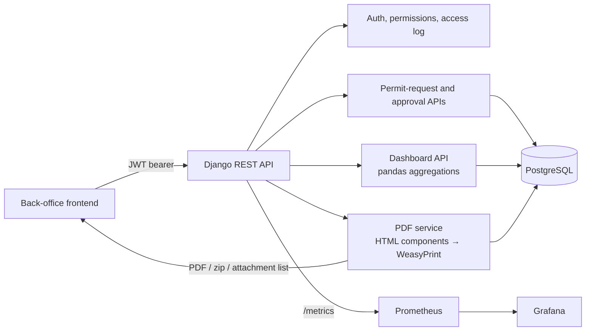

## Summary
### Resume bullets
- Built the PDF generation service for a municipal building-permit system in Django and
  WeasyPrint: HTML components render Thai official forms, merge officer review pages and ship
  attachments as a zip.
- Designed the authentication and audit layer: bearer-token sessions with a logout token
  blacklist, first-login password reset tokens, superadmin-only permission management and a
  filterable access log.
- Profiled a slow member-forms API with cProfile and PyInstrument and rewrote its per-row
  fetch-and-save loop as filtered querysets that skip drafts and already-expired requests.
- Built the dashboard API: pandas aggregations of permit requests by type, status, month,
  building type and staff position, tested on generated mock requests.
- Built a single create-and-update API for permit requests that saves nested addresses,
  buildings, engineers, architects and multi-file attachments in one call.
- Added Prometheus metrics and a Grafana service to the Docker Compose stack, and replaced
  print debugging with a central logging configuration.
### Remarks
- B1: traces to the WeasyPrint proof, PDF component library, request-form PDF and download-API
  bullets · strongest, most distinctive work, backed by tickets and 95% blame in the PDF
  utilities · a teammate wrote most later form templates (several permit types): claim the
  engine, the primary permit form and the officer pages, not every form · outcome (in use by
  the client) to confirm · roles: backend.
- B2: traces to the authentication and access-log bullets · solid backend fundamentals · the
  login and role scaffold came from a company Django template; claim the parts listed only ·
  roles: backend.
- B3: traces to the profiling bullet · a ticket title claims "10x" but git holds only the
  before profile (about 92 s for a full run on dev data); do not quote a speed-up until the user
  confirms the figure and its scope · roles: backend, data.
- B4: traces to the dashboard bullet · the staff-position query was flagged as slow (2–3 min) in
  a ticket and git shows no fix for it: do not claim dashboard performance · roles: backend,
  data.
- B5: traces to the merged create/update API bullet · shared area: a teammate wrote the form
  models and serializers · roles: backend.
- B6: traces to the monitoring and logging bullet · Grafana dashboards themselves are not in
  git: do not claim built dashboards · roles: backend, infra.
- `2–3 min for ~1,000 tasks over 2 years`: ticket description of the slow staff-task dashboard
  query, a "before" with no "after"; leave out.
- `~92 s profile run`: dev-environment profile before the member-API rewrite; no after figure
  in git. Leave out unless the user supplies the after figure.
- `10x`: ticket title only (user-reported, unmeasured in git); see B3.
- Scope caveat: main work spans three months (2024-02 ~ 2024-04) on a team of three backend
  developers; the project continued under teammates until 2026. A GraphQL API proof lives only
  on an unmerged branch and a WebSocket notification proof was later switched off: neither is in
  a bullet.

## Context
Jira citations write the project's own key as `PRJ` (the real key carries the client name); ticket numbers are real.

A back-office system for a city's building-control office in Thailand. Citizens' permit
requests (build, alter, demolish, transfer and related forms) move through an approval chain of
officers (district inspector, planning officer, architect and engineer checks, directors), and
the system prints each request and its officer pages as Thai official-form PDFs. The backend is
Django REST Framework on PostgreSQL in Docker Compose behind nginx, deployed by a Bitbucket
pipeline that pulls the `dev` branch onto the server. Three developers committed to the backend;
a teammate started it from a company Django template and wrote most of the form models.
[backend:conf 0%] [PRJ-171] [PRJ-179]

Branches: `origin/dev` is the deployed line (the CI pipeline deploys `dev`) and holds all of my
merged work; `master` holds only the initial commit. `graph-ql` holds 5 unmerged commits of
mine (a GraphQL proof). Other feature branches are merged into `dev`.

## What I Did
- **Proved WeasyPrint for Thai official-form PDFs** in a notebook (HTML + CSS to PDF, embedded
  Thai fonts), then moved it into a shared `pdf_utils` package with a base stylesheet and a
  Bootstrap grid. [backend@cba7cbe03] [backend@e97fcfc15] [backend:proof-pdf 100%]
  [backend:src/pdf_utils 95%] [PRJ-313]
- **Wrote the PDF component library**: functions that return HTML fragments for checkboxes,
  dotted fill-in fields, signature blocks (one- and two-column), the national emblem header and
  page breaks, plus Thai-numeral and Thai Buddhist-calendar date formatters.
  [backend@dc9eac1e1] [backend@e61664622] [backend@a81da3a05] [backend@b36547bfa]
  [backend@ae697c877] [PRJ-337]
- **Used an Either monad for missing data in templates**: a `getattr_monad` walks nested Django
  model attributes and returns a placeholder instead of raising when a relation is empty, so a
  half-filled request still renders. [backend@c86e3dbd8] [backend@d54e91659]
  [backend:src/back_office/form/controllers/pdf_generator/monad.py 100%]
- **Built the primary permit-request PDF and the officer review pages**: the main request form
  with its buildings, engineers and architects; architecture and engineering checks, district
  inspector, planning officer, opinion and rejection pages; and the print conditions for
  certificates that need four approvals. [backend@03fce2894] [backend@a596e1e35]
  [backend@da3aa5045] [backend@3a7a5feb5] [backend@e3bfaa514] [backend@c78deaf62]
  [PRJ-331] [PRJ-335] [PRJ-336] [PRJ-338] [PRJ-344] [PRJ-346] [PRJ-434]
- **Built the PDF download API**: one endpoint per form type assembles the request page and
  every approval page into one PDF, checks availability first, and returns the PDF, a zip of
  the PDF and attachments grouped by folder, or a list of attachment URLs, chosen by a `mode`
  parameter. [backend@1f9293659] [backend@0b31ef161] [backend@7848a96b9]
  [backend@143666d94] [backend@1196ef70e] [backend@5c0809f5f]
  [backend:src/back_office/form/controllers/download_pdf.py 90%] [PRJ-432]
- **Built authentication and session security**: login with bearer-token validation, logout
  with a token blacklist, password reset tokens that invalidate earlier tokens, and a forced
  reset on first login. [backend@3883c7259] [backend@dd3ce4b23] [backend@177d84cea]
  [backend@388107838] [backend@f8104040d] [PRJ-180] [PRJ-240] [PRJ-257] [PRJ-318]
- **Built permission management and the access log**: role and permission APIs restricted to
  superadmins, automatic and manual access-log entries, and a paginated access-log API filtered
  by member and date range. [backend@38970690f] [backend@addb40365] [backend@7f4bae729]
  [backend@cf3b91aa6] [backend:src/back_office/access_log/controllers/access_log.py 99%] [PRJ-235]
  [PRJ-241] [PRJ-334] [PRJ-400]
- **Built the dashboard API**: pandas aggregations of requests across all form tables by type,
  status, month, building type and staff position over a date range, and notebooks and seed
  scripts that generate mock members and requests to test it.
  [backend@139af85b1] [backend@881f46b57] [backend@fd6b1380f] [backend@050bb0997]
  [backend:src/back_office/dashboard 100%] [backend:mock-data 100%] [PRJ-303] [PRJ-296]
- **Profiled and rewrote the slow member-forms API**: cProfile and PyInstrument showed time
  spent in per-row `get()` and `save()` calls while expiring requests; the rewrite filters with
  querysets that exclude drafts and already-expired requests before updating.
  [backend@1fbe290bc] [backend@feb1ce704] [backend@d049e4177] [backend@a990cac12] [PRJ-435]
- **Merged permit-request create and update into one API**: a reusable multi-file upload
  controller, and endpoints that save nested addresses, several buildings, engineers and
  architects with their file fields in one call, plus add/delete-file endpoints.
  [backend@71184e964] [backend@d2a55023c] [backend@6c3793296] [backend@69ecca5ce]
  [backend@9543ff936] [backend:src/base/controllers/upload_controller.py 87%]
  [PRJ-399] [PRJ-412] [PRJ-429] [PRJ-433]
- **Added monitoring and logging**: django-prometheus metrics scraped by Prometheus, a Grafana
  service, a split base/dev/test Compose layout, and a dictConfig logging setup that silences
  WeasyPrint and font-subsetting noise. [backend@f2a5d95f8] [backend@d57caedb7]
  [backend@41ceb33b7] [backend@ac816febb] [backend:config 100%] [PRJ-436]
- **Proved WebSocket notifications** with Django Channels (consumers and a signal on member
  creation); a teammate later disabled the Channels app. [backend@46e48ac28]
  [backend@96ff08bec] [backend:src/notification 100%] [PRJ-156]
- **Prototyped a GraphQL API** (graphene-django) for permit requests and approval nodes, on an
  unmerged branch. [backend@e4fe2ba56]
- **Changed the dashboard date filter** to request expiry dates in a 2025 hotfix.
  [backend@508d30875]

## Numbers
| Value | Scope | Source |
| ----- | ----- | ------ |
| 2–3 min | staff-task dashboard query over 2 years, ~1,000 tasks, before any fix (user-reported in ticket) | [PRJ-398] |
| ~92 s | member-forms API, one profiled run on dev data before the rewrite (measured) | [backend@feb1ce704] |
| 10x | member-forms API speed-up (ticket title, not measured in git) | [PRJ-435] |

## Tools
tools: Python, Django, Django REST Framework, PostgreSQL, WeasyPrint, HTML/CSS (Bootstrap grid),
PyMonad, pandas, Faker, Jupyter, cProfile, PyInstrument, django-prometheus, Prometheus,
Grafana, Docker Compose, Django Channels + Daphne, graphene-django, Bitbucket Pipelines
Studied, not used: GraphQL (unmerged proof), RabbitMQ (removed from Compose early), Gmail
sending (proof ticket only, no code found)

## Architecture

Each permit request references an approval record whose officer sub-forms fill in as the
request moves through the chain. The PDF service renders the request and each filled officer
page from Python HTML components, joins them with page breaks, and returns one PDF or a zip with
the attachments.

## Not mine
- Project scaffold from a company Django template (settings, auth scaffold, nginx,
  Let's Encrypt script, CI pipeline). A teammate. [backend:conf 0%]
- Most form models and serializers, the form-listing API, and the PDF templates for most other
  permit types (later requests and notices). Teammates. [backend:src/back_office/form/models 5%]
  [backend:src/back_office/form/serializers 0%]
- The frontend (separate repo, not ingested).

## Open questions
1. Is the system in production use by the client's building-control office, and since when?
   The CI pipeline deploys `dev` to a server, and fixes continued into 2026.
2. What was the member-forms API's response time after the rewrite? The ticket says "10x"; git
   holds only the before profile (about 92 s).
3. Was the slow staff-task dashboard query (2–3 min) fixed, and by whom? Git shows no change to
   its query loop.
4. Ticket PRJ-284 "deploy frontend" is assigned to you: did you deploy the frontend, and how?
5. Was "Proof send gmail" (PRJ-258) built anywhere? No email-sending code of yours is on `dev`.
6. How many forms or requests did the office process, or how many staff used it?
7. Was the GraphQL proof dropped by decision, and why REST was kept?
