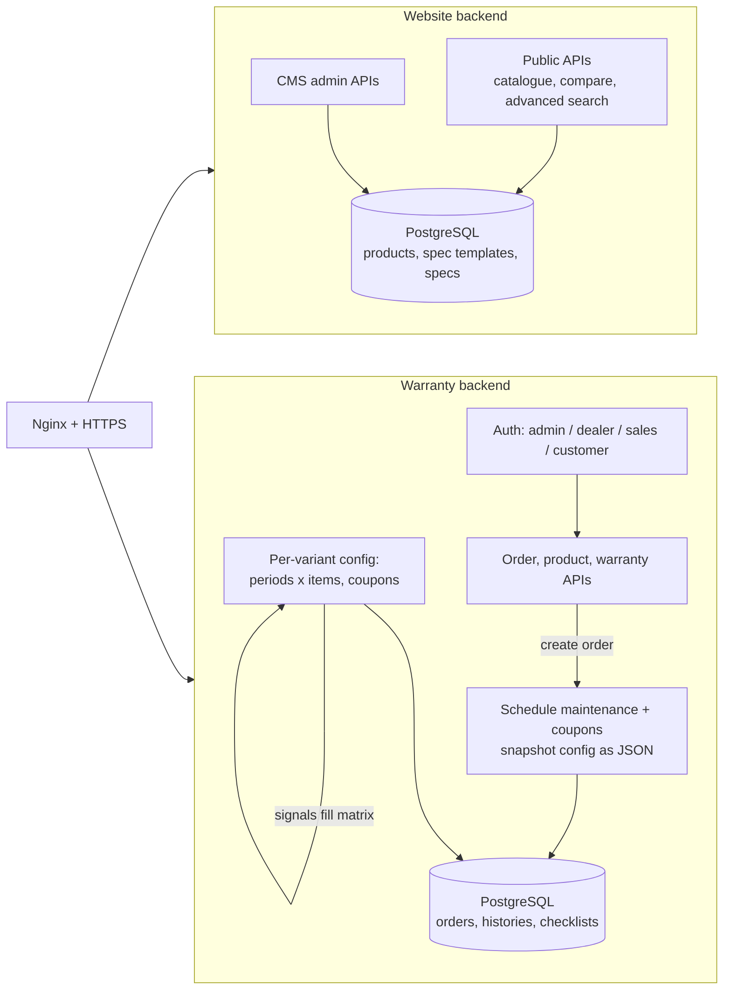

## Summary
### Resume bullets
- Built a Django REST backend for truck dealers to track vehicle warranties and maintenance,
  auto-scheduling service visits and coupons per vehicle from per-model configuration when a sale
  is recorded.
- Designed the warranty data model: per-model maintenance periods, items and coupons, with JSON
  snapshots on each vehicle's history so later configuration edits leave existing schedules
  unchanged.
- Built authentication for four account types (admin, dealer, sales, customer) on shared base
  classes and mixins, with a per-controller read/write permission model seeded from scripts.
- Built the product-specification CMS for a truck brand's website: ordered spec and summary
  templates per powertrain (diesel or electric), a backfill API and a side-by-side model-comparison
  API.
- Loaded the client's production catalogue (15 truck variants, their warranty coupons and service
  schedules) from spreadsheets with seed scripts, and configured the Docker Compose production
  deployment.
### Remarks
- B1: traces to the order-scheduling, reschedule-on-delivery-date and order-API bullets ·
  end-to-end ownership of a core business flow (blame 77% of the warranty app, most order logic)
  · no user or vehicle counts; outcome (still in use?) to confirm · roles: backend.
- B2: traces to the warranty data-model and snapshot bullets · a clear design trade-off
  (denormalised JSON snapshots vs live joins) · the 30-day month approximation in scheduling is a
  simplification: do not claim calendar-exact scheduling · roles: backend, data.
- B3: traces to the account base-class and per-controller permission bullets · reusable design ·
  the permission checks were commented out on the viewsets by a teammate in 2024-09 and stay off at
  HEAD: do not claim the permission model was enforced in production · roles: backend.
- B4: traces to the spec-template, refresh API, comparison API and advanced-search bullets ·
  shared repo where I own about half the product CMS lines (the rest by teammates) · roles:
  backend.
- B5: traces to the production-seeding and deployment bullets · the 15 variants are configured
  catalogue data, quoted as scale, not a result · the production compose runs Django's development
  server: do not claim a hardened production setup · roles: backend, DevOps-adjacent.
- `11 coupon types`, `~160 maintenance periods`, `~290 maintenance-item rows`: configured catalogue
  data; B5 makes the scale point with the 15 variants. Use them only if asked about data volume.
- `4 account types`: a design fact, kept in B3 as a description, not a metric.
- Scope caveat: the website backend was started by teammates two months earlier; its home,
  article, member, contact and lead apps are not mine. No automated tests exist in either repo:
  do not claim test coverage. Real-time WebSocket notifications were prototyped and reverted: do
  not claim them.

## Context
Jira citations write the two projects' own keys as `WEB` (website) and `WTY` (warranty), since the real keys carry the client name; ticket numbers are real.

A software agency built two backends for the Thai distributor of a commercial-truck brand: a
marketing website with a CMS (truck catalogue, specifications, articles, leads), and a separate
warranty system where dealers and sales staff register each sold truck by VIN and track its free
maintenance visits and warranty coupons. Both are Django REST Framework services on PostgreSQL,
started from the agency's reusable Django template and run with Docker Compose behind Nginx.
Two teammates worked on the website backend before and alongside me; one teammate worked on the
warranty backend with me and carried on after my last commit (dashboard, CSV export, e-mail
password reset, fixes into 2025). [website-backend:src/cms 19%] [warranty-backend:src/warranty 77%]
[WTY-3] [WTY-9]

## What I Did
- **Built the vehicle-order flow in the warranty backend**: order CRUD keyed by a unique,
  upper-cased VIN, VIN search, and list APIs scoped by role (admin sees all orders, a dealer, sales
  person or customer sees only their own). [warranty-backend@91eb73fd6] [warranty-backend@f3f8e7daf]
  [warranty-backend@63d57a143] [warranty-backend@8b7c801f5] [warranty-backend@7ab37d3f7]
  [warranty-backend@58108b837] [WTY-22]
- **Designed the warranty and maintenance data model**: per-variant maintenance periods (month and
  mileage), maintenance items (required or optional), a period × item configuration matrix, and
  warranty coupons attached to periods; products split into a main model and its variants, with a
  default variant created with each new model. [warranty-backend@8a92963fe]
  [warranty-backend@9cb6c1ade] [warranty-backend@7f8e98c2d] [warranty-backend@39b7bc5d6]
  [warranty-backend@660e7a61f] [warranty-backend@df4ae96b9] [warranty-backend:src/warranty 77%]
  [warranty-backend:src/product 80%] [WEB-162] [WTY-23] [WTY-45]
- **Auto-scheduled maintenance and warranty on each new order**: creating an order generates one
  maintenance-history row per active period (scheduled at delivery date + months × 30 days), the
  matching warranty-coupon rows and the maintenance checklist for each visit.
  [warranty-backend@3f27588c3] [warranty-backend@3e1937791] [warranty-backend@413b7b199]
  [warranty-backend@9546ce6c5] [WTY-49]
- **Chose JSON snapshots over live joins for history**: each maintenance history, warranty
  history and checklist row stores an `archived_data` copy of the period, coupon or config it was
  created from, so later edits to a model's configuration do not rewrite an existing vehicle's
  schedule; rescheduling reads the snapshot. [warranty-backend@3f27588c3]
  [warranty-backend@b8e5c0212] [warranty-backend@2901a9fca]
- **Rescheduled visits when a delivery date changes**: an endpoint recomputes every scheduled
  maintenance date from the new delivery date and creates a notification record for staff.
  [warranty-backend@0c657703e] [warranty-backend@716045c88] [warranty-backend@a02efced1]
- **Kept the configuration matrix complete with Django signals**: creating a period, product or
  coupon fills in the missing period × item and product × coupon rows in bulk, with fallbacks to the
  global active items; a teammate co-edited these signals. [warranty-backend@0de243c0f]
  [warranty-backend@017d154df] [warranty-backend@27e2f7920] [warranty-backend@25d510305]
  [warranty-backend@45420dba1]
- **Built authentication for four account types on shared base classes**: an abstract account
  model with password hashing, revocation and reset tokens, plus authentication and password-reset
  mixins reused by the admin, dealer, sales and customer apps; JWT bearer tokens carry the account
  type. [warranty-backend@f1b3e38f8] [warranty-backend@d0b433760] [warranty-backend@927f66431]
  [warranty-backend@3b99403a1] [warranty-backend@a0653e59d] [warranty-backend@d64389536]
  [warranty-backend@16845fb2a] [warranty-backend:src/account 54%] [WTY-2] [WTY-3]
- **Designed a per-controller permission model**: a permission-resource table names each
  controller, each account type has a none / read / write level per controller, and a DRF
  permission class checks the level against the HTTP method; seed scripts load the resources and
  levels. [warranty-backend@938e22383] [warranty-backend@6c62a6db6] [warranty-backend@686275ee3]
  [warranty-backend@0a9fa00e4] [warranty-backend@7847168d3] [WTY-13] [WTY-14] [WTY-29]
- **Reworked customer relations**: a customer can belong to several dealers and sales staff
  (many-to-many), with per-dealer order counts in the serialisers. [warranty-backend@0343bfb09]
  [warranty-backend@2df486eb9] [warranty-backend@3f995ab06]
- **Trimmed API payloads**: a lighter list serialiser for orders and pagination on list APIs;
  Swagger tags and schemas across the API. [warranty-backend@53588dae8]
  [warranty-backend@57eb3c775] [warranty-backend@4fdd86cf8] [warranty-backend@b8e5cc8af]
- **Prototyped WebSocket notifications** with Django Channels and Daphne (ASGI), pushing the latest
  notifications to connected clients; reverted to WSGI a week later. [warranty-backend@7ed528924]
  [warranty-backend@3d13d69a3]
- **Seeded the client's production data** from spreadsheets: truck variants, maintenance periods,
  maintenance items per variant and warranty coupons, with items deactivated and whitespace
  stripped on load. [warranty-backend@3c4a7c5be] [warranty-backend@42eda2756]
  [warranty-backend@ba4570df9] [warranty-backend@e0fe47da3] [WTY-184]
- **Configured production deployment** for both backends: production Docker Compose files
  (PostgreSQL, backend, ports, monitoring services turned off), and a line-ending fix to the
  Let's Encrypt init script for HTTPS. [warranty-backend@1faa2831c] [warranty-backend@10dadc845]
  [website-backend@7d84dac60] [website-backend@b45fcec93] [WTY-109] [WTY-181] [WTY-183]
- **Built the product-specification templates in the website CMS**: spec topics, sub-topics and
  summary rows, separate for diesel (ICE) and electric (EV) trucks, each product holding one spec
  value per template row. [website-backend@6ddbcc6dd] [website-backend@68e3c0830]
  [website-backend@c502d4e45] [website-backend@1d777311b] [website-backend:src/cms/product 48%]
  [WEB-209]
- **Made template rows orderable within their group**: model managers override create, move and
  reset-position so a topic orders within its powertrain and a sub-topic within its topic.
  [website-backend@754feefda] [website-backend@73b1540d1] [website-backend@e3d56b028]
  [website-backend@dc8ca7bc6] [WEB-212]
- **Added a refresh API that backfills templates**: it creates any missing spec and summary rows
  for every product, defaulting to "-", so new template rows appear on all products.
  [website-backend@f374df909] [website-backend@07530977b] [website-backend@24906cf91] [WEB-214]
  [WEB-215]
- **Built the model-comparison and advanced-search APIs**: comparison returns spec values for
  several selected products grouped by topic; advanced search filters trucks by duty, axle
  configuration, weight and power ranges and segment. [website-backend@fe970a515]
  [website-backend@1e33ca155] [website-backend@58f300e16] [website-backend@ae21475db] [WEB-116]
- **Seeded the website catalogue**: seed utilities and scripts loading categories, products,
  images and brochure PDFs from CSV, and default details, galleries, specs and summaries for each
  product. [website-backend@2d65d04cb] [website-backend@89d1562b7] [website-backend@e28cfe632]
  [website-backend@3b0be5bb0] [website-backend@708629a70] [website-backend@13577ade1] [WEB-210]
- **Fixed media URLs**: serialisers receive the request context so image URLs carry the host root.
  [website-backend@934399c29] [WEB-216]

## Numbers
| Value | Scope | Source |
| ----- | ----- | ------ |
| 15 truck variants | production catalogue seeded into the warranty system (configured) | [warranty-backend@3c4a7c5be] |
| 11 coupon types | warranty coupons in the production seed (configured) | [warranty-backend@3c4a7c5be] |
| ~160 maintenance periods | month/mileage service intervals across variants in the production seed (configured) | [warranty-backend@3c4a7c5be] |
| ~290 maintenance-item rows | service items per variant in the production seed (configured) | [warranty-backend@3c4a7c5be] |
| 4 account types | admin, dealer, sales, customer (design) | [WTY-3] |

## Tools
tools: Python, Django, Django REST Framework, PostgreSQL (JSONField, ArrayField), JWT (PyJWT),
drf-yasg (Swagger), Django signals, Django Channels + Daphne (prototype, reverted), pandas (seed
scripts), Docker Compose, Nginx, Let's Encrypt, CI pipeline (from the template)
Studied, not used: none recorded

## Architecture

The website backend serves the brand's public truck catalogue and a CMS; the warranty backend is
a separate service where dealers register sold trucks by VIN. On each new order the warranty
backend copies the variant's current maintenance periods, items and coupons into the order's
history as JSON snapshots, so each vehicle keeps the schedule it was sold with.

## Not mine
- The agency's Django template that both repos start from: base models (including the position
  model), address API and data, utilities, Nginx and Let's Encrypt scripts, CI pipeline and base
  compose files. [warranty-backend@94d6828d2]
- Website CMS apps for home, articles, members, contact forms, lead integration and rich-text
  upload, and the CMS authentication: built by two teammates. [website-backend:src/cms 19%]
- Warranty-backend notification model and APIs, CSV export, dashboard, admin token login,
  e-mailed random password reset, and later fixes into 2025: built by a teammate. The same
  teammate disabled the per-controller permission checks on the viewsets in 2024-09.
  [warranty-backend:src/notification 35%]

## Open questions
- Was the warranty system used in production after the 2024-10 deploy, and by how many dealers,
  sales staff or vehicles? A 2026 ticket asks for a password reset on the system, which hints it
  was still in use, but the ticket alone does not prove it.
- Why were the per-controller permission checks turned off, and was any access control enforced
  in production other than role-scoped order lists?
- [WTY-182] records investigating a race condition when two APIs updated the same maintenance
  history at nearly the same time. Did you find or ship a fix? No fix commit was found.
- Why was the WebSocket notification prototype reverted to WSGI after a week?
- Did the website CMS go live with the spec templates, comparison and advanced search you built?
- Advanced search joins the filters with a union, so a truck matching any one filter is returned.
  Was that the intended behaviour?
- Were you the lead or main backend developer for the warranty system, and who designed the
  database ([WEB-162] is assigned to you)?
