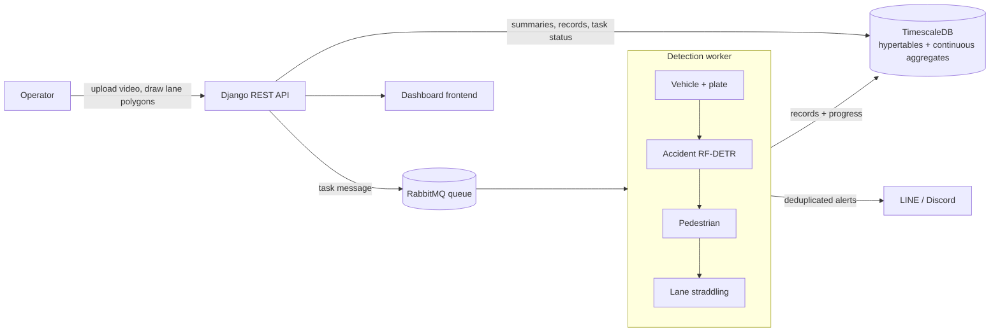

## Context
A research-and-development project for a provincial client in Thailand: detect road
accidents and risky road behaviour from roadside CCTV footage, store the detections as time
series, alert staff, and show the data on a dashboard. Work ran in phases with progress
reports reviewed by an external committee: phase 1 was a proof of concept (YOLO scripts),
phase 2 integrated detection into a streaming system, phase 3 improved the accident model and
added behaviour detection. Footage came from 3 camera sites supplied by the client.
The notes record that one engineer built most of the system alone, with limited GPU access.
[notes:Notes 100%] [notes:Notes/meeting 100%]

## What I Did
- **Designed the system architecture** after a published distributed video-analytics framework:
  detection workers decoupled from ingestion by a message broker, results in TimescaleDB, a
  Django API and a separate alert path. [notes:Notes 100%]
- **Built the phase-2 streaming pipeline on Kafka**: a Django endpoint reads a video and
  produces base64 frames to a `frames` topic from a background thread; two Kafka consumers
  (vehicle, accident) run detection and write results. Kafka was chosen as a buffer because
  per-frame detection exceeds the 33 ms real-time budget at 30 fps, so frames would otherwise
  be dropped. [backend@383b459a8] [backend@0dbf4de1b] [notes:Notes 100%]
- **Migrated the system from Kafka streaming to a RabbitMQ task queue (2025-10)** when the
  requirement changed from live streams to "upload a video, then process it": a Django task API
  publishes jobs, a worker consumes them with manual ack/nack and `prefetch_count=1`, and
  progress and failure state are written to a task table the dashboard polls.
  [worker@96c6cfaee] [backend@c5a535d7c] [backend@7ced5e3e9] [backend@db853d21d]
  [worker:src 100%]
- **Hardened the long-running worker**: a heartbeat thread keeps the broker connection alive
  during multi-minute video jobs, database connections are reset for long tasks, and
  connection timeouts were added. [worker@61acee04d] [worker@59a2c119b] [worker@da32c250b]
- **Wrote an internal Python detection library** to end the copy-paste between the PoC and
  production repos: a composable `ProcessingChain` of processors joined with `|` / `>>`, one
  detector interface over YOLO and RF-DETR, ByteTrack tracking, licence-plate detection and OCR
  (EasyOCR or a local multimodal LLM). Versioned by git tag (0.1.0 → 0.1.6) and installed by
  the worker as a git dependency. [detection-lib:src 100%] [detection-lib@40d12fc87]
  [detection-lib@86a83bfde] [detection-lib@975894112]
- **Made the library install the right PyTorch build per platform** (CPU wheels on macOS, CUDA
  wheels on Linux/Windows) via uv index markers, and added a CUDA check script for the GPU
  machine. [detection-lib@1d8e45827] [detection-lib@2c97c2600] [worker@a57214615]
- **Trained an RF-DETR accident-detection model** (phase 3) to replace the phase-1 YOLO
  accident model, which had a high false-positive rate; training metrics logged to Weights &
  Biases. The worker loads this checkpoint at a 0.7 confidence threshold.
  [notes:Notes 100%] [worker@28c9305fa] [worker@6fcb2a612]
- **Built a lane-straddling detector**: per-lane polygon zones, an FPS-based timer per
  (zone, tracker ID) that splits presence into sessions and raises an event when a vehicle
  stays on a lane line longer than a threshold (1.0 s in the worker).
  [detection-lib@82ea51260] [detection-lib@1b62c9f68] [worker@79c4a0dfa] [worker@a9f1e0a69]
- **Added pedestrian detection** as a fourth pipeline step; the worker runs vehicle, accident,
  pedestrian and lane-straddling steps per video. [worker@7681bc99f] [worker:src/utils 100%]
- **Built the alerting path**: on a new accident, pedestrian or lane-straddling event the worker
  sends a Discord webhook and a LINE message with the annotated crop, video time and frame
  index, sent asynchronously. [worker@5885e2574] [worker@2e5e31677] [worker:src/utils 100%]
- **Changed the duplicate-alert strategy, trading embedding search for tracker IDs.** Phase 2
  stored a 512-d embedding per accident in pgvector and suppressed alerts whose cosine distance
  to an accident at the same site in the last 5 minutes was under 0.3. Phase 3 dropped the
  embedding column and deduplicates by ByteTrack ID + site + video within a 5-minute window,
  plus an idempotent insert check on reruns.
  [detection-lib:_legacy/utils 100%] [backend:.github/_references 100%] [worker@54fc297a8]
  [worker@e658c6637]
- **Built the dashboard backend in Django REST Framework**: video upload with thumbnails and
  per-video lane polygons, paginated record APIs and summary APIs for vehicle pass, accident,
  pedestrian and lane-straddling data, JWT-protected, Swagger-documented.
  [backend:src/api 100%] [backend@bd958d97f] [backend@65433d0f5] [backend@c75a9bd64]
- **Modelled detection data in TimescaleDB**: hypertables keyed on timestamp, continuous
  aggregates (5-minute, hourly, daily) refreshed on a schedule, and an API to refresh the
  materialized views; the notes record that this removed the need for Airflow.
  [backend:.github/_references 100%] [backend@ca99b4f45] [notes:Notes/meeting 100%]
- **Ran experiments with local multimodal LLMs (Ollama, gemma3 4B)** for licence-plate OCR and
  for re-checking accident frames. OCR read digits but not Thai characters and was not better
  than EasyOCR; accident re-checking could tell overlapping cars from a crash but was too slow on
  the laptop (see Numbers). Kept as experiments, not in the final worker.
  [detection-lib@667f750f0] [notes:Notes 100%]
- **Profiled the vehicle + licence-plate pipeline** with PyInstrument on client footage.
  [notes:Notes 100%]
- **Wrote a launcher script** that starts the database, backend, worker and frontend for a demo
  machine, and a video render script that draws detections onto output video.
  [backend@062cd7b11] [worker@02369cafc] [worker:src/render 100%]

## Numbers
| Value | Scope | Source |
| ----- | ----- | ------ |
| 3 camera sites | footage supplied by the client for phase 2–3 (user-reported in notes) | [notes:Notes 100%] |
| ~25 s → 0.8 s per frame | gemma3 4B accident re-check, Apple M1 Pro 32 GB vs RTX 4070 Super (measured, informal, sample size not recorded) | [notes:Notes 100%] |
| ~2 s+ per image | gemma3 4B licence-plate OCR, no accuracy gain over EasyOCR (measured, informal) | [notes:Notes 100%] |
| 33 ms per frame | real-time budget at 30 fps that detection exceeded, motivating the Kafka buffer (derived) | [notes:Notes 100%] |
| 5-minute window | duplicate-alert suppression per tracker / site / video (configured) | [worker@131016f7c] |
| 5 min / hourly / daily | TimescaleDB continuous-aggregate granularity (configured) | [backend:.github/_references 100%] |
| 4 detection steps per video | vehicle, accident, pedestrian, lane straddling (configured) | [worker:src 100%] |

## Tools
tools: Python, uv, PyTorch, Ultralytics YOLO11, RF-DETR, Supervision (ByteTrack, PolygonZone),
OpenCV, EasyOCR, Ollama + LangChain (gemma3), Weights & Biases, PyInstrument, Kafka
(confluent-kafka), RabbitMQ (pika), TimescaleDB + pgvector, PostgreSQL, Django + Django REST
Framework, JWT, Swagger (drf-yasg), Docker Compose, Discord webhooks, LINE Messaging API, CUDA
Studied, not used: SCB Typhoon OCR (listed for comparison, no result recorded), SvelteKit
dashboard frontend (planned as "unofficial"; frontend repo not in the evidence)

## Architecture

Phase 2 streamed frames from the API into a Kafka topic consumed by two detection consumers.
Phase 3 replaced this with a job queue: each uploaded video becomes one task, the worker runs
four detection steps from the shared detection library, writes per-event rows (with crops and
video offsets for playback) to TimescaleDB, and sends deduplicated alerts. Continuous
aggregates serve the dashboard summaries.

## Not mine
- Starter scaffolding in the backend's first commit (auth app with roles, TOTP and LINE login;
  self-hosted CI pipeline) appears to come from a reused company Django template;
  authored under my identity in git but not built for this project. [backend@078dcda74]
- Public Roboflow accident datasets used as training-data candidates.
  [notes:Notes 100%]

## Open questions
- Jira was not checked: no Jira export exists yet for this company.
- Accident model accuracy: the evaluation tables in the notes (YOLO11 n/s/m vs RF-DETR, inference
  time and accuracy) are empty. Is there an mAP / precision / recall figure, or a false-positive
  rate before vs after RF-DETR?
- Model evaluation on real data: the notes plan frame extraction from client footage → Label
  Studio → YOLO/COCO export, and note "no accident happens?" in real footage. Was it done, and with
  what result?
- Label Studio: confirmed as dockerised labelling tooling in the project (separate repo not
  ingested). Teaching others to label is not in git — confirm.
- DVC: noted as an experiment for tracking YOLO model versions; no DVC files in the ingested
  repos. Confirm whether it was used.
- Cloudflare Tunnel demo deploy: no trace in the ingested repos or notes. Confirm.
- LLM verification of accidents: measured as an experiment only; was it ever integrated?
- Repos not ingested but named in the notes: PoC/training repo, Label Studio repo, the phase-2
  Kafka consumer repo, the Kafka compose repo, a FastAPI alert service, the TimescaleDB repo and the
  frontend. The model-training code and the FastAPI alert service are likely there.
- Scale: hours of footage processed, number of videos, alerts sent, or dashboard users?
- Team: who else worked on the frontend or deployment, and what was the final status (handed
  over, demoed, dropped)?
