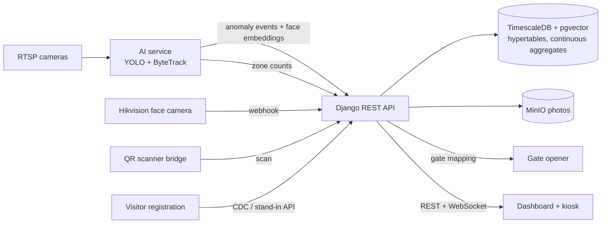

## Summary
### Resume bullets
- Built the Django REST and TimescaleDB backend of an on-premises CCTV visitor and security
  platform: visitor check-in and check-out, anomaly events, zone counts, dashboard APIs and
  WebSocket live feeds.
- Built face-recognition check-in: InsightFace embeddings of registered visitors stored in
  pgvector and matched by cosine distance against Hikvision camera webhooks, limited to the
  appointment day.
- Built a multi-camera RTSP detection service with YOLO and ByteTrack that reports weapon,
  violence and fall events only after an object stays tracked across consecutive frames,
  attaching face embeddings for later search.
- Built people counting per camera zone into a TimescaleDB hypertable with minute, hourly and
  daily continuous aggregates, serving time-slot heat-map APIs to the dashboard.
- Built a stand-in registration API for a third-party visitor system so the check-in flow could
  be tested end to end, with face embeddings generated on save and old photos purged by date.
### Remarks
- B1: traces to the backend foundation, attendance, anomaly-event, dashboard and WebSocket
  bullets · breadth and ownership (99% of anomaly-event code, 94% of dashboard code) · a
  teammate built the QR scanner bridge and gate control; do not claim them · go-live and usage
  are to confirm · roles: backend, data.
- B2: traces to the face check-in, Hikvision webhook and Avigilon bullets · end-to-end ML
  feature with a real device integration · no match-accuracy figure; outcome to confirm ·
  roles: ML, backend.
- B3: traces to the AI service, tracking-gate and anomaly face-embedding bullets · real-time
  multi-stream CV · who trained the weapon, violence and fall weights is unknown: do not claim
  model training · no false-alarm figure · roles: ML, AI infra.
- B4: traces to the zone-counting bullets · time-series modelling · no traffic or camera-count
  figure · roles: data, backend.
- B5: traces to the mock registration API, face-embedding signal and clean-up bullets ·
  integration work around an external dependency · the production integration with the
  third-party system was built by a teammate; do not claim it · roles: backend.
- Metal-detector gate alert (HSV LED detection, no model): not in a bullet; add it to B3 for
  CV-heavy roles ("and a rule-based metal-detector alarm reader").
- On-premises deployment (Podman, justfile, Cloudflare Tunnel, Nginx): not in a bullet; fits
  as a sub-clause of B1 for infra roles.
- `60 frames` / `120 frames`: configured tracking and cooldown values; B3 describes the
  mechanism without them.
- `0.4 cosine distance`, `512-d embeddings`: configured values; B2 names the method without
  them.
- `5-second slot`, `1 min / 1 h / 1 day buckets`: configured values; B4 names the granularity in
  words.
- `5 AI detectors`: configured services (weapon, violence, fall, zone counting, metal); a count
  of services, not a result. Leave out.
- `1 s gate open`: configured; gate control is a teammate's work. Leave out.
- Scope caveat: teammates continued the backend after 2026-03 (third-party registration
  integration, bypass QR roles, register and check-in fixes); the frontend and kiosk repos were
  not ingested.

## Context
A visitor and security platform for a single client site in Thailand. Visitors register in
advance with a photo; at the site they check in by QR code or by face at camera-equipped gates,
and each visitor may bring a number of followers. CCTV streams also feed AI detectors for
weapons, violence, falls, metal-detector alarms and people counts per zone. A dashboard shows
attendance, visitor demographics, anomaly events and crowd heat maps, with live WebSocket
feeds. The system runs on one on-premises Windows machine. [backend:.vault 100%] [TT-653]

Visitor registration first ran in a company-built registration system synced to the dashboard
database; the client later moved registration to an external vendor's system. All work is on
`main` in both repos; no branch holds unmerged work. [TT-508] [TT-617] [backend@833db90]

## What I Did
- **Set up the backend foundation**: Django on TimescaleDB with Docker Compose, a manual
  migrations script, the first face-similarity search API over pgvector, and logical WAL on the
  database for change data capture from the registration system. [backend@7c9dac2]
  [backend@88a68c4] [backend@cb8287d] [backend@6b17871] [TT-498] [TT-508]
- **Built the attendance app**: check-in and check-out APIs, attendance logs with filters and
  CSV export, and a Django Channels WebSocket that broadcasts each check-in or failure.
  [backend@7e083a5] [backend@a4d8f5e] [backend@ac0533d] [backend@97b67af] [TT-505]
- **Allowed several check-ins per visitor QR code**: a visitor may hold up to 1 + their follower
  count active check-ins; the API returns used and remaining slots. [backend@3f7e3e7] [TT-554]
- **Built the dashboard read layer**: controller → repository → serializer, with attendance,
  demographic, follower, visitor and event endpoints. V1 aggregates with the Django ORM; V2
  queries TimescaleDB continuous aggregates with raw SQL for time-slot heat maps in local time.
  [backend:src/dashboard 94%] [backend@4c5cb8c] [backend@f37f7b0] [backend@043ece5]
  [backend@fdac99d] [TT-651] [TT-757]
- **Added API-key and JWT authentication** for the dashboard, devices and WebSocket clients.
  [backend@7040fd8] [backend@63e5654] [backend@6551d87] [backend:src/permissions 100%] [TT-528]
- **Integrated an Avigilon NVR**: a REST client with token generation, alarm import that
  creates cameras and event types, a check-in/check-out webhook that handles batched detections
  and heartbeats, and an NVR image proxy. Later replaced by Hikvision cameras.
  [backend@b2357bf] [backend@08b5147] [backend@76b5e61] [backend@a9c8202] [backend@9b8d9c4]
  [backend:src/avigilon_utils 100%] [TT-609] [TT-662]
- **Built face-recognition check-in**: InsightFace (`buffalo_l`) embeddings for each visitor,
  created by a `post_save` signal from the photo in MinIO; a cosine-distance search in pgvector
  with a configurable threshold, filtered to visitors whose appointment is that day; the match
  then runs the same check-in rules as QR. [backend@ede19ea] [backend@184bae8]
  [backend@a54a101] [backend@2ff1d4b] [backend@03d0fe1] [backend@abf939e] [TT-688]
- **Built the Hikvision check-in webhook**: parses the camera's multipart event, embeds the face
  image, matches and checks the visitor in, and records the camera and snapshot time; the
  camera ID keys a gate-mapping table I designed for the gate opener. [backend@10f5d47]
  [backend@5c682c3] [backend@261ee5c] [backend@a31e887] [backend@15b12a4] [backend@d76a743]
  [TT-763]
- **Built the anomaly-event pipeline in the backend**: a generic create-event API keyed by
  camera IP, event types with severity and Thai names, event logs and export, a WebSocket feed
  of the latest events, an hourly continuous aggregate, and a face-embedding table with a search
  API to find who appeared in an event. [backend@330fff5] [backend@afe9808] [backend@a60ccda]
  [backend@c3decdf] [backend@1c8641c] [backend@7d880e2] [backend:src/anomaly_event 99%]
  [TT-698] [TT-744]
- **Built the AI service for RTSP streams**: Ultralytics YOLO over many streams at once,
  camera identified by IP from the stream URL, events sent fire-and-forget in a background
  thread with aiohttp so slow API calls do not stall inference; PyTorch CPU or CUDA wheels per
  platform via uv indexes. [ai-service@c8be018] [ai-service@dd25cfe] [ai-service@a3a4545]
  [ai-service:src 100%] [TT-613]
- **Gated anomaly alerts on tracking persistence**: per-camera ByteTrack state reports an
  object only after it stays tracked for a set number of consecutive frames, then holds a
  cooldown per tracker ID and drops stale tracks; switched from wall-clock to frame counts so
  the rule holds under variable processing speed. Each alert carries InsightFace embeddings of
  the faces in the frame. [ai-service@0e51146] [ai-service@e70b3c6] [ai-service@96b7540]
  [ai-service@0e25ce9] [ai-service:docs 100%]
- **Built zone counting end to end**: the AI service counts persons per camera and posts once
  per time slot; the backend stores counts in a TimescaleDB hypertable (composite primary key on
  camera and timestamp) with 1-minute, hourly and daily continuous aggregates, a refresh API and
  dashboard APIs. [ai-service@71070cb] [ai-service@fcaf76e] [backend@aa6729a]
  [backend@1f49292] [backend@822e847] [backend@ef3cf20] [TT-734] [TT-743] [TT-754]
- **Built a metal-detector alarm reader without a model**: HSV colour masks on two regions of a
  walk-through metal detector's video find its red LEDs; an event fires only when both sides
  light at once, with a cooldown and stream reconnect. [ai-service@efca349]
  [ai-service@a628970] [TT-805]
- **Built a stand-in registration API for the third-party visitor system**, writing visitors
  straight into the dashboard database so the embedding signal and check-in flow could be
  tested end to end; added a dev check-in API and Faker scripts that mock visitors, followers
  and check-ins for dashboard testing. [backend@029765c] [backend@f521b10] [backend@fad32c7]
  [backend@7492190] [TT-697] [TT-531]
- **Prepared the visitor model for an external database**: a database router and an unmanaged
  model so visitor reads can move to a second database (MySQL) without touching other models;
  wrote the migration plan to the vendor's system. [backend@d32769f] [backend@c14fb0f]
  [backend@6fa5887] [backend@833db90] [TT-617]
- **Added a clean-up API** that deletes old visitor photos and embeddings by appointment date.
  [backend@eb295e4]
- **Scripted the on-premises deployment**: a Python service launcher, then justfiles that start
  the database and MinIO (Podman), Django, the Next.js frontend, Nginx, a Cloudflare Tunnel and
  each AI detector on the GPU; wrote the deployment document and the system notes (API,
  WebSocket and gate-control flows). [backend@ee39b54] [backend@e17e4c1] [backend@5bf9db6]
  [backend@2a8ace0] [backend@8e41d00] [TT-652] [TT-715] [TT-806]

## Numbers
| Value | Scope | Source |
| ----- | ----- | ------ |
| 1 + followers check-ins per visitor | check-in cap per QR code or face (configured rule) | [backend@3f7e3e7] |
| 0.4 cosine distance | face-match threshold, configurable (configured) | [backend@03d0fe1] |
| 512-d embeddings | InsightFace `buffalo_l` face vectors (configured) | [backend:src/cdc 66%] |
| 60 / 120 frames | tracking persistence before an alert / cooldown, about 2 s / 4 s at 30 fps (configured) | [ai-service@e70b3c6] |
| 5-second slot | zone-count posting interval per camera (configured) | [ai-service@fcaf76e] |
| 1 min / 1 h / 1 day | zone-count continuous-aggregate buckets (configured) | [backend@1f49292] |
| 5 AI detectors | weapon, violence, fall, zone counting, metal (configured services) | [backend:.vault 100%] |

## Tools
tools: Python, uv, Django, Django REST Framework, Django Channels (Daphne), drf-yasg / Scalar,
djangorestframework-api-key, Simple JWT, TimescaleDB, PostgreSQL, pgvector, MySQL, MinIO,
InsightFace, ONNX Runtime, Ultralytics YOLO11, Supervision (ByteTrack), OpenCV, PyTorch, CUDA,
aiohttp, Faker, Avigilon REST API, Hikvision camera webhooks, Docker Compose, Podman, just,
Cloudflare Tunnel, Nginx, pm2
Studied, not used: DeepFace (notebook comparison of face representations), RF-DETR (declared in
the AI service, not used in its scripts)

## Architecture

Cameras feed two paths. The AI service reads RTSP streams and posts anomaly events (with face
embeddings) and per-zone person counts. Face cameras post check-in webhooks; the backend embeds
the face, finds the visitor in pgvector among that day's appointments and records the check-in,
which a WebSocket pushes to the dashboard. Counts and events land in TimescaleDB hypertables
whose continuous aggregates serve the dashboard's time-slot views.

## Not mine
- The QR scanner bridge (an HTTP listener that maps scanner IDs to gates, with a local
  fallback) and Modbus gate control, built by a teammate. [backend:src/attendance 44%]
- The production integration with the third-party registration system (walk-in register API
  client), instant-bypass QR roles, and the register and check-in fixes from 2026-03 to
  2026-06, built by a teammate. [backend:src/cdc 66%]
- Polygon (diagonal) regions for the metal-detector reader, MediaMTX and Windows justfile
  changes, and the newest zone-counting APIs, built by another teammate.
- The Next.js dashboard frontend and the kiosk frontend (repos not ingested).
- The backend's auth app scaffolding (roles, TOTP) and CI pipeline look reused from a company
  Django template; authored under my identity but not built for this project.

## Open questions
- Parking-slot PoC (polygon + detection): a ticket assigned to me, closed 2025-11-06, but no
  code in the ingested repos. What did it do, and where is the code? [TT-474]
- OCR with multi-scan QR: the ticket notes "+ OCR", but no OCR code exists in git. What was
  read by OCR (ID cards?), and was it built? [TT-554]
- Who trained the weapon, violence and fall YOLO weights, and on what data? The weights are not
  in git.
- Go-live: was the system used at the client site, and from when? Any scale: cameras, visitors
  per day, check-ins, events?
- Face check-in accuracy: any figure for match rate or false matches at the 0.4 threshold?
- CDC: the ticket records the decision to keep a local visitor model synced by CDC rather than
  call the vendor API per query. Which CDC tool was used, and was this my decision? [TT-653]
- The FastAPI CCTV-event service and the registration-system UAT deploy have tickets but no
  repo here. Should they be added? [TT-500] [TT-509]
- The admin user-management dashboard subtask is assigned to me; its code is not in these
  repos. Was it built? [TT-912]
