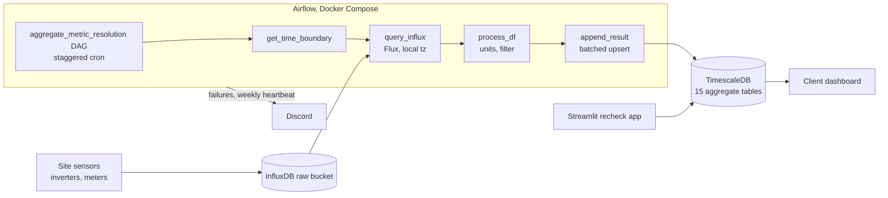

## Summary
### Resume bullets
- Built an Apache Airflow pipeline that aggregates raw InfluxDB energy telemetry (solar, grid,
  time-of-use, voltage, current, power) into 15-minute, hourly and daily TimescaleDB tables, in
  production since 2025-09.
- Designed a thin-DAG pattern: each metric shares one Flux query, transform and upsert module
  across its resolutions, with local-time (UTC+7) windows and a 5-minute ingestion-delay offset.
- Traced intermittent production task failures and lost top-of-hour points (13 of 24 on one
  day) to 9 DAGs firing in the same minute on a 2-vCPU host, then staggered the schedules.
- Found a 1.84 GB Airflow XCom table caused by tasks returning whole DataFrames, and changed the
  final task to return a row count; merged batched `ON CONFLICT` upserts after verifying 0 duplicates.
- Investigated a solar feed silent for about six months, using per-day row counts to show all 4
  inverters stopped within minutes, pointing to a site gateway fault rather than the pipeline.
- Added Discord failure alerts, a weekly heartbeat DAG and 30-day log cleanup, and fixed a
  heartbeat task that sent duplicate messages and false failure alerts.
### Remarks
- B1: traces to the pipeline, metric-coverage and deploy bullets · end-to-end ownership, sole
  committer · "in production since 2025-09" rests on TT-353 (deploy ticket) and the 2026-07 issue
  writeups describing the prod host; confirm · roles: data, backend.
- B2: traces to the DAG-pattern and timezone bullets · a clear, reusable design · configured
  values only, no outcome figure · roles: data, backend.
- B3: traces to the `:05` herd investigation and stagger bullets · measured diagnosis · the
  stagger was "done in code, deploy pending" in the last commits; do not claim the data loss
  stopped until the user confirms deploy and outcome · roles: data, backend, infra.
- B4: traces to the XCom and branch-adoption bullets · measured root cause · the batch-upsert,
  lazy-import and connection code came from an unmerged branch whose commits are not in the clone
  (authorship unknown): the bullet says "merged", not "wrote"; no after-figure for the XCom table
  · roles: data, backend.
- B5: traces to the PV outage bullet · good diagnostic story · the write-up lives only on an
  unmerged branch, and the fix was outside the pipeline; nothing was recovered · roles: data.
- B6: traces to the alerting and heartbeat bullets · operability · small scope · roles: data,
  backend.
- `~270k–330k PV rows per month`: source volume for one metric; left out of bullets as it is
  input scale, not a result. Usable as "hundreds of thousands of sensor points a month" if the
  user wants scale in B1.
- `~3.2 GiB RAM baseline`, `2 vCPU / 7.7 GB host`: diagnosis context for B3; B3 keeps "2-vCPU"
  only.
- `9 → 1 peak concurrent DAG starts`: configured schedule effect, not a measured result; B3
  states the cause (9 DAGs together) and the change, not a result.
- `15 aggregate tables`, `5-minute offset`, `120 s import timeout`: configured values; B2 uses the
  offset as design.
- Scope caveat: commits from 2026-07 (investigations, docs, stagger, XCom fix, heartbeat) carry an
  AI coding-assistant co-author trailer. There is no unit-test suite: do not claim test coverage.
  The InfluxDB ingestion and the dashboard that reads the tables are outside this repo.

## Context
An energy-monitoring client in Thailand (a site with solar inverters and grid meters) streams
raw sensor readings into InfluxDB. The dashboard needs fixed-resolution series, so this repo is an
Apache Airflow pipeline that reads the raw bucket, aggregates each metric into 15-minute, hourly
and daily windows aligned to local time (UTC+7), and upserts the results into TimescaleDB. It runs on
one Docker Compose host with the LocalExecutor. Work began 2025-08 (research and setup), went to
production in 2025-09, gained voltage, current and power metrics in 2026-01, alerting fixes in
2026-04, and a reliability pass in 2026-07 after recurring alerts on the production host.
I am the only committer in the repo. Ticket TT-1272 records that the 2026-07 work merged via
pull request; the production deploy of it is not recorded in git.
[airflow:airflow/dags 100%] [TT-290] [TT-353] [TT-1272]

## What I Did
- **Built the aggregation pipeline end to end**: Docker Compose stack (Airflow 3 on LocalExecutor,
  TimescaleDB for both Airflow metadata and results), environment config, InfluxDB and Postgres
  connection utilities, then the first solar, grid and time-of-use DAGs.
  [airflow:airflow/dags 100%] [airflow@8086b2352] [airflow@9e2f906e5] [airflow@4620348e0]
  [TT-290] [TT-342] [TT-343] [TT-344]
- **Designed the DAG pattern: one metric × one resolution = one thin DAG file.** Each DAG only
  sets its window size, offset and cron, then wires `get_time_boundary → query_influx → process_df
  → append_result`; the Flux query, unit conversion (W → kW, Wh → kWh), filtering and upsert live
  once per metric in `common_tasks/`. A `ProcessingContext` dataclass carries the window and data
  between tasks, passed through XCom as a dict. [airflow:airflow/dags 100%] [airflow@0fa9e42c5]
  [airflow@bcab54269]
- **Made the windows timezone-correct**: Flux queries pin the local timezone (UTC+7) so daily windows end at
  local midnight; bounds are computed in UTC from the run's interval end minus a 5-minute
  ingestion-delay offset, then formatted as ISO 8601 with pendulum.
  [airflow@f464600c7] [airflow@129b9ec64] [airflow@81c709c50] [TT-380]
- **Fixed an aggregation-semantics bug**: grid and time-of-use windows summed instantaneous
  readings; changed them to the mean. [airflow@eb36e2cca]
- **Extended coverage to six metrics** (2026-01): three-phase voltage average (pivot VoltA/B/C,
  mean of the three), total current and total power, each at hourly and daily resolution, through
  repository classes per metric. [airflow@c26fa2486] [airflow@8d24842fe] [airflow@09d4871a1]
  [airflow@3f8b9ed10]
- **Built a Streamlit app and notebooks to recheck results**: query any aggregate table by date
  range and timezone, plot per-device and summed series, and classify rows as peak, off-peak or
  holiday. [airflow:src/app 100%] [airflow@36d8824eb] [airflow@5654cd9d7]
- **Added operability**: retries (3 × 1 min) and a 10-minute execution timeout on every task, a
  Discord failure callback with the error text, and a daily DAG that deletes Airflow logs older than
  30 days. [airflow@7c829561f] [airflow@73dba03c9] [airflow@39aea3bb3] [airflow@2df2933ab]
  [airflow@7561096b1] [TT-934]
- **Diagnosed the production `:05` failures** (2026-07): from logs, container state and the
  database, showed that all hourly and 15-minute DAGs fired in the same second at minute 5 (9 DAGs
  at once), pushing DAG-file imports past the 120 s timeout on a 2-vCPU, no-swap host, which caused
  task failures, scheduler restarts and missing top-of-hour points (13 of 24 on one day in one
  table). A RAM investigation found a host-wide OOM kill in the same window. Wrote an issue
  write-up and a remediation plan split into eight changes. [airflow@5ebb0442d]
  [airflow@19e883855] [airflow@ff526eafe] [airflow@9fb0f0d79] [TT-1272]
- **Staggered every aggregate DAG's fire minute** so no two start within about 3 minutes, while
  keeping each aggregation window unchanged, and documented the schedule table.
  [airflow@087b56c6c] [airflow:airflow/dags 100%]
- **Cut XCom growth**: the XCom table had reached 1.84 GB / 498k rows because every task,
  including the last, returned the context with its DataFrame. The terminal task now returns only
  `{resolution, rows}`. [airflow@66c4b07ad] [airflow@ff526eafe]
- **Merged a pending hardening branch** after a written diff analysis: lazy `influxdb_client`
  import (out of DAG parse time), a `db_conn()` context manager that always closes connections,
  and batched `execute_values` upserts with `ON CONFLICT` on a new unique index, hand-merged with
  the XCom change. Ran a read-only check that found 0 duplicate keys across all 15 aggregate
  tables, so the index could build without a dedupe step; wrote a migration runbook.
  [airflow@f883a9823] [airflow@6ab2aa6ea] [airflow@cc0acf0ae] [airflow@4a5e31445]
- **Replaced a deliberate weekly failing task with a heartbeat DAG** (Monday 08:00 local time) and
  fixed it returning a non-serialisable HTTP response to XCom, which had failed the task after
  sending, causing duplicate heartbeats and a false failure alert. [airflow@aac904207]
  [airflow@89a3d5ee5] [airflow@e8bf0e670]
- **Investigated a solar (PV) feed silent since 2026-01-10**: per-month and per-day source row
  counts and per-device last-seen times showed the source stopped (after two 8-day gaps in 2025-12)
  and all 4 inverters went quiet within about 6 minutes, pointing to a shared logger or gateway
  fault. A notebook reruns the DAG logic against a pre-outage window to show the query and
  transform are correct. On an unmerged branch. [airflow@e74682b98]
- **Wrote the project docs**: architecture guide, deploy how-to, and an artifact convention for
  issues, plans and runbooks. [airflow@dc6e21139] [airflow@34005d078] [airflow@973171a7d]
  [airflow@bb94e6dd2]

## Numbers
| Value | Scope | Source |
| ----- | ----- | ------ |
| ~270k–330k rows per month | PV source readings in a healthy month, 2025-10 and 2025-11 (measured) | [airflow@e74682b98] |
| 4 inverters | PV devices at the site (measured in the outage write-up; ticket says 4 in use) | [airflow@e74682b98] [TT-342] |
| ~6 months | PV feed silent, 2026-01-10 to the write-up date (measured) | [airflow@e74682b98] |
| 13 of 24 | top-of-hour points missing in one 15-minute table on one day before the fix (measured) | [airflow@5ebb0442d] |
| 9 DAGs at once | concurrent starts at minute 5 before the stagger (measured in logs) | [airflow@5ebb0442d] |
| 1.84 GB / 498k rows | Airflow XCom table size before the fix (measured) | [airflow@ff526eafe] |
| ~3.2 GiB | fixed RAM baseline (Postgres buffers + idle executor workers) on the host (measured) | [airflow@19e883855] |
| 2 vCPU / 7.7 GB, no swap | production host size (configured) | [airflow@5ebb0442d] |
| 0 duplicates | across 15 aggregate tables before adding the unique index (measured) | [airflow@4a5e31445] |
| 15 tables | aggregate tables: 6 metrics at 2–3 resolutions (configured) | [airflow:airflow/dags 100%] |
| 5-minute offset | ingestion-delay buffer before each window is read (configured) | [airflow@81c709c50] |

## Tools
tools: Python, Apache Airflow 3 (LocalExecutor), InfluxDB + Flux (influxdb-client), TimescaleDB /
PostgreSQL (psycopg2, `execute_values`), pandas, pendulum, Docker Compose, Discord webhooks,
Streamlit, Plotly, Jupyter, uv, Ruff
Studied, not used: none recorded

## Architecture

Each of 15 DAGs covers one metric at one resolution. The DAG computes its window from the run
time minus an offset, the shared metric module runs the Flux aggregation with the local
timezone pinned, converts units, and upserts one row per device and window. Fire times are
staggered so DAG imports do not pile up on the small host.

## Not mine
- The InfluxDB ingestion from the site devices and the dashboard that reads the aggregate tables:
  outside this repo; who built them is not recorded here.
- Five commits on the unmerged hardening branch (lazy import, connection cleanup, batched upsert,
  reduced parallelism, container memory limits) are not in the clone; their author is unknown. I
  merged their code changes into the main line. [airflow@6ab2aa6ea]
- Vendored Claude Code skills and a spec-kit template (`.agents/`, `.claude/`, `.specify/`) are
  tooling, not project work. [airflow@e4f86fdf0] [airflow@3d0d131a5]

## Open questions
1. Was the 2026-07 work (stagger, XCom fix, batched upserts, heartbeat) deployed to production,
   and did the `:05` failures and missing top-of-hour points stop afterwards?
2. Were the missing points backfilled (plan 001.02), and was the metadata-DB cleanup and swap
   (plans 001.04, 001.05) done?
3. Who wrote the five commits on the hardening branch (lazy import, batched upsert, memory
   limits)? If they were mine, B4 can say "built".
4. Was the PV outage fixed on site after the write-up, and was the branch merged?
5. TT-1380 (new cloud server for this client and a vulnerability check, 2026-08) and TT-1485
   (dump and backup of the raw InfluxDB, aggregate Postgres and dashboard Postgres, 2026-09):
   ticket-only. Did I do this work, and what did the server move involve?
6. TT-696 (2026-01, add voltage, current and power aggregation) matches the 2026-01 commits;
   who asked for these metrics and what does the dashboard show with them?
7. Who consumes the aggregate tables (the client dashboard), and how many sites or devices
   beyond the 4 inverters feed the grid and time-of-use metrics?
8. How much of the 2026-07 analysis and code was AI-assisted? Commits carry an AI co-author
   trailer.
