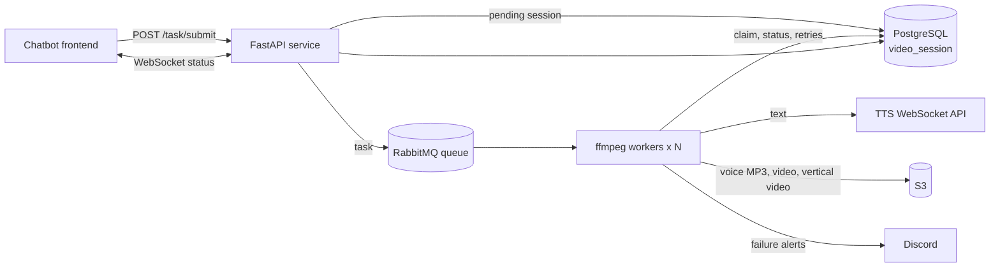

## Summary
### Resume bullets
- Built a RabbitMQ-driven ffmpeg worker that turns a chatbot session into a personalised video:
  text-to-speech greeting, preset clips with transitions, and a 9:16 version with Thai text overlays.
- Replaced MoviePy with ffmpeg and added encoder auto-selection (NVIDIA NVENC, Apple VideoToolbox,
  others) with per-call CPU fallback, so one worker runs on a Mac or an NVIDIA server.
- Fixed duplicate processing across parallel GPU workers with an atomic Postgres task claim,
  database-tracked retries with requeue, and per-worker temp directories.
- Designed preset-video selection from three chatbot answers, then made it prefer the preset the
  chatbot sends and report the preset used, fixing mismatched video covers.
- Wrote the worker's error-handling layer as an Either-monad pipeline with retry decorators and
  Discord failure alerts, so failed sessions surface with their error message.
### Remarks
- B1: traces to the worker pipeline, TTS and vertical-video bullets · end-to-end ownership of the
  worker (95–100% of `src`) · output volume and users unknown · roles: backend, media/AI infra.
- B2: traces to the ffmpeg migration and encoder-selection bullets · a teammate wrote the first
  GPU re-render concat and the NVIDIA compose setup; my part is the selection helper, option probing
  and fallback · no speed figure: do not claim a speed-up · roles: backend, infra.
- B3: traces to the task-claiming bullet · a real concurrency fix · "parallel GPU workers" rests on
  a 6-worker compose file (configured, teammate co-wrote it) · roles: backend.
- B4: traces to the preset-mapper bullet · the fix is backed by a ticket describing the bug
  [TT-275] and my commits · roles: backend.
- B5: traces to the error-handling bullet · design pattern more than outcome; alert volume unknown ·
  roles: backend.
- `6 workers`: configured in a compose file, not a measured throughput; B3 says "parallel GPU
  workers" without the figure.
- Scope caveat: the earlier MoviePy worker on AWS is not in the ingested repos; the AWS → on-prem
  move and the EC2 vertical-scaling test are backed only by tickets, so no bullet claims them.
- Scope caveat: status `shipped` is inferred, not confirmed; the chatbot frontend and the
  chatbot itself were built by others.

## Context
A marketing chatbot microsite for an insurance client: a visitor chats with a bot, answers three
questions about free time and activities, and receives a personalised video. The service turns a
finished chat session into that video: a text-to-speech intro that greets the visitor by name,
two to three preset clips picked from the answers with transition clips between them, a random
ending clip, and a vertical 9:16 version with the visitor's name, a recommendation text and the
brand logo drawn over the video. Outputs go to S3; the frontend polls status over a WebSocket.
[TT-47] [TT-157] [TT-210] [merge-worker:src 100%]

The first worker used MoviePy on AWS (EC2 for RabbitMQ and the worker, S3 for media). In 2025-08
the team researched moving compute from AWS to an on-prem machine and switching MoviePy to ffmpeg
[TT-258]; the new ffmpeg worker repo ships a 6-worker compose file for an NVIDIA GPU server while
S3 stays the output store [merge-worker:. 90%] [TT-265]. That first MoviePy worker is not in the
ingested repos; its utilities were copied into the new worker [merge-worker@82ede0f5a].

Two branches hold one commit of mine each not on `main`: a VideoToolbox-only encoder change
(`render-mac`), later replaced by the encoder auto-selection on `main`, and a name-truncation
tweak (`hotfix/preset-mapper`), superseded on `main`.

## What I Did
- **Built the merge worker's processing pipeline** in Python: a RabbitMQ consumer
  (`prefetch_count=1`, manual ack) reads a chat-session task and runs, in order: generate the
  intro voice, merge it onto the intro clip, pick preset clips, concatenate everything, render the
  vertical version, and upload audio and both videos to S3; status and output paths are written to
  Postgres. [merge-worker:src 100%] [merge-worker@f5eadd5bc] [merge-worker@2f88f83c4] [TT-212]
- **Integrated a cloud text-to-speech WebSocket API** (MiniMax T2A, a custom cloned voice):
  streams the greeting and intro summary text, collects hex audio chunks into an MP3, and merges
  greeting and intro into one clip. [merge-worker:src/utils 95%] [merge-worker@16699c592]
  [merge-worker@9bfb23b30]
- **Replaced MoviePy with ffmpeg subprocess calls**: audio-onto-video merge that pads or trims the
  video to the voice length (`tpad` / `trim`), forces constant 30 fps and 48 kHz audio, and a
  re-encoding concat through `filter_complex` for stable audio/video sync. A teammate wrote the
  first GPU re-render concat; I extended it. [merge-worker@022c0960f] [merge-worker@0e770a9c4]
  [merge-worker:src/utils/ffmpeg_merge.py 90%] [TT-258]
- **Wrote hardware-encoder auto-selection**: probes `ffmpeg -encoders` and picks the first of
  NVENC, VideoToolbox, Quick Sync, AMF, then libx264; probes per-encoder options (`-rc vbr`,
  `-b_ref_mode`) before adding them; then wrapped every ffmpeg call (merge, concat, single
  re-encode, vertical render) in a GPU-first, CPU-fallback loop. The same code runs on an Apple
  Silicon laptop and the NVIDIA server. [merge-worker@3468e1db2] [merge-worker@b26796317]
  [merge-worker@cd06e6f6e] [TT-263]
- **Built the vertical-video renderer**: Pillow draws a 9:16 overlay (header, name, a wrapped
  recommendation text and logo) with Thai-aware word wrapping (PyThaiNLP tokens measured by pixel
  width) and a rounded-corner mask; ffmpeg composites the scaled source video into the card.
  [merge-worker:src/utils/vertical_video_generator.py 90%] [merge-worker@01a810e8c]
  [merge-worker@092f78867]
- **Designed the preset-video mapper**: a registry maps the tuple of three chatbot answers to a
  preset (activity clips, affirmation, time management, self-encouragement and combinations), adds
  transition clips between items and a random ending clip, and falls back to an activity preset.
  After bot answers drifted from the expected values and covers no longer matched videos, I made
  it look up the preset name sent by the chatbot first, fall back to the answer tuple, and return
  the preset actually used to the frontend. [merge-worker:src/utils/preset_mapper.py 98%]
  [merge-worker@a16435593] [merge-worker@b89c3e329] [merge-worker@78dc35025] [TT-157] [TT-275]
- **Fixed a race condition between parallel workers**: an atomic Postgres `UPDATE … WHERE status
  IN ('pending','retrying') AND processing_worker_id IS NULL` claims each task; a worker that loses
  the claim acks and skips. Failures increment a database retry count, release the claim and
  requeue with `nack`, up to 3 tries; temp files sit in per-worker, per-session directories. The
  worker also retries the status lookup, because the API publishes to the queue before it inserts
  the session row. [merge-worker@fd0fe3eda] [merge-worker@3cf84d0f0] [merge-worker@da285593f]
  [merge-api@d61a35c10] [TT-378]
- **Structured error handling as an Either-monad pipeline** (PyMonad): each step returns
  `Right(context)` or `Left(error)`, steps chain with `bind`, temp files are cleaned up either
  way, and failures send a Discord webhook alert with the session and error; retry decorators wrap
  monadic and plain functions. [merge-worker:src/utils/decorators.py 100%]
  [merge-worker@6ccc963d4] [merge-worker@5f591e645] [merge-worker@b131dfa30] [TT-371]
- **Built the first version of the FastAPI service and the task API**: the project scaffold,
  MoviePy merge endpoints that were later removed, RabbitMQ task submission (`/task/submit`) that
  records a pending session, Postgres in Compose, Swagger, and a refactor of the WebSocket status
  endpoint. [merge-api@180501609] [merge-api@a81db0374] [merge-api@5b44b9f2a]
  [merge-api@9ccd1aa07] [merge-api:app/routers 60%] [TT-64]
- **Added schema migrations** for voice path, vertical-video path and worker ID, and wrote the
  API's project documentation. [merge-api@149b7f570] [merge-api@9696e1fad] [merge-api@d61a35c10]
  [merge-api@9ccd1aa07]
- **Set up CI deploys** for both repos: a pipeline on a self-hosted runner pulls the main branch
  on the server over SSH, with a manual step to restart the containers. [merge-worker@7385ecc02]
  [merge-api@a5f1e7367]

## Numbers
| Value | Scope | Source |
| ----- | ----- | ------ |
| 6 workers | GPU worker containers in the on-prem compose file (configured) | [merge-worker:. 90%] |
| 3 retries | task retries before a session is marked failed (configured) | [merge-worker:src 100%] |
| 3 chatbot answers | inputs to preset selection (design) | [TT-157] |

## Tools
tools: Python, uv, ffmpeg / ffprobe (NVENC, VideoToolbox, libx264), MoviePy (first version),
Pillow, PyThaiNLP, PyMonad, RabbitMQ (pika), PostgreSQL (psycopg2), FastAPI, WebSockets, Swagger,
AWS S3 (boto3), MiniMax text-to-speech WebSocket API, Discord webhooks, Docker Compose, NVIDIA
container runtime, Bitbucket Pipelines (self-hosted runner), PyInstrument, ruff
Studied, not used: Google voice cloning (API limits; needed vendor support) [TT-266]

## Architecture

The API publishes a task and records a pending session. Each worker takes one message at a time,
claims the session in Postgres, generates the voice, merges and concatenates clips with ffmpeg on
the best available encoder, renders the vertical version, uploads to S3 and marks the session
completed; the frontend's WebSocket reads the status and output paths.

## Not mine
- The NVIDIA runtime and GPU library mounts in the 6-worker compose file, the first GPU
  re-render concat, CPU-encoder handling in the vertical renderer, and logo and colour tweaks:
  a teammate. [merge-worker@fecdd1f5f] [merge-worker@86d754b50] [merge-worker@60104071b]
- The migration runner, the first `video_session` schema and status columns: a teammate.
  [merge-api:migrations 10%]
- The first WebSocket endpoint, CORS, and the name, recommendation and preset fields: a teammate.
  [merge-api@6876c9f1f] [merge-api@4509a1f8c] [merge-api@67ef43314]
- The chatbot, its frontend and the video clips themselves: other team members (not in the
  repos).

## Open questions
1. Was the service live for the client's campaign, and for how long? How many videos did it
   produce, or how many visitors used it?
2. AWS → on-prem: what was your part in the move (research only [TT-258], or setting up the
   services on the on-prem server [TT-265])? Why was it moved (cost, GPU access)?
3. The EC2 vertical-scaling test to `c5a.large` [TT-219]: what did it measure, and was there a
   result (for example, seconds per video before and after)?
4. Did the switch from MoviePy to ffmpeg, or GPU encoding, cut the time per video? Is there a
   before/after figure?
5. How many workers actually ran in production, on what GPU?
6. Did you set up the AWS side (S3, EC2 for RabbitMQ, IAM, nginx with HTTPS/WSS, server scale-up)?
   Tickets assign these to you [TT-64] [TT-169] [TT-170] [TT-194], but no repo holds that work.
7. Team: who owned the chatbot and frontend, and were you the lead on the backend?
