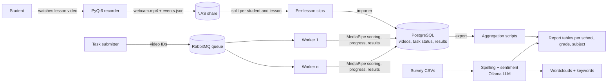

## Summary
### Resume bullets
- Built a RabbitMQ worker pipeline that scored student attention in ~930 webcam recordings
  (~64 h) from 2 schools, using MediaPipe face landmarks for gaze, blinks, head pose and emotion.
- Wrote a reusable long-running RabbitMQ task worker with a heartbeat thread, manual ack/nack and
  PostgreSQL task-status and progress tracking, so multi-minute video jobs ran on parallel workers.
- Built a Thai survey-comment pipeline: LLM spelling correction and sentiment classification on a
  local Typhoon2 8B model, then PyThaiNLP and gensim n-gram wordclouds and keyword rankings.
- Built a PyQt6 desktop recorder that plays lesson videos while recording the student's webcam,
  logs playback events to JSON, and switches between Qt and VLC playback backends.
- Aggregated per-video attention and comment sentiment by school, grade, subject and lesson into
  report tables, and wrote Thai runbooks from raw recordings to results.
### Remarks
- B1: traces to the concentration-scoring worker, the video import and task submission bullets,
  and the ~930 recordings / ~64 h rows in Numbers · real data at scale · whether I designed the
  scoring heuristic or ported it from a supplied script is an Open question; do not claim the
  scoring method is validated (no ground-truth accuracy exists) · roles: ML, AI infra, backend.
- B2: traces to the long-running worker framework and PostgreSQL schema bullets · reusable
  engineering, same pattern as another project's worker · no throughput figure quoted (see the
  derived row below) · roles: backend, AI infra.
- B3: traces to the spelling-correction, sentiment and wordcloud/keyword bullets · local LLM on
  Thai text · no accuracy check of the LLM labels found; one school's survey was replaced by mock
  data, so do not claim 4 schools · roles: ML, data, NLP.
- B4: traces to the recorder bullets · desktop app, ~95% of its lines mine · a teammate wrote
  the Windows build script and some UI styling; the later timeline-sync and camera-dropdown work
  sits on an unattributed branch, so do not claim it · roles: backend, ML (data collection).
- B5: traces to the aggregation and runbook bullets · end-to-end ownership · reports for one
  school are backed only by a ticket [TT-1122]; confirm delivery before saying "delivered to the
  client" · roles: data.
- `~33 h of video in ~3.5 h wall-clock`: derived from result timestamps with an unknown worker
  count and restarts; left out. Say "ran on parallel workers" instead.
- `40 comments per file`, `0.4 / 0.3 / 0.2 / 0.1 score weights`: configured values, not results;
  B3 and B1 describe them without the figures.
- `3 schools` (survey comments): left out of B3 as a number until confirmed; B3 makes the point
  without it.
- Scope caveat: the 11 newest analysis commits (new survey format, keyword extraction, runbooks,
  2026-06) live only on an unmerged feature branch; they read as unshipped unless the user says
  otherwise. Server deployment [TT-822] has no trace in git.

## Context
A research project for a public-sector education client in Thailand: measure how well lower- and
upper-secondary students paid attention while watching digital lesson videos (Thai, English,
maths and science), and combine it with the students' free-text survey comments written after
each video. Students watched the videos in a desktop recorder that filmed them with a webcam; the
recordings were split into per-student, per-lesson clips (by a separate tool not in the evidence)
and analysed by a queue of video workers. Survey comments were classified by sentiment and
turned into wordclouds and keyword tables per school, grade and subject. Work ran from 2026-02 to
2026-03 (recorder, worker, first survey analysis), with a second round in 2026-06 for a new survey
format and extra schools. [TT-732] [TT-739] [TT-775] [TT-853] [TT-1115] [TT-1122]
The 11 newest analysis commits (2026-06) are only on the `feature/eye-track` branch, not on `main`.

## What I Did
- **Built the video attention-scoring worker** on MediaPipe Face Landmarker (iris, eye and
  blendshape outputs): a 3-second gaze calibration, Eye Aspect Ratio blink detection, an
  eye-region brightness/variance check for occlusion, gaze direction against the calibrated
  baseline, a head-position check, and blendshape-based emotion (positive / negative / neutral).
  Each frame gets a weighted concentration score, smoothed over 6 frames and labelled
  concentrated, distracted, blink, occluded or no face; each video gets status percentages,
  emotion shares and the lowest-scoring third (beginning, middle, end).
  [analysis:src/concentration_analysis 100%] [analysis@a2b8580c0] [analysis@c28ce4099]
- **Wrote a reusable long-running RabbitMQ task worker**: typed task messages, a heartbeat
  thread that keeps the broker connection alive during multi-minute jobs, manual ack on success
  and nack without requeue on failure, `prefetch_count=1`, success and failure callbacks, and a
  context factory per worker ID, so several workers can run in parallel.
  [analysis:src/utils 100%] [analysis@b0353be37] [analysis@f874c9e44] [TT-775]
- **Modelled the job data in PostgreSQL** with versioned SQL migrations (videos, task status,
  results, school ID) and a migration runner; the worker writes progress every 1% of frames and a
  success flag, so failed videos can be found and rerun.
  [analysis:migrations 100%] [analysis:migrations/scripts 100%] [analysis@2720f0ca3]
  [analysis@eca65a91c]
- **Built the video import and task submission tools**: an importer that walks the mounted NAS
  share, stores relative paths with school, grade, subject and lesson, and skips duplicates; a
  path-update script; and task submission by ID range or from a CSV. A `just` file runs services,
  migrations, import and workers on macOS, Linux and Windows (PowerShell).
  [analysis:src/importer 100%] [analysis@7a1b606fe] [analysis@47303a830] [analysis@b6a333f04]
  [analysis@a88d382de] [analysis@c7dd3b042] [analysis@95b7a8e14]
- **Built the Thai survey sentiment step**: a local LLM (Typhoon2 8B, a Llama 3.1-based Thai
  model, served by Ollama through LangChain) classifies each comment as positive, neutral or
  negative with a confidence, parsed into a Pydantic model from JSON output; comments are grouped
  by topic, read from the survey's column headers, and summarised as percentages per subject and
  topic. [analysis:data_analysis/src 100%] [analysis@f2c05e71d] [analysis@5dc4bc0f9] [TT-739]
- **Added an LLM spelling-correction step** before sentiment, which also blanks comments with no
  meaning. [analysis:data_analysis/scripts_ 100%] [analysis@5ccf99a87]
- **Built n-gram wordclouds and keyword tables** for Thai comments: PyThaiNLP tokenisation and
  stopwords, gensim `Phrases` for 2- and 3-grams, wordclouds per subject and per subject and topic,
  then frequency-ranked keywords per sentiment. [analysis:data_analysis/src 100%]
  [analysis@650c1914e] [analysis@0498e4fa0] [analysis@986be5a18] [analysis@a5fe0a6e8]
- **Extended the survey pipeline to a new survey format** (one column per subject, upper-secondary
  grades), with subject-name mapping, a single runner with skip flags per step, and
  safe output file names. Only on the unmerged feature branch.
  [analysis@e1d939185] [analysis@b5cde9ed1] [analysis@fd58217bc]
- **Aggregated attention and sentiment for reporting**: per-video attention results grouped by
  school, grade, subject and lesson (means, standard deviation, emotion shares, the most common
  low-attention segment, sample size), merged with comment sentiment. [TT-853]
  [analysis:data_analysis/scripts_ 100%] [analysis@4349d766d] [analysis@f3daee07a]
- **Re-implemented the analysis as scripts and wrote Thai HTML runbooks** for the full flow
  (raw recordings → per-student clips → import → workers → reports) and a quickstart, when the
  earlier service was too complex to start. [TT-1115] [analysis@202e345ee] [analysis@4803b4953]
  [analysis@661567f08]
- **Built the desktop recorder in PyQt6**: students pick a lesson video from a YAML
  configuration (subjects and chapters, generated by a script); the app records the webcam in
  sync with playback (pausing with the video), on separate preview and writer threads with a
  bounded frame queue, and logs play, pause and seek events to JSON in a per-participant,
  per-subject, per-chapter folder with collision-safe timestamps. [TT-732] [TT-807]
  [recorder:utils 98%] [recorder:. 93%] [recorder@5957062d4] [recorder@3cbdb9532]
  [recorder@a63a2c337]
- **Put the recorder's playback behind one player interface** with Qt (`QMediaPlayer`) and VLC
  backends chosen by a flag, plus camera-index and participant-ID flags and a test mode for
  negative IDs; fixed webcam preview freezing and missing videos from mixed file extensions.
  [recorder:utils/players 95%] [recorder@f5f255c19] [recorder@cb63a1840] [recorder@c092aac51]
  [TT-811]
- **Wrote the PyInstaller spec** to package the recorder as a Windows executable.
  [recorder:. 93%]

## Numbers
| Value | Scope | Source |
| ----- | ----- | ------ |
| ~930 recordings (925 processed successfully) | student webcam clips from 2 schools, 3 grades × 4 subjects, analysed by the worker (measured, exported results) | [analysis:data_analysis/raw_data 100%] |
| ~64 h of video | total duration of those recordings (measured, exported results) | [analysis:data_analysis/raw_data 100%] |
| ~33 h of video in ~3.5 h wall-clock | one school's batch, from result timestamps; worker count unknown (derived) | [analysis:data_analysis/raw_data 100%] |
| 3 schools | real survey comments analysed; a 4th school's survey was replaced by mock data (measured from the repo) | [analysis@7f61d3dd0] |
| 40 comments per file | cap on rows read per survey file (configured) | [analysis@8049124fb] |
| 0.4 / 0.3 / 0.2 / 0.1 | concentration-score weights: gaze, head, no blink, base (configured) | [analysis:src/concentration_analysis 100%] |

## Tools
tools: Python, uv, MediaPipe (Face Landmarker), OpenCV, NumPy, pandas, RabbitMQ (pika),
PostgreSQL (psycopg2), Docker Compose, just, Ollama + LangChain, Typhoon2 8B (Llama 3.1-based),
Pydantic, PyThaiNLP, gensim, wordcloud, matplotlib, Jupyter, PyQt6, python-vlc, PyYAML,
PyInstaller
Studied, not used: ONNX Runtime (declared as a dependency; no code uses it)

## Architecture

The recorder films each student while a lesson video plays. A separate tool splits the raw
recordings into per-student, per-lesson clips on a NAS share; the importer registers them in
PostgreSQL and the submitter queues their IDs. Workers take one task at a time, score attention
frame by frame and write progress and results back. Survey comments go through LLM spelling
correction and sentiment, then wordclouds and keyword tables; aggregation scripts join the two
data sets for reports.

## Not mine
- A teammate wrote the recorder's Windows build script, part of its UI styling and its VLC
  configuration. [recorder:. 93%]
- A teammate committed updated survey sentiment results in the analysis repo (data only, no
  code).
- The tool that splits raw recordings into per-student clips is a separate project, not
  ingested; its author is not known from git.
- Three recorder commits on a separate branch (2026-06: per-frame timestamps so the webcam video
  joins the event log, a camera-name dropdown, a video-preparation script and a new build setup)
  were made under a shared deploy identity; they are not counted as mine here.

## Open questions
1. Did you design the concentration-scoring heuristic (EAR blinks, gaze calibration, weights), or
   port it from a script supplied by someone else? Git shows it arriving in one large commit.
2. Was the scoring ever checked against human judgement or another ground truth?
3. Were the attention and survey reports delivered to the client, and used for what decision?
   Jira shows a report for one school [TT-1122] but no outcome.
4. Were the three recorder commits under the shared deploy identity (timeline sync, camera
   dropdown, video preparation, 2026-06) yours?
5. Was the server deployment [TT-822] done by you, and what did it run (workers, database)?
6. Did the 11 commits on the unmerged feature branch (new survey format, keyword extraction,
   runbooks) reach the client's reports, or stay unshipped?
7. How many students and survey comments were there in total, and how many recording sessions
   used the desktop recorder?
8. Who wrote the clip-splitting tool, and was it part of your work?
9. Was the sentiment output from the local LLM spot-checked for accuracy?
