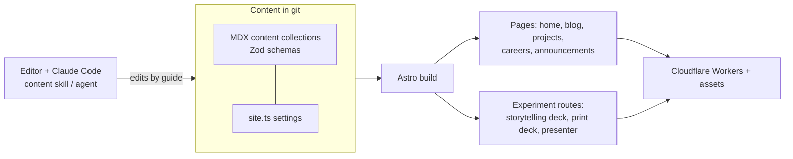

## Summary
### Resume bullets
- Rebuilt the company's marketing website in Astro, Tailwind and React islands, moving every page
  section into schema-validated content collections and adding careers, blog, projects and
  announcement pages.
- Built a scroll-driven company-profile page as a React slide deck: a custom wheel and touch hook
  drives per-scene animation progress, overscroll changes scene, and scenes load lazily.
- Designed a print-first 16:9 credential deck on a 12-column, 8 px baseline grid, with a
  print-to-PDF page rule, auto-paginated client slides and a live presenter mode.
- Set up an AI-assisted content workflow: a Claude Code content skill, per-collection authoring
  guides and two project agents, with a rule that schema changes update the guides.
- Built a theme system of 8 CSS colour presets with a switcher, applied before first paint to
  prevent a theme flash, and configured Cloudflare Workers deployment.
### Remarks
- B1: traces to the rebuild, content-architecture and site-sections bullets · breadth, sole
  developer · not shown live in git (status wip); do not claim it replaced the live site ·
  roles: frontend, full-stack.
- B2: traces to the storytelling-page bullet · a real interaction design with a written PRD ·
  experiment route, linked only from the footer · roles: frontend.
- B3: traces to the print-deck bullet · precise layout engineering · lives only on an unmerged
  branch: write it as built, not shipped · roles: frontend.
- B4: traces to the content-workflow bullet · AI tooling for non-developers · adoption by
  content editors not shown in git; outcome to confirm · roles: AI tooling, frontend.
- B5: traces to the theme-system and Cloudflare bullets · "8 colour presets" is a configured
  value, not a result · the Cloudflare config exists, but no deploy is recorded in git ·
  roles: frontend.
- Scope caveat: most commits carry an AI-assistant co-author trailer: the code was written with
  Claude Code. Do not imply hand-written code; "built with Claude Code" is accurate.
- Scope caveat: no outcome measured. The site's own case-study page claims Lighthouse scores
  above 95, but no measurement is in git, so no bullet quotes it.

## Context
The company is a technology consultancy in Thailand. Its live marketing website is an older Astro
project in a separate repo, built and run by teammates (see the evidence file
`corporate-website-astro-upgrade-and-product-pages`). In 2026-05 I started this repo as a new,
from-scratch rebuild of that site: the first content commit extracts every page section "from
live site" into JSON, which was then split into content collections. [website@3e9c49f2f]
[website@ff6444064] [TT-1036]

How the two relate, from git only: the two repos share no history, and this repo has no commit
after 2026-06-14. The live-site repo kept receiving teammates' commits from 2026-05 to 2026-08
(CMS-driven credential download, a 3D hero, PM2 deploy fixes, a language switch), so this rebuild
did not replace the live site in git. In 2026-11 I upgraded the live site instead, and several
patterns from this repo reappear there: the `@/` import alias, a single `src/data/site.ts`
settings object, the Astro Font API loader, colour tokens split into preset files and a
configurable greyscale filter with a default of 0.6. The site's own case-study page here calls it
a replacement for a heavier predecessor; git does not show that it went live.

The last seven commits (a print presentation deck and its presenter mode) live only on the
unmerged branch `feature/swiss-design-presentation`. Most commits carry an AI-assistant
co-author trailer. [website@800a4dbb7] [website@c32aae357]

## What I Did
- **Rebuilt the site as a new Astro 6 project** with Tailwind CSS 4, shadcn/ui, React islands and
  strict TypeScript: started the repo, extracted the live site's sections into JSON, then split
  them into content collections and MDX. [website@992c253a3] [website@3e9c49f2f]
  [website@ff6444064] [website:src 100%]
- **Designed the content architecture**: 8 Zod-validated content collections (services, blogs,
  testimonials, announcements, open positions, projects, value props, clients), one definition
  file per entity re-exported from one config file, cover images through Astro's `image()` schema
  helper, and projects in year folders with `featured` and `archived` flags.
  [website:src/content-definition 100%] [website@3dcb0454c] [website@e86e658af]
  [website@f80d8b218] [website@b18e60bf4] [website@98dbe5bc9]
- **Built the site sections**: a careers section from an open-positions collection with a
  tech-stack page, a blog with cover images and a two-column masonry layout, a projects grid with
  featured-first sorting and a case-study page, responsive footer link groups, and SEO metadata
  (canonical, Open Graph, Twitter) through `astro-seo`. [website:src/pages 100%]
  [website@dd90c6458] [website@cc4e14570] [website@6c01e1e6c] [website@31fa34ba7]
  [website@9374c831d] [website@63a1c08eb]
- **Built an announcement (splash) modal** from a content collection, with layout variants, a
  3D-card mode, a full-page route and a 24-hour suppression after close, plus a site-wide
  greyscale filter configured in `site.ts`. [website:src/components 100%] [website@c88441dc6]
  [website@de0db265b] [website@f4aeb01aa] [website@e81c5349d]
- **Built the theme system**: 8 colour presets as CSS custom-property files, a dropdown switcher
  grouped by light and dark, the choice kept in `localStorage`, and an inline script that sets
  the preset before first paint so the page does not flash the wrong theme.
  [website:src/styles 100%] [website@42a9056a3] [website@adde04c6e] [website@b9380c20b]
- **Tried hero backgrounds and kept the simplest**: a Three.js isometric wireframe and
  theme-aware shader backgrounds fed by CSS colour variables, then reverted to a boxes
  background, and made the hero a variant switcher. [website@fa8dd4cde] [website@90a8b1ca7]
  [website@1db9e9ece] [website@a6a75509f] [website@531598786]
- **Wrote a PRD and built a scroll-driven company-profile ("storytelling credential") page**: a
  React slide deck of 12 full-viewport scenes. A custom hook intercepts wheel and touch input
  without moving the DOM, turns it into a 0-to-1 progress value that scenes map to animations
  with `motion/react`, and moves to the next or previous scene on overscroll, with a cooldown.
  Scenes are lazy-loaded from a registry. Arrow keys, a chapter navigation and a laser pointer
  (colour, size, fading tail) control the deck, and scenes entered backwards start at their end
  state. [website:docs/artifacts 100%] [website@747ac5038] [website@095e3e7ca]
  [website@003a65837] [website@ad793257a] [website@7585d5765] [website@6b82db775]
- **Built a print-first 16:9 credential deck** (unmerged branch): a standalone layout on a
  12-column grid with an 8 px baseline and subgrid bands, an `@page` rule so printing from the browser
  gives one 16:9 page per slide, and slides scaled on screen with container-query
  units. One component per slide. The client-logo slide paginates 20 logos per slide and the
  deck total is computed so every folio stays correct. A second route reuses the same deck as a
  live presenter with keyboard and click navigation, `#n` deep links, fullscreen and a laser
  pointer. [website@800a4dbb7] [website@a51a9deda] [website@c32aae357] [website@b31d892db]
- **Set up an AI-assisted content workflow**: a `manage-content` Claude Code skill routing each
  content type to its authoring guide, later moved to `docs/content/` with per-collection
  references; two project agents, a developer and a content editor limited to `src/content/` and
  `src/data/`; and a CLAUDE.md rule that any schema or data change updates the matching guide.
  Wrote a blog post explaining the workflow. [website:project-skills/manage-content 100%]
  [website:docs 100%] [website@ee037eb2f] [website@9326e6748] [website@9cea7bbd0]
  [website@aca37b840]
- **Ran design reviews in the repo**: wrote product and design context files and committed
  design-critique snapshots of pages, then fixed the issues they raised (duplicate call to
  action, accessibility of the modal, alt text for unnamed logos).
  [website:.impeccable/critique 100%] [website@4d95f1b71] [website@59d9a3e0e]
  [website@c0e21fce0] [website@9d1fafd38]
- **Configured Cloudflare Workers deployment**: the `@astrojs/cloudflare` adapter with a
  compile-time image service, a `wrangler.jsonc` with observability on, and fonts moved to the
  Astro Font API. [website@acb91db29] [website@88e3813e0] [website@9adee6c81]

## Numbers
| Value | Scope | Source |
| ----- | ----- | ------ |
| 8 colour presets | theme presets shipped in the code (configured) | [website@42a9056a3] |
| 12 scenes | storytelling credential page (configured) | [website@6b8fb73e4] |
| 20 logos per slide | client-slide pagination in the print deck (configured) | [website@a51a9deda] |

No measured outcome (traffic, performance, leads) is in git.

## Tools
tools: Astro 6, TypeScript, React 19, Tailwind CSS 4, shadcn/ui, MDX, Zod (Astro content
collections), motion/react, Three.js (@react-three/fiber), simplex-noise, astro-seo, Astro Font
API (Google Fonts), @thesvg/react, Cloudflare Workers (@astrojs/cloudflare, Wrangler), Bun,
Claude Code (skills, project agents)
Studied, not used: Lenis (planned in the PRD; the code uses a custom wheel and touch hook)

## Architecture

Content lives as MDX files with typed schemas, so a build fails on a bad entry. Pages are static
Astro with React islands only where interaction is needed. The storytelling and print decks are
separate routes with their own layouts. The Cloudflare adapter was configured for deployment.

## Not mine
- Third-party agent skills installed into `.agents/skills/` and `.claude/skills/` (a skill
  creator, a design-critique skill, a grid-system skill, others); their 100% blame share is an
  install, not authorship. [website:.agents/skills 100%] [website@2a40fadd5]
- UI primitives in `src/components/ui/` copied from open component libraries (shadcn/ui and
  animated-background components such as background boxes, flip words, vortex, 3D card).
- Site copy, client logos and case-study text, taken from the live site and the company
  profile PDF. [website@3e9c49f2f]

## Open questions
- Did this rebuild ever go live, on Cloudflare or elsewhere, or was it an internal prototype?
  Git shows no deploy, and the live site stayed on the other repo.
- Was it a deliberate input to the 2026-11 upgrade of the live site? Git shows shared patterns
  but no shared code history.
- Was the unmerged print deck and presenter mode used in a real client presentation?
- The case-study page claims Lighthouse scores above 95: was this measured, and on which pages?
- Did anyone besides me use the content skill or the content-editor agent to update content?
- Jira: TT-1036 matches this work (created 2026-05-21, done 2026-05-25); no other ticket found.
