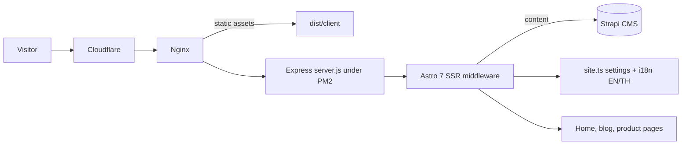

## Summary
### Resume bullets
- Upgraded the company's live website from Astro 5 to Astro 7 and Tailwind 3 to 4, removing
  unused dependencies and checking page layouts against the old build on desktop and mobile.
- Built a Products navigation menu and a bilingual product page for the company's AI
  video-analytics product, with keyboard-accessible dropdowns, a mobile accordion, light and dark
  themes and a datasheet download.
- Added a 7-day minimum release age to the npm and Bun configs and regenerated the lockfiles under
  it, so newly published, possibly compromised packages are not installed.
- Centralised site-wide settings in one typed config and added a switchable mourning mode, with
  the greyscale filter on the root element so fixed elements stay in place.
- Wrote onboarding, project-structure and styling docs and Thai content-update guides for the
  team site, and specified the product menu as tickets before building it.
### Remarks
- B1: traces to the stack-upgrade bullet · a large dependency upgrade with a visual check ·
  shared repo; I did the upgrade, teammates built the site · roles: frontend.
- B2: traces to the products-menu and product-page bullets · shipped to main (PR #41) ·
  the production deploy date is not in git; to confirm · roles: frontend.
- B3: traces to the supply-chain bullet · a security practice, configured not measured ·
  roles: frontend, DevOps.
- B4: traces to the site-settings and mourning-mode bullets · small but shipped ·
  roles: frontend.
- B5: traces to the docs bullet · a README, a deployment guide and an issues file existed
  before; the deployment guide was moved and extended, not written from scratch · use by the
  team to confirm · roles: any.
- `7-day minimum release age`: configured value; B3 quotes it as a setting, not a result.
- `5 s` scroll re-align window: configured value, left out; the hash-scroll fix can be described
  without it.
- Scope caveat: I own about 10% of the repo's commits. The site, its CMS integration, the EN/TH
  language switch, the server and the deployment are teammates' work (see Not mine). Claim the
  upgrade, the product pages and the docs only.
- Scope caveat: most of my commits carry an AI-assistant co-author trailer: the code was written
  with Claude Code.

## Context
The company's live marketing website: an Astro site served by an Express server under PM2 behind
Nginx and Cloudflare, with most content pulled from a Strapi CMS. Teammates started it in
2024-07 and kept it running through 2026. My two commits in 2025-06 are only PR merges.
[website:public 0%] [website:src/components 4%]

On 2026-11-02 I upgraded the stack, added a Products menu and a product page, and wrote the
project docs, all in one PR that I merged to main. Teammates then built a 3D home stage on top of
it. [website@2db74efd2] [TT-1689]

How it relates to `corporate-marketing-website-astro`, from git only: that project was a separate
from-scratch rebuild of this site in 2026-05 and 2026-06, with no shared history and no sign in
git that it replaced this site. This upgrade brought several of its patterns into the live site:
the `@/` import alias, one `src/data/site.ts` settings object, the Astro Font API loader, colour
tokens split into preset files and a greyscale filter with a default of 0.6. The code itself was
not copied across; the upgrade commit names another repo as its layout model.
[website@4855bf9f2] [website@66b6117f8] [website@0714335dd]

## What I Did
- **Upgraded the stack**: Astro 5 → 7, `@astrojs/node` 8 → 11 (still middleware mode behind the
  Express server), the React integration 3 → 7 and Tailwind CSS 3 → 4 through its Vite plugin.
  Removed dependencies that were installed but never loaded (Tailwind and UI plugins, carousel and
  animation libraries, icon packs), moved fonts to the Astro Font API and icons to one library,
  and kept the design and deployment unchanged. [website@4855bf9f2] [website:src/layouts 100%]
- **Kept the old rendering through the Tailwind upgrade**: colours converted to `oklch` tokens in
  preset files, the v3 fluid type scale and desktop-first breakpoints ported into CSS config, v3
  spacing utilities re-created, and classes that were no-ops under v3 removed. Fixed markup the
  new compiler rejected. Checked the result against a build of main: page heights and section
  positions matched on desktop and mobile in both themes. [website@4855bf9f2]
  [website:src/styles 46%]
- **Added a supply-chain guard**: a 7-day minimum release age in `.npmrc` and `bunfig.toml`,
  lockfiles regenerated under the rule, and a deployment note that older npm versions skip the
  setting silently. [website@4855bf9f2] [website:docs/documents 56%]
- **Built a Products menu**: a disclosure in the header (hover with a close delay, click,
  Enter/Space, Escape, click outside, `aria-expanded`), an accordion in the mobile menu, and the
  products defined once in a typed list that both menus render. [website@d0e0e54ce] [TT-1689]
- **Built a product page for the company's AI video-analytics product** from a spec and design
  reference: hero, features, customer references and a closing call to action with a datasheet
  download, in English and Thai through the site's i18n keys (extended to translate image alt
  text), light and dark theme tokens, responsive layout and page metadata. Fixed the Express
  static handler so the product's asset folder did not redirect the page route. Then renamed the
  product across the page, keys and assets, moved the page to the fluid type scale, and aligned
  card text across rows with CSS subgrid. [website@d0e0e54ce] [website@a460358ef]
  [website@0457919a5] [website@bc709b0e3] [website@42c099219] [website:public/products 100%]
- **Fixed in-page links landing in the wrong place**: links to `/#section` jumped once on load
  and ended above the target as images loaded. The page now re-aligns on every body resize until
  the user scrolls, taps or types, or 5 s pass, and also handles same-page hash changes.
  [website@ceea901bf]
- **Centralised site-wide settings** (name, URL, contact details, fallback credential PDF,
  mourning settings) in one `siteConfig`, replacing constants spread across five files, and made
  phone and email clickable. [website@66b6117f8] [website@1aafa3a18] [website:src/data 21%]
- **Added a switchable mourning mode**: a home-page modal and a site-wide greyscale filter, each
  with its own switch, the value clamped to 0–1. The filter sits on `<html>`, because a filter on
  any other element makes `position: fixed` elements scroll with the page. [website@0714335dd]
- **Wrote the project docs**: an onboarding guide, project-structure and styling docs, the
  existing deployment guide moved into `docs/` and extended, Thai guides for updating content
  (CMS or code), the credential PDF and mourning mode, a glossary, and a products-menu spec split into tickets in a local issue tracker. Set up agent
  skills for the repo. [website:docs 100%] [website:docs/content 100%] [website@068d57e28]
  [website@0e9f65801] [website@6921484d4] [website@670365fe6] [website@8d2033f74]

## Numbers
| Value | Scope | Source |
| ----- | ----- | ------ |
| 7 days | minimum package release age before install (configured) | [website@4855bf9f2] |
| 5 s | longest hash-scroll re-align window after load (configured) | [website@ceea901bf] |

No measured outcome (traffic, performance, leads) is in git.

## Tools
tools: Astro 7, @astrojs/node, React, Tailwind CSS 4 (@tailwindcss/vite), TypeScript, Astro
Font API, lucide-react, Express, PM2, Nginx, Cloudflare (as deployed by the team), Strapi (as an
existing content source), npm and Bun configs, Claude Code (agent skills, local issue tracker)
Studied, not used: none recorded

## Architecture

Astro runs as SSR middleware inside an Express server under PM2, behind Nginx and Cloudflare.
Most content comes from the CMS. My work changed the framework versions, the source layout, the
header menu, a new product route, the settings file and the docs. The server, CMS and deployment
were already in place.

## Not mine
- The original site, its sections and assets, built by a teammate from 2024-07.
  [website:public 0%]
- The Strapi CMS integration, the Express server and the PM2 process setup (2025-06), by a
  teammate. [website:src/lib 9%]
- Deployment fixes (2026-06), performance and security fixes for the CMS access (2026-06), the
  EN/TH language switch (2026-08) and the 3D home stage (2026-11, after my PR), by teammates.
  [website:src/i18n 16%] [website:src/components 4%]
- My 2025-06 commits are PR merges of teammates' branches. [website@fedca7cf5]
  [website@a343d01da]

## Open questions
- Was the 2026-11 PR deployed to production, and when? Git shows the merge to main, not the
  deploy.
- Was the upgrade informed by the earlier rebuild (`corporate-marketing-website-astro`)? Git
  shows shared patterns but no shared code.
- Did the docs and Thai content guides get used by the team or content editors?
- Is the product page still live under the product's current name?
- Jira: TT-1689 matches this work (created 2026-11-02, done 2026-11-09). It asks for a
  responsive, bilingual page with a datasheet download in both themes, all present in git.
