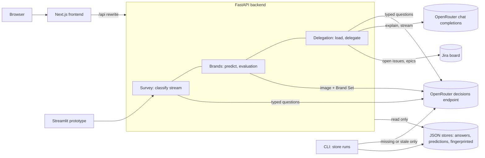

## Summary
### Resume bullets
- Evaluated a vision decision model for retail-shelf brand recognition on 739 labelled product
  crops in 6 categories, reaching 89% top-1 accuracy, with per-brand precision, recall, F1 and
  confusion matrices.
- Compared two vision decision models on the same labelled images: both matched all 44 images
  against a 200-brand choice set, and the second cost about one-ninth as much per image.
- Built an image send policy for a vision model API (resize, JPEG-quality steps, budget halving
  on 413 retries) and fingerprinted prediction stores, so evaluations re-ran only changed images.
- Rebuilt a Streamlit sentiment prototype as a FastAPI and Next.js app classifying Thai
  employee-survey comments with one decision-model call per comment, streamed to the browser as
  NDJSON.
- Prototyped a task-delegation tool: a decision model picks owner, type and severity, code checks
  capacity caps against live Jira load, and a chat model streams the reasoning.
- Prototyped a support-chatbot intent router on a decision model (15 intents plus handoff and
  notify probabilities), matching the expected action on 42 of 43 labelled messages.
### Remarks
- B1: traces to the shelf-survey evaluation, evaluation page and stored-predictions bullets ·
  strongest: a measured result on real client imagery · caveat: one survey's crops, labels
  hand-checked in commits co-written with an AI coding agent (who labelled is to confirm),
  accuracy read with no confidence threshold · outcome: the retail-shelf project then took the
  decision model in as a second brand recognizer (its ADR-10, 2026-11-24), but that port is on
  an unmerged branch there, so say "led to an integration" only, not "deployed" · roles: ML, AI
  infra.
- B2: traces to the model-comparison bullet · cost and latency trade-off with numbers · caveat:
  44 images reused from two small categories; accuracy ties, so do not claim one model is more
  accurate · roles: ML, AI infra.
- B3: traces to the send-policy and stored-predictions bullets · solid engineering with a
  reason (the 413 limit) · no measured saving · roles: backend, AI infra.
- B4: traces to the survey rewrite, Question Set and live-classification bullets · full-stack
  delivery · caveat: the survey data is a fictional 200-response example; no accuracy figure
  exists for sentiment, and the outcome (demoed, adopted) is to confirm · roles: backend, ML.
- B5: traces to the task-delegation bullets · combines rules in code with two models · caveat:
  a recommendation tool never writing to Jira (merged to main 2026-11-23); usage is to confirm ·
  roles: backend, AI.
- B6: traces to the intent-router bullet · caveat: the router was tuned on the same 43 messages
  it is scored on, so the figure is not a held-out accuracy; say "on a labelled test set" only
  with that caveat ready · roles: ML, AI.
- `74%–96% per category`: left out of bullets; the pooled 89% says it. Use the range when asked
  where the model struggles (soft drinks, 20 brands, lowest).
- `~$0.0005 per image`: left out; cost per call is a vendor price, not a result. Phrase as
  "costed each prediction" if needed.
- `1.9 s vs 0.6 s median latency`: left out to keep B2 at two numbers; usable instead of the
  cost figure for a latency-focused role.
- `239 KB passed, 594 KB failed`: an informal observation that motivates B3, not a result.
- `8 concurrent calls`, `5-minute board cache`, `500 responses per upload`: configured values;
  B4 and B5 describe the design without them.
- Scope caveat: an internal R&D repo re-applying hosted decision models to earlier projects'
  problems; no production deployment is in git. 159 of 163 authored commits carry an AI
  coding-agent co-author trailer.

## Context
An internal R&D project at a Thai software consultancy: try "decision models", hosted models on
OpenRouter's decisions endpoint that answer typed questions (a choice with per-option
probabilities and a confidence, a score, a probability), on problems from the company's earlier
projects. One repo holds four experiments:
- **Survey sentiment**: classify Thai employee-survey comments (overall sentiment, polarity,
  attrition risk, follow-up flag, sentiment per topic), first as a Streamlit app, then rebuilt
  as FastAPI + Next.js.
- **Chatbot intent routing**: a prototype router for a customer-support chatbot (another
  project) [TT-1594].
- **Brand recognition**: which brand a product image shows, measured on labelled images, for a
  retail-shelf analytics product (another project) [TT-1583].
- **Task delegation**: recommend who in the tech team should own a new task, following the
  team's written role charter and current Jira load.

The repo is a single-developer project (164 of 164 commits mine, one a merge; 100% of blame on every area).
The commits record that the work ran through specs and vertical-slice tickets kept in the repo
(`.scratch/<feature>/`), and 159 of the 163 non-merge commits carry an AI coding-agent co-author trailer.
Survey and brand recognition were merged to `main` on 2026-10-05; task delegation (2026-10-08 ~
10-09) and the shelf-survey evaluation (2026-11-23) were merged on 2026-11-23 through a pull
request. A report on the new shelf images and the decision-model result was filed for review
the same day [TT-1772]. The next day, the retail-shelf project ported the decision-model client
and imported these brand sets as a second brand recognizer (that project's evidence file).
[sentiment-classifier@372ae96] [sentiment-classifier:backend/src 100%]
[sentiment-classifier:frontend/src 100%] [TT-1543]

## What I Did
- **Built the first sentiment prototype in Streamlit**: one decision-model request per comment
  asks every question in parallel (overall sentiment, polarity, attrition risk, needs-follow-up,
  and a per-topic sentiment with a `not_mentioned` option for seven topics), with per-topic
  confidence and the request JSON shown on the page. [sentiment-classifier@0170694]
  [sentiment-classifier@1fd3da5] [sentiment-classifier@0c94e88] [TT-1543]
- **Wrote the spec and rebuilt the tool as a FastAPI backend and Next.js frontend**, keeping the
  Streamlit app runnable as a prototype on the same domain code. Domain logic sits in a package
  with no web imports (a test enforces it); thin routers and separate Pydantic wire schemas sit
  on top; frontend types are generated from the backend's OpenAPI schema.
  [sentiment-classifier@f52b901] [sentiment-classifier@28153f2] [sentiment-classifier@15e9b3a]
  [sentiment-classifier@20fdb50] [sentiment-classifier:backend/src 100%]
- **Moved the question wording into a validated JSON Question Set**: topics are added or removed
  by a data edit, a broken core question stops the backend at start with the offending field
  named, and the set's fingerprint invalidates stored answers. The move kept the old fingerprint,
  so no stored answer had to be re-requested. [sentiment-classifier@0cf7269]
  [sentiment-classifier@d93742c]
- **Built live classification for uploaded surveys**: `POST /api/classify/stream` runs up to 8
  calls at once and streams one NDJSON line per comment in completion order; one failed call
  becomes that comment's error line; uploaded comments are never written to disk. The dashboard
  fills in as lines arrive. [sentiment-classifier@0615a1e] [sentiment-classifier@189fe22]
- **Built the survey dashboard**: sentiment by department and tenure, a per-topic drivers table
  (net sentiment, confidence), diverging stacked bars, attrition and follow-up lists, threshold
  sliders applied in the browser, and CSV export, over a fictional 200-response example survey.
  [sentiment-classifier@131684a] [sentiment-classifier@0055888] [sentiment-classifier@38cecd6]
- **Made the model provider swappable**: one request body sent either to OpenRouter over plain
  httpx or to the model vendor's LangChain client, behind one interface; OpenRouter is the
  default. [sentiment-classifier@c7b45d8] [sentiment-classifier@59d633a]
- **Prototyped a chatbot intent router on a decision model**, modelled on the support chatbot's
  existing router: one call per message answers the intent (15 intents, each mapped to an answer
  prompt), a hand-off-to-staff probability and a notify-staff probability. Tuned the criteria on
  43 labelled messages and added a rule that the fraud intent always hands off; the commits
  record the expected action on 42 of 43. [sentiment-classifier@e906552]
  [sentiment-classifier@1973b38] [sentiment-classifier@f935448] [sentiment-classifier@008fc8f]
  [TT-1594]
- **Built a brand-recognition client for a vision decision model (Cloudflare Clef)**: the image
  goes as a JPEG data URL inside chat-style state parts, because OpenRouter drops the vendor's
  documented `images` field; the Brand Set becomes one choice question with a description per
  brand and an `other` option. [sentiment-classifier@f0037e8] [sentiment-classifier@a172199]
  [sentiment-classifier:backend/src 100%] [TT-1583]
- **Designed the image send policy** after finding the vendor rejects requests (413) from an
  estimate based on image bytes: images become RGB JPEGs within 720 px, JPEG quality steps down
  and then the size halves to fit a 200 KB budget, and each 413 halves the budget and retries,
  up to 4 attempts. [sentiment-classifier@26f50da]
- **Built fingerprinted prediction stores**: one file per model and category, each entry keyed
  by a hash of model, question, Brand Set, image bytes and send policy, so a CLI run sends only
  missing or stale images, records each failure without stopping, and reports the run's cost.
  The evaluation pages never call the model. [sentiment-classifier@4ba94b3]
  [sentiment-classifier@8e04936]
- **Built the evaluation pages**: accuracy and cost summary, per-image table, per-brand
  precision, recall and F1, macro-F1, a confusion matrix, mean confidence, and a confidence
  threshold below which a prediction counts as "unsure" (and wrong).
  [sentiment-classifier@53bb826] [sentiment-classifier@bcd9f8a] [sentiment-classifier@ac34c12]
- **Compared a second vision decision model (Perplexity's decider) against Clef** on the same
  labelled images, including a 200-brand Brand Set built to test a large choice list (see
  Numbers). [sentiment-classifier@6ad7f65] [sentiment-classifier@48ebf07]
  [sentiment-classifier@0063b1d] [sentiment-classifier@ff3bd0f]
- **Evaluated Clef on a real shelf survey**: imported 1,015 product crops exported from the
  retail-shelf app, grouped them into six category folders, labelled every identifiable crop
  (739 kept; shelf tags, backs of packs and blurry shots left out) with brand descriptions, stored
  Clef's predictions, and added a survey page pooling every category's evaluation.
  [sentiment-classifier@1da1a41] [sentiment-classifier@87405d5] [sentiment-classifier@d73dc33]
  [sentiment-classifier@6e8fb0a] [sentiment-classifier@a47ea01] [TT-1772]
- **Built a task-delegation tool from a written role charter**: the team's Jira board is read
  through the Jira REST search (paged, cached for 5 minutes) into each member's load (projects
  held against a capacity cap, open issues); a decision model answers four typed questions
  (task type, severity, owner, reviewer) whose wording follows the charter and lives in a data
  file. [sentiment-classifier@7be45b4] [sentiment-classifier@dfc6741]
  [sentiment-classifier@e5778b7] [sentiment-classifier@aa9ca4a]
- **Kept the charter's hard rules in code, not in a model**: over-cap, senior-time booking,
  unclear task type, load unavailable and an always-on independent-review reminder are checked
  without any model and shown beside the recommendation. [sentiment-classifier@a0369db]
- **Streamed a chat model's explanation after the decision**: the delegation streams as NDJSON;
  a second, chat model then explains it in Thai citing charter sections, and ends with a marker
  and JSON verdict that a stream reader splits off to show a "disagreement" when the model
  judges the decision breaks a rule; a malformed verdict reads as none. Both models are picked
  from suggestions or typed and checked against OpenRouter.
  [sentiment-classifier@85bec90] [sentiment-classifier@f3b7326] [sentiment-classifier@fe2d519]
- **Set supply-chain guards**: bun, npm and uv refuse package releases younger than 7 days,
  with a documented per-package exemption. [sentiment-classifier@15e9b3a]

## Numbers
| Value | Scope | Source |
| ----- | ----- | ------ |
| 89% top-1 accuracy (661 / 739) | Clef on hand-labelled product crops from one retail-shelf survey, 6 categories of 6–65 brands, no confidence threshold (measured; computed from the stored predictions at the verified sha) | [sentiment-classifier@6e8fb0a] [sentiment-classifier@d73dc33] |
| 74%–96% per category | same run: soft drinks (20 brands) lowest, body care (41 brands) highest (measured) | [sentiment-classifier@6e8fb0a] |
| 44 / 44 both models | 200-brand Brand Set, 44 images reused from the drinks and canned-fish categories, Clef vs Perplexity decider (measured) | [sentiment-classifier@ff3bd0f] |
| $0.080 vs $0.009 for 44 images | same run, cost as OpenRouter reported it (measured) | [sentiment-classifier@ff3bd0f] |
| 1.9 s vs 0.6 s median latency per image | same run (measured, from stored latencies) | [sentiment-classifier@ff3bd0f] |
| 31 / 31 vs 30 / 31 | drinks category, 17 brands, Clef vs Perplexity decider (measured) | [sentiment-classifier@0063b1d] |
| ~$0.0005 per image | Clef, shelf-survey run of 739 images, ~$0.40 in total (measured) | [sentiment-classifier@6e8fb0a] |
| 239 KB passed, 594 KB failed | JPEG size that the vision model's 413 check accepted vs rejected (observed, informal) | [sentiment-classifier@26f50da] |
| 42 / 43 expected action | intent router on 43 labelled chatbot messages, the same set used to tune it (measured, not held out) | [sentiment-classifier@008fc8f] |
| 200 survey responses | fictional example survey used by the dashboard (configured data) | [sentiment-classifier@0055888] |
| 8 concurrent calls, 500 responses per upload | live classification limits (configured) | [sentiment-classifier@0615a1e] |
| 5-minute cache | Jira board reuse between delegations (configured) | [sentiment-classifier@7be45b4] |

## Tools
tools: Python, uv, FastAPI, Pydantic, httpx, Pillow, LangChain (`langchain-core` and the model
vendor's client), Streamlit, pandas, pytest, OpenRouter (decisions endpoint and chat completions,
SSE streaming), Cloudflare Clef, Perplexity decider, GPT Luna decisions, Claude Haiku, Jira REST
API, NDJSON streaming, TypeScript, Next.js (App Router), React, Tailwind CSS v4, TanStack Charts,
openapi-typescript, bun, ESLint, just, ruff
Studied, not used: none recorded

## Architecture

One backend serves three bounded contexts, each split the same way across domain, routers and
schemas, with the OpenRouter client shared. Live paths (survey upload, Try pages, delegation)
call the models and stream NDJSON to the browser without writing anything. Stored answers and
predictions are written only by CLI runs and read by the dashboards and evaluation pages, which
never call a model.

## Not mine
- The decision models themselves (Clef, the Perplexity decider, the text decision model used
  for sentiment, GPT Luna decisions) and the chat models are third-party hosted models.
- The 1,015 shelf crops came from the retail-shelf app (another project), with that app's
  logo-match brand names as first-draft labels. [sentiment-classifier@87405d5]
- The intent router follows the support chatbot's existing router, built in another project.
  [sentiment-classifier@e906552]
- The role charter was written by the team, not built here. [sentiment-classifier@7802825]

## Open questions
1. Who labelled the 739 shelf crops: you by eye, or an AI agent with your review? The commits
   say "hand-label" and carry an AI co-author trailer.
2. The repo was built ticket by ticket with an AI coding agent (159 of 163 commits carry its
   co-author trailer). How do you want that described: as your workflow, or not at all?
3. Partly answered by git (2026-11-24): the retail-shelf product's ADR-10 records that
   management decided to run the decision model beside the logo matcher, on an unmerged branch
   there. Did the shelf-survey report (TT-1772) drive that decision, and was it shown to the
   client?
4. Was the sentiment tool demoed to a client or used on a real survey, or did it stay an
   internal demo on the fictional data?
5. The task-delegation branch was merged to main on 2026-11-23. Is the tool used by the team?
6. Did the intent router go into the support chatbot? Ticket TT-1594 says an intent router via a
   decision model was implemented there; is that this prototype's design?
7. Who asked for this R&D (a lead, a client) and was it presented anywhere?
