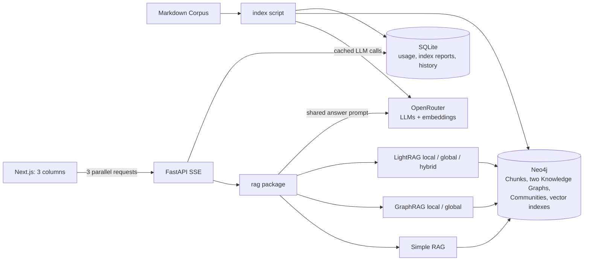

## Summary
### Resume bullets
- Built a research prototype that compares Simple RAG, GraphRAG and LightRAG side by side over
  one Neo4j-backed corpus, holding chunks, embeddings, LLMs, prompt and an 8k-token context
  budget constant.
- Implemented GraphRAG from its paper without the official library: LLM entity extraction with
  gleaning, hierarchical Leiden communities, community reports, and local and map-reduce global
  query modes.
- Implemented LightRAG's dual-level retrieval: question keyword extraction, entity- and
  relationship-level vector search in Neo4j, and local, global and hybrid query modes fitted to a
  shared token budget.
- Built an indexing pipeline with a disk cache of LLM calls keyed by model and prompt, 1–8
  worker threads, live progress, and per-call token and cost tracking in SQLite.
- Built a FastAPI and Next.js comparison UI that streams three answers in parallel over
  Server-Sent Events, with each strategy's retrieved context, a knowledge-graph browser and a
  scored question history.
- Analysed indexing at 100k-chunk scale, estimating about $255 of GraphRAG extraction cost, and
  proposed range indexes, windowed embedding writes and a streaming merge.
### Remarks
- B1: traces to the fair-comparison design and Neo4j storage bullets · the clearest framing of
  the project's purpose · research prototype on an unmerged branch, no user or adoption outcome;
  outcome to confirm · roles: AI infra, ML, backend.
- B2: traces to the GraphRAG bullet and the ADR bullet · shows depth on graph-based retrieval ·
  a partial implementation (no claims, no `drift` mode); results describe this implementation,
  not the official library · roles: ML, AI infra.
- B3: traces to the LightRAG bullet · pairs with B2; merge with it for a short resume · no
  `naive`/`mix` modes or incremental indexing · roles: ML, AI infra.
- B4: traces to the indexing-run and usage bullets · solid engineering for costly LLM pipelines ·
  thread counts are configured, not measured speed-ups · roles: AI infra, backend, data.
- B5: traces to the API and frontend bullets · full-stack breadth · no frontend tests; local
  single-user app with no auth · roles: backend, full stack.
- B6: traces to the indexing-at-scale record bullet · the $255 and 35 h are estimates
  extrapolated from one measured per-chunk cost, and the changes were proposed, not built: write
  "estimated" and "proposed" · roles: AI infra, data.
- Every commit carries an AI coding-agent co-author trailer. Claim the design, specification and
  decisions; how much code was hand-written is to confirm before using "implemented" in an
  interview context.
- No answer-quality result exists in git: the 0–3 star scores live in a local SQLite file, not
  the repo. Do not claim which strategy won. A finding is to confirm.
- `$0.00255 per Chunk`: quoted only inside B6's estimate; on its own it is one log line.
- `1–8 threads`, `1,200/100-token Chunks`, `8k budget`, `3,072-dim embeddings`, `Community size
  10`: configured values; B1 and B4 use two of them as design facts, not results.
- `12 topic corpora, 91 documents`: test data generated with an AI research skill from public web
  sources; describes the test bed, not a client dataset. Leave out or write "a multi-topic test
  corpus".
- Scope caveat: about one week of work, done as internal R&D; status wip.

## Context
An internal research prototype for comparing retrieval-augmented generation (RAG) strategies.
The problem, as the spec states it: papers claim Simple RAG, GraphRAG and LightRAG each win on
some kinds of questions, but a fair check needs the same question asked of all three over the
same corpus, with chunks, models, prompt and context size held constant, and with each
strategy's retrieved context visible. The deliverable is a local web app: one question box, three
streaming answer columns, and an offline indexing script. The test corpus is 12 public-topic
corpora (history, science, food, software) of 91 English Markdown documents, written with an AI
research skill from web sources. All feature work lives on the unmerged branch
`feat/rag-comparison`; `main` holds only the scaffold and the spec.
[rag-research:.scratch/rag-comparison 100%] [rag-research:data 100%] [rag-research@8ac80220f]

## What I Did
- **Specified the comparison for fairness**: a spec with 48 user stories, a glossary, an ADR and
  10 tickets. Every strategy shares the same Chunks (1,200 tokens, 100 overlap, `cl100k`), one
  embedding model, one indexing LLM, one answering LLM, one answer prompt and one ~8k-token
  Retrieved Context budget, so the remaining differences come from the architecture.
  [rag-research@8ac80220f] [rag-research:.scratch/rag-comparison 100%] [rag-research:docs/adr 100%]
- **Decided to implement every strategy from the papers instead of the official GraphRAG and
  LightRAG libraries** (ADR-0001): the libraries bring their own storage, chunking and prompts and
  hide their retrieved context. Trade-off recorded: results describe this implementation, not the
  libraries, and only part of each paper is built. [rag-research:docs/adr 100%]
- **Stored everything in one Neo4j instance**: shared Chunk nodes, each strategy's graph under its
  own labels (Community Edition allows one database), and native vector indexes over Chunks,
  Entities and LightRAG Relationships, so one Cypher query runs the vector lookup and the graph
  expansion. [rag-research:backend/packages 100%] [rag-research@9effa80f7] [rag-research@8d815a70e]
- **Built Simple RAG as the control**: embed Chunks, vector top-k, fill the budget in similarity
  order, counting the budget as the rendered prompt text. [rag-research@8d815a70e]
  [rag-research@487e50de9]
- **Built GraphRAG indexing and querying**: entity and relationship extraction with the paper's
  prompts and one gleaning round, merge by normalised name with LLM description summaries,
  hierarchical Leiden (`graspologic-native`, max Community size 10, fixed seed) over the largest
  connected component, one LLM Community Report per Community, a `local` mode (Entities →
  Relationships, Chunks and Community Report summaries) and a `global` mode that map-reduces over
  Community Reports at a configured level. [rag-research@8ce4af136] [rag-research@679d018f8]
  [rag-research@c0c5c2d16] [rag-research@9ce1fb29c]
- **Built LightRAG indexing and querying**: extraction of Entities, Relationships and
  relationship keywords with LightRAG's prompts, embeddings of both, LLM extraction of low- and
  high-level keywords from the question, and `local` (Entity match), `global` (Relationship match)
  and `hybrid` (interleaved, deduplicated) modes fitted to the shared budget.
  [rag-research@41cedc84f] [rag-research@be3855165]
- **Built the indexing run**: every indexing LLM call goes through an atomic on-disk cache keyed by
  model and prompt, so a crashed or repeated run never pays twice; a step's independent calls fan
  out on 1, 2, 4 or 8 threads with results kept in Chunk order; progress shows per-phase bars,
  cache hits and cost; an interactive script picks strategies and corpus folders.
  [rag-research@ed420d38e] [rag-research@8f6f0b5eb] [rag-research@fe39dd070]
  [rag-research@5d567c421] [rag-research:backend/scripts 100%]
- **Kept stale graphs from serving answers**: re-indexing compares the stored Chunks with the new
  ones and clears every other strategy when they differ, so its column reports "not indexed".
  [rag-research@81c845069]
- **Tracked tokens and cost per model call** (indexing and answering, from OpenRouter) and moved
  question history, index reports and usage from Neo4j to SQLite (ADR-0002): plain SQL for cost
  and score queries, and clearing the graph never touches the records; WAL and a busy timeout for
  concurrent writes. [rag-research@949fb0c20] [rag-research@3b87cfd16] [rag-research@c4e5ef9b9]
  [rag-research:docs/adr 100%]
- **Built the FastAPI layer**: `POST /comparisons/{strategy}` streams context, token, done and
  error events as Server-Sent Events, with typed 4xx errors for unknown strategies or Query Modes
  before streaming, a 503 naming a missing env variable, and endpoints for example questions,
  graph browsing, history and models. The `rag` package takes injected settings (LLM, embedder,
  Neo4j driver) and never reads `.env`. [rag-research:backend/apps 100%] [rag-research@ee69654c4]
  [rag-research@6a196b392] [rag-research@70d6b19d8]
- **Built the Next.js frontend** (Tailwind, shadcn): three columns that stream in parallel and
  re-run one at a time, Query Mode and answering-model pickers (any OpenRouter model), latency,
  tokens and cost per answer, a Retrieved Context view, a Retrieved Graph view, Explore pages to
  browse each Knowledge Graph and its Communities, and a history table with 0–3 star scoring.
  [rag-research:frontend/src 100%] [rag-research@abde146fb] [rag-research@156281637]
  [rag-research@ce48b35b9] [rag-research@a074d5e1b]
- **Made answers cite their sources**: the shared answer prompt cites Retrieved Context items as
  `[N]` and declines when the context lacks the information. [rag-research@d8be2ff78]
- **Tested through the public interface**: `index` and `answer` run against a fixture corpus on a
  throwaway Neo4j, with deterministic fake LLM and embedding clients, plus thin FastAPI
  `TestClient` tests of the SSE format. [rag-research@224b8fe69] [rag-research:backend/packages 100%]
- **Built the test corpus tooling**: an agent skill that researches a topic on the web into a new
  Corpus folder with sources, and example questions tagged specific, multi-hop or big-picture to
  probe where vector or graph retrieval should win. [rag-research@57ca18540]
  [rag-research@a96c34e09] [rag-research@8b48954dd]
- **Analysed indexing at scale (10k+ files, 100k+ Chunks)** in a discussion record: found that
  entity embeddings held as Python float lists would exceed RAM first, that Neo4j writes lacked
  range indexes, and estimated cost and time from a measured per-Chunk cost; compared the design
  with the official GraphRAG and LightRAG pipelines and proposed ordered changes (constraints,
  windowed embed-and-write, float32 vectors, a streaming merge). Proposed only, not built.
  [rag-research@e51e31524]
- **Wrote the docs**: onboarding guide, project-structure design and an HTML indexing manual.
  [rag-research:docs/documents 100%] [rag-research@b52fdb1e6]

## Numbers
| Value | Scope | Source |
| ----- | ----- | ------ |
| ~$0.00255 per Chunk | GraphRAG extraction cost, 2 indexing-LLM calls on one Chunk (measured, one log line) | [rag-research@e51e31524] |
| ~$255 and ~35 h | GraphRAG extraction for 100k Chunks on 8 threads (estimated from the per-Chunk figure) | [rag-research@e51e31524] |
| 10–30 GB | entity embeddings held in memory at 100k Chunks (estimated) | [rag-research@e51e31524] |
| 1,200 / 100 tokens | Chunk size and overlap, `cl100k` (configured) | [rag-research:backend/packages 100%] |
| ~8,000 tokens | shared Retrieved Context budget (configured) | [rag-research:backend/packages 100%] |
| 1, 2, 4 or 8 threads | indexing concurrency (configured) | [rag-research@8f6f0b5eb] |
| 12 corpora, 91 documents | test corpus (dataset size) | [rag-research:data 100%] |

## Tools
tools: Python, uv (workspace), FastAPI, Server-Sent Events, Neo4j (Community Edition, vector
indexes, Cypher), graspologic-native (hierarchical Leiden), tiktoken, httpx, OpenRouter (Claude
Haiku for indexing, Claude Sonnet for answers, Gemini embeddings), SQLite, pytest, tqdm,
questionary, Docker Compose, just, TypeScript, Next.js, React, Tailwind CSS, shadcn, Bun, Claude
Code (AI coding agent with agent skills)
Studied, not used: the official GraphRAG and LightRAG libraries (read as references, ADR-0001);
Neo4j GDS Leiden (planned fallback, not needed)

## Architecture

Indexing is an offline script: it chunks the Corpus once, then builds each strategy's index in
Neo4j under its own labels. At question time the frontend opens one SSE request per strategy;
each streams its Retrieved Context, then answer tokens, then latency, tokens and cost. Every model
call and every answer is recorded in SQLite.

## Not mine
- The vendored agent skills under `.agents/skills` and `.claude/skills` (except
  `research-data-for-rag`) come from a public skills collection pinned by version.
  [rag-research@6375588b7]
- Frontend scaffold files from `create-next-app` and shadcn UI components. [rag-research@507df2aa3]

## Open questions
- Every commit carries an AI coding-agent co-author trailer. Which parts did you write or review by
  hand, and how do you want to describe the agent's role?
- Did you reach a finding on which strategy answers which kinds of question better (specific,
  multi-hop, big-picture)? The star scores are in a local database, not in git.
- Was this for a client, a pre-sales study or internal learning, and did anyone else use the app
  (it can be shared on the LAN)?
- The branch was never merged to `main`. Is it finished, paused or dropped? Were the proposed
  scale changes ever built?
- What did a full index of the 12-topic corpus cost and how long did it take, per strategy?
  (Index reports are kept in SQLite, not in git.)
- Jira: no ticket matched the internal name, the repo name, "GraphRAG" or "LightRAG". Was the work
  tracked anywhere?
