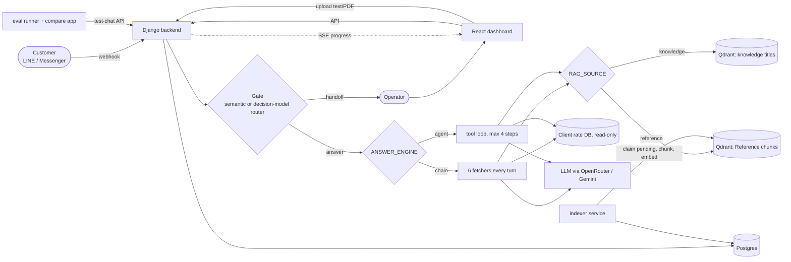

## Summary
### Resume bullets
- Built a second RAG knowledge source for a human-in-the-loop support chatbot: operator text/PDF
  upload, a background indexer chunking and embedding into Qdrant, live SSE progress, and
  generation-safe re-indexing.
- Evaluated the new retrieval against the existing knowledge base on the client's test questions
  before switching (recall@1 56.8% vs 91.3%) and kept it behind a default-off switch with
  one-variable rollback.
- Prototyped an agent answer engine (tool loop over the existing rate, branch and knowledge
  resolvers) beside the fixed chain, keeping must-not-fail rules in code: step cap, admin
  handoff on failure, reply guardrails.
- Built chatbot evaluation tooling: a runner executing the client's 633-case multi-turn test set
  with concurrency and resume, and a React/TypeScript app comparing runs and grading answers.
- Moved the Django backend from WSGI to ASGI (gunicorn + uvicorn workers), chosen over a threaded
  WSGI server because long-lived SSE connections would exhaust its thread pool.
- Audited the client's rate database read-only before building on it, found three client bugs
  and data contradicting the client's own answers, and limited the source to rate numbers.
### Remarks
- B1: traces to the Reference subsystem bullet · end-to-end ownership (model, indexer, API, UI) ·
  its retrieval was measured weaker and left off (see B2), so do not imply it serves customers ·
  roles: AI, backend.
- B2: traces to the measure-before-switching bullet and the reversible-switch bullet · strongest
  judgement signal: a negative result acted on, not hidden · the number shows the new work
  losing, so frame the bullet around the decision · roles: AI, ML.
- B3: traces to the agent answer engine bullet · design trade-off recorded as an ADR · lives on a
  feature branch, production use unconfirmed, no agent-vs-chain result recorded, so it reads as
  prototyped · roles: AI, backend.
- B4: traces to the evaluation tooling bullet · 633 cases is the suite's scale, not a pass rate ·
  feature branch, merged to `dev` by a teammate · roles: AI, ML, backend.
- B5: traces to the ASGI bullet · infra reasoning with a rejected alternative · no latency or
  load figure · roles: backend.
- B6: traces to the data audit bullet · shows checking data before building · audit, not code ·
  roles: data, backend.
- The banknote feature, prompt v13, decision-model routing and dashboard model configuration are
  in What I Did but not in a bullet; swap one in if a role asks for prompt or routing work.
- `recall@3 98.8% vs 79.9%`, `174 shared cases: 90.8% → 56.3%`: left out to keep B2 to one
  figure; use the shared-case figure if asked how the comparison was kept fair.
- `prompt v13 vs v12: 6/6 vs 0/4, ~300 vs 1,300–1,800 chars`: left out; 6 questions over 2–3
  runs is too small a sample. Say "revised the system prompt and checked it against the old one
  on banknote questions".
- `banknote recall@1 95.5% unchanged`: a no-regression check, not an outcome; leave out.
- `6,787 cached vs 683 new prompt tokens`: single runs, caching not guaranteed; leave out.
- `~25 branches, ~40 currencies`: client business scale, rounded; may go in a project line
  ("for a currency-exchange chain with ~25 branches") rather than a bullet.
- Scope caveat: joined a running POC in 2026-09 that teammates started in 2026-03; status wip;
  nothing confirms which of the switches were turned on in production.

## Context

A customer-support chatbot for a currency-exchange retail chain with about 25 branches. It
answers customers on LINE and Facebook Messenger (branch info, live exchange rates, banknotes,
booking requests, travel questions) and is **human-in-the-loop**: operators watch every
conversation in a React dashboard and can take a chat over from the bot at any time.

The backend is Django 5.2 + DRF, with Postgres, Qdrant (vector search), Redis (shared cache)
and LLMs through OpenRouter / Gemini, traced in Langfuse. Live rates come read-only from the
client's own rate database over VPN. The project began before I joined (first commits by
teammates 2026-03); I joined in 2026-09 when it was a running POC being hardened for production.

Citation paths: `chatbot` is the single repo; `backend/` stands for its Django project folder.

## What I Did

- **Built the Reference subsystem, a second RAG knowledge source.** Operators paste text or
  upload a PDF; a background `indexer` service claims pending documents, chunks them
  (paragraph → sentence → space breaks, 800 chars, 100 overlap), embeds and upserts them into
  Qdrant, and the dashboard shows indexing progress live over Server-Sent Events. Supports
  edit, active/inactive switch, re-index with different chunking, full rebuild, delete with
  every chunk, and chunk inspection. Re-indexing writes a new `generation` so old and new
  chunk sets never mix while a document is re-cut.
  [chatbot@799a188] [chatbot@7d21593] [chatbot@440269c] [chatbot@ad4673b] [chatbot@0a5a8cc]
  [chatbot:backend/webhook/views/rag_resource.py 90%] [chatbot:backend/webhook/views/dashboard/rag_resource_admin.py 82%]
  [chatbot:backend/webhook/rag_chunker.py 100%] [chatbot:frontend-react/src/components/ReferencePage.jsx 69%]
- **Retrieval for the Reference source behind a reversible switch.** `retrieve_context` reads
  `RAG_SOURCE` per call and picks the old knowledge path or the Reference path; both return the
  same context shape, so the system prompt is unchanged and rollback is one env var with no
  re-index. Reference retrieval keeps the best chunk per document, applies a score tiebreak,
  widens the hit with ±2 neighbour chunks from the same generation, de-duplicates the overlap,
  and never raises (a failure returns empty context). Tested against a real in-memory Qdrant
  with vectors built so each score is exact.
  [chatbot@148dc06] [chatbot@de79474] [chatbot:backend/webhook/tests/test_rag_reference_context.py 100%]
- **Measured the new retrieval against the old one before switching, and kept it off.** Wrote
  `rag_resource_eval` and a relabelled test set, ran old vs new on the same question pool, and
  found the new source much weaker (see Numbers), mainly from short "magnet" articles that
  attract unrelated questions and from right/wrong score distributions that overlap. Trade-off
  recorded: the switch ships default-off and the production threshold is not reused.
  [chatbot@cf92762] [chatbot@7b0f70f] [chatbot@12210d9] [chatbot:backend/webhook/management/commands/rag_resource_eval.py 100%]
- **Turned the knowledge base into atomic markdown content** that seeds the Reference
  collection on boot, splitting reply scripts from factual content, and built a prototype
  page that scans article pairs by embedding similarity and has an LLM flag conflicting or
  duplicate articles.
  [chatbot@a2039fd] [chatbot@d03ddba] [chatbot@b1cc7ea] [chatbot@91c5743] [chatbot:backend/webhook/data 92%]
- **Audited the client's rate database and the bot's data sources** (read-only) before
  building on them: most tables the plan relied on were empty, three bugs were found in the
  rate-DB client, and the rate data contradicted the client's own answers on per-branch
  currency availability. This drove the decision that the rate DB supplies rate numbers only.
  [chatbot:docs/records/2026-09-03-rate-db-audit.md 100%] [chatbot:docs/records/2026-09-09-data-conflict-audit.md 100%]
  [chatbot:docs/adr/0006-rate-db-is-exchange-only.md 100%]
- **Moved the backend from WSGI `runserver` to ASGI** (daphne in dev, gunicorn + uvicorn
  workers in prod), chosen over a threaded WSGI server because long-lived SSE connections
  would exhaust a WSGI thread pool; mode is derived from the existing debug flag, and the
  Postgres connection budget per worker was checked before raising workers to 2 on a shared
  Redis cache. [chatbot@18555b2] [chatbot@7dcff84] [chatbot@365309a]
  [chatbot:docs/adr/0007-serve-backend-over-asgi.md 100%]
- **Banknote data feature end to end**: a Banknote table, seed command, dashboard admin page,
  context block for the prompt, and follow-up questions that resolve the currency from chat
  history; plus a system-prompt revision (v13) tuned through three rejected drafts and
  measured against v12 (see Numbers).
  [chatbot@262da9e] [chatbot@78a281f] [chatbot@e48126f] [chatbot@96336a1]
  [chatbot:backend/webhook/views/banknotes.py 100%] [chatbot:backend/webhook/tests/test_banknotes.py 100%]
  [chatbot:docs/records/2026-09-21-system-prompt-v13-vs-v12.md 100%]
- **Decision-model routing.** Prototyped a page that routes a message with its conversation
  history through several hosted decision models side by side (intent, handoff and notify
  probabilities, threshold sliders, testbook cases), then added it to the backend as a
  selectable gate (`ROUTER_TYPE`) next to the existing semantic router, and changed the history
  it receives to a structured form with timestamps and events.
  [chatbot@5544888] [chatbot@7cb1a09] [chatbot@ef7cd19] [chatbot@1ffa003] [chatbot@ae4d0d7]
  [chatbot:backend/webhook/views/decision_router.py 100%] [chatbot:prototype/lib/routing 100%]
- **Model configuration from the dashboard**: operators pick the chat, decision and vision
  models without a redeploy. [chatbot@d8d07c0] [chatbot@47afd07]
  [chatbot:backend/webhook/views/model_config.py 100%] [chatbot:frontend-react/src/components/ModelConfigPage.jsx 100%]
- **Agent answer engine (tool loop) beside the existing chain.** Compared the fixed chain
  (keyword-decided, 6 fetchers every turn) with an agent that chooses tools itself, first in a
  Streamlit prototype with a message and prompt-cache inspector, then in the backend on the
  `tau-ai` loop: tools wrap the chain's own resolvers (rates, best rate, branches, banknotes,
  holidays, knowledge search, web search), selected by `ANSWER_ENGINE` with the chain kept as
  fallback. Must-not-fail rules stay in code, not the prompt: rate DB down → admin, all tools
  failed → admin, step cap (4) → admin, guardrails check the reply against tool results.
  Recorded as an ADR that supersedes the team's earlier "no agent loop" decision.
  [chatbot@52091f7] [chatbot@882744b] [chatbot@dd1b0df] [chatbot@ae9ab66] [chatbot@18004cd]
  [chatbot:backend/webhook/agent 94%] [chatbot:prototype/lib/bot/agent 100%]
  [chatbot:docs/adr/0009-agent-answer-engine.md 100%]
- **Chatbot evaluation tooling.** A runner that imports the client's test workbook into case
  files, sends every case (multi-turn, with history built like the dashboard) to the test-chat
  API with concurrency and resume, and writes versioned runs; plus a React + TypeScript compare
  app that shows N runs as columns, grades answers pass/fail/unsure (singly or in bulk),
  expands full tool traces, imports old answer columns, and shows LLM agent reviews per topic.
  [chatbot@2aebad7] [chatbot@9ee0374] [chatbot@1105213] [chatbot@e479a50] [chatbot@642737f] [chatbot@312a88b]
  [chatbot:backend/evaluation 100%]
- **Nearest-station tool (in progress)**: a rail-station graph and name resolver so the agent
  can answer "which branch is near station X". [chatbot@935a2c4] [chatbot@36f6486] [chatbot@727c1d0]
  [chatbot:backend/webhook/agent/tools/station_nodes.py 100%]
- **Project documentation and onboarding**: onboarding map, deploy guide, technical and
  routing manuals, retrieval and evaluation guides, ADRs and discussion records.
  [chatbot:docs/documents 87%] [chatbot:docs/records 89%] [chatbot@8ed5fcd]

## Numbers

| Value | Scope | Source |
| ----- | ----- | ------ |
| Retrieval recall@1: old knowledge base 91.3% (241 cases) vs new Reference source 56.8% (234 cases); recall@3 98.8% vs 79.9% | Measured. Single-turn RAG questions from the client's test set (319 pooled; each side scored only where its labels exist), local stack, 2026-09-21 | [chatbot:docs/records/2026-09-21-rag-eval-old-vs-new.md 100%] [chatbot@5765be9] |
| On the 174 cases scorable by both: recall@1 90.8% → 56.3% (66 regressed, 6 improved) | Measured, same run | [chatbot:docs/records/2026-09-21-rag-eval-old-vs-new.md 100%] |
| Prompt v13 vs v12: "not sold" answered correctly for unsold notes 6/6 vs 0/4; "which currencies need small-note booking" reply ~300 chars vs 1,300–1,800 chars | Measured. 6 banknote questions through the real pipeline, 3 runs (v13) vs 2 runs (v12); small sample | [chatbot:docs/records/2026-09-21-system-prompt-v13-vs-v12.md 100%] |
| Banknote retrieval recall@1 95.5% unchanged v12 → v13 | Measured. 44 banknote cases, retrieval only | [chatbot:docs/records/2026-09-21-system-prompt-v13-vs-v12.md 100%] |
| Agent second model call: 6,787 prompt tokens read from cache, 683 billed as new input; another run 7,612 uncached | Measured. Single runs on Gemini 2.5 Flash, 2026-10-30; caching was not guaranteed | [chatbot:docs/records/2026-10-30-chain-vs-agent-design.html 100%] |
| Client test set: 633 cases (683 turns) | Scale of the evaluation suite the runner executes | [chatbot@2aebad7] |
| ~25 branches, ~40 currencies served by the bot | Scale of the client business, from the rate-DB audit | [chatbot:docs/records/2026-09-09-data-conflict-audit.md 100%] |

## Tools

tools: Python, Django 5.2, Django REST Framework, Postgres 16, Qdrant, Redis, Gemini embeddings,
OpenRouter / Gemini LLMs, Langfuse, tau-ai (agent tool loop), daphne, gunicorn, uvicorn (ASGI),
Server-Sent Events, pypdf, Streamlit (prototypes), React 18, Vite, TypeScript, Radix UI, Vitest,
httpx / questionary / rich (eval CLI), uv, just, Docker Compose, LINE Messaging API

Studied, not used: OpenAI Responses API `previous_response_id` (rejected: saves request size, not cost, and unavailable via OpenRouter);
gunicorn `gthread` WSGI (rejected: blocks SSE); Python `holidays` library (teammate's ADR, noted)

## Architecture

A customer message passes the gate (keyword floor plus a router); unless handed to an operator,
an answer engine builds context and calls the LLM. The two switches I added (`RAG_SOURCE`,
`ANSWER_ENGINE`) let the new Reference retrieval and the agent engine run beside the old paths
and roll back by env var. The `indexer` service keeps embedding work out of request threads.

## Not mine

- Webhook core (LINE / Messenger handlers, messaging, guards, admin mode, tagging, surveys,
  notifications, analytics and exports), most dashboard pages (conversations, dashboard, RAG
  Data, branches, branch rates, users, permissions, quick replies) and the rate-DB client:
  built mainly by a teammate (backend/frontend engineer).
  [chatbot:frontend-react/src/components/DashboardPage.jsx 0%] [chatbot:backend/webhook/views/messaging.py 0%] [chatbot:backend/webhook/rate_db.py 0%]
- The semantic intent router, its exemplars, the 800,000 THB amount floor, router decision
  logging, the original RAG eval harness (`rag_eval`, 35% mine) and ADRs 0001, 0002, 0005:
  a second teammate. [chatbot:backend/webhook/views/router.py 46%] [chatbot:backend/webhook/intent_exemplars.py 0%]
- Holiday / branch-closure model (ADR 0008), the first `branches_near_station` tool reading
  station names from branch directions, and the agent tool-call view in the test chat: a
  teammate. [chatbot:backend/webhook/agent/tools/stations.py 24%]
- Booking flow and rate calculator are shared (23% / 31% mine).
  [chatbot:backend/webhook/views/booking.py 23%] [chatbot:backend/webhook/views/rate_calculator.py 31%]

## Open questions

- Jira was not checked: no Jira export exists under `raw/` yet, and `mapping.yml` holds a
  placeholder API token (re-checked 2026-11-23). Ticket assignment and dates are unverified.
- Role title and team size: git shows three other engineers; confirm my title and whether I
  led any part.
- What reached production? Main has the Reference subsystem, ASGI, banknotes, model config and
  the decision-model router. The agent engine and eval tooling live on feature branches
  (merged into `dev` by a teammate's PR). Confirm whether `ANSWER_ENGINE=agent`,
  `ROUTER_TYPE=decision` or `RAG_SOURCE=reference` were ever switched on in production, and
  whether prompt v13 was promoted.
- Production scale is not in git: conversations or messages per day, share handled without an
  operator, handoff rate, response latency. These would be the strongest resume numbers.
- Did the agent engine improve answer quality on the 633-case test set? No agent vs chain
  eval result is recorded in the repo.
- The rate-DB and data audits are dated 2026-09-02 ~ 09-09 but committed 2026-09-17; confirm the
  start month (period assumes 2026-09).
