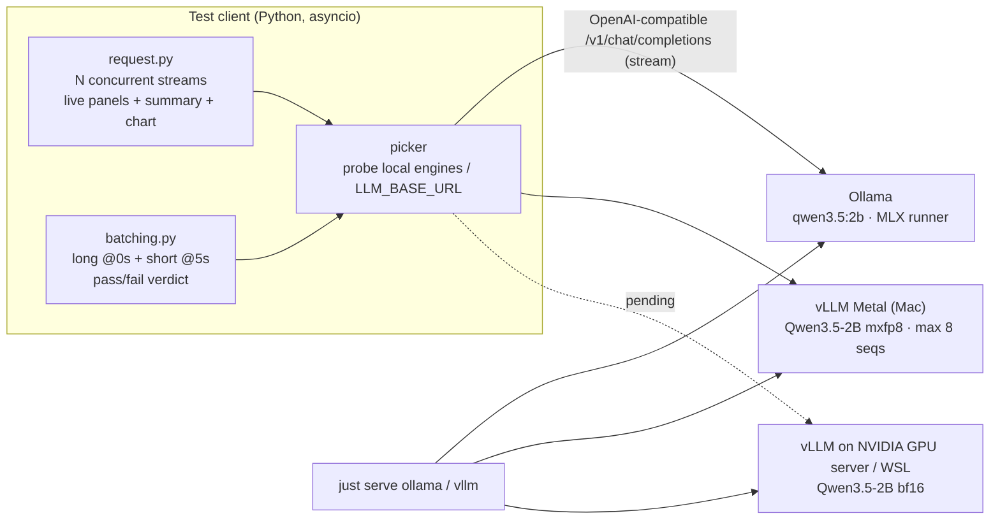

## Summary
### Resume bullets
- Built a concurrent streaming load tester for OpenAI-compatible LLM servers (Python asyncio +
  httpx) reporting per-request TTFT and throughput; it showed Ollama serving 4 concurrent
  requests one at a time (TTFT 0.1 → 4.4 s).
- Root-caused Ollama's failure to parallelise Qwen 3.5: its scheduler pins hybrid-architecture
  models to a single slot, traced to an unfixed upstream llama.cpp recurrent-state issue, plus a
  desktop-app setting forcing one parallel slot.
- Designed a continuous-batching test (long request at 0 s, short at 5 s) that separates
  continuous from static batching; on vLLM the late request got its first token 0.4 s after send.
- Evaluated vLLM, SGLang, llama.cpp and Ollama against six serving requirements for a 5–10
  concurrent-request target, recommending vLLM for the GPU server and advising against MTP
  speculative decoding at that load.
### Remarks
- B1: traces to the load-tester bullet · concrete, reusable tool with a visible finding · the
  staircase was measured on a laptop with a 2B model · roles: AI infra, backend.
- B2: traces to the Ollama root-cause bullet · shows debugging into an engine's scheduler and
  upstream code · a diagnosis, not a fix · roles: AI infra.
- B3: traces to the continuous-batching test bullet · test design that a naive simultaneous-send
  test cannot replace · single laptop run on vLLM Metal · roles: AI infra, ML.
- B4: traces to the engine-comparison bullet and the vLLM Metal requirement-test bullet · decision
  work · whether vLLM was adopted on the GPU server is unknown (outcome to confirm) · roles: AI
  infra. "5–10 concurrent requests" is the requirement, not a measured load.
- `TTFT 3.28 s / 3.32 s`: left out; two requests on a laptop says little on its own. Make the
  point as "both requests started streaming together" if needed.
- `12.4 tok/s aggregate, ~8 tok/s per request, 34.43 s wall`: left out; laptop numbers on vLLM
  Metal, slower than Ollama per request. Not a result worth quoting until the GPU-server run.
- `~50 tok/s Ollama vs ~8 tok/s vLLM Metal`: left out; it favours the rejected engine and the
  vLLM single-request run was not done. Mention only as a risk flagged.
- `4 of 6 requirements passed`: left out; partial and laptop-only. B4 can say "tested vLLM
  against the requirements" without the count.
- `max 8 concurrent sequences`: configured serve setting, not a result; leave out.
- Scope caveat: a one-day spike (2026-10-29) on a developer laptop; the GPU-server run is
  pending, so nothing here reads as a production deployment.

## Context
A one-day engineering spike (2026-10-29) to choose a self-hosted serving engine for Qwen 3.5.
The model had been tried on Ollama, which answered concurrent requests one at a time. The
requirements: run Qwen 3.5 directly, serve 5–10 concurrent requests truly in parallel, support
continuous batching, expose an OpenAI-compatible API, and deploy on an in-house GPU server.
Candidates compared: vLLM, SGLang, llama.cpp (`llama-server`) and Ollama. Tests ran on a
developer laptop (Apple M1 Pro, 32 GB); the GPU-server run is still pending.

## What I Did
- Built a concurrent streaming load tester for any OpenAI-compatible server: fires N requests
  at once with `asyncio` + `httpx`, renders each stream live in its own panel, then reports
  per-request TTFT, total time, tokens and tok/s, plus wall time and aggregate throughput, and a
  tokens-over-time chart where a "staircase" exposes one-at-a-time serving. Auto-detects running
  local engines and prints model architecture and machine spec beside the results.
  [serving-eval:src 100%] [serving-eval@032611b] [serving-eval@9141f1a] [serving-eval@346b1bd]
  [serving-eval@178fa2d]
- Designed a dedicated continuous-batching test: a 400-token request at t=0 and a 30-token
  request at t=5s; it passes only if the late request gets its first token and finishes while
  the long one is still generating. It separates continuous batching from static batching,
  which a simultaneous-send test cannot, and reports failed requests so an error cannot pass as
  a result. [serving-eval:src 100%] [serving-eval@6074c84]
- Root-caused why Ollama would not parallelise Qwen 3.5: its scheduler hard-pins hybrid
  architectures (`qwen35`, Gated DeltaNet + attention) to one slot regardless of
  `OLLAMA_NUM_PARALLEL`, traced to an unfixed upstream llama.cpp recurrent-state crash path; a
  second, machine-level cause was the desktop app running with `OLLAMA_NUM_PARALLEL=1`, and on
  Mac its MLX runner serialises requests for any model. [serving-eval:docs/reports 100%]
  [serving-eval@42b71e5] [serving-eval@9fd6d78]
- Wrote the engine comparison against the six requirements and recommended vLLM for the NVIDIA
  GPU server, SGLang where requests share long prefixes (its radix cache covers hybrid-model
  state), and llama.cpp instead of Ollama on small machines; advised against MTP speculative
  decoding at 5–10 concurrent requests (helps latency at low load, costs throughput at high
  load). [serving-eval:docs/reports 100%] [serving-eval@42b71e5]
- Tested vLLM Metal against each requirement on the laptop with a same-size, same-quantisation
  model as Ollama's (Qwen3.5-2B, mxfp8) for a fair comparison: 4 of 6 requirements passed, 1
  partly tested, 1 pending the GPU server; flagged vLLM Metal's slow per-request speed as a
  risk to recheck. [serving-eval:docs/reports 100%] [serving-eval@7be1432]
- Scripted reproducible server start-up with `just` recipes (Ollama with parallel slots and the
  model pinned in memory; vLLM with max sequences, context length, batched-token budget and
  reasoning/tool-call parsers). [serving-eval:just 71%] [serving-eval@178fa2d]

## Numbers
| Value | Scope | Source |
| ----- | ----- | ------ |
| 2 requests started together: TTFT 3.28 s and 3.32 s (0.04 s apart) | measured; vLLM Metal 0.32.0, Qwen3.5-2B mxfp8, Apple M1 Pro 32 GB, 2 concurrent requests | [serving-eval@7be1432] |
| Aggregate 12.4 tok/s, ~8 tok/s per request, wall time 34.43 s | measured; same setup, 2 concurrent requests, 256-token cap | [serving-eval@7be1432] |
| Late request: first token 0.4 s after send, finished 18.7 s before the long request | measured; continuous-batching test, vLLM Metal, Qwen3.5-2B mxfp8, M1 Pro, 400-token + 30-token requests | [serving-eval@6074c84] [serving-eval@7be1432] |
| Ollama staircase: TTFT 0.1 / 1.5 / 2.9 / 4.4 s; aggregate 50 tok/s (1 request) → 55 tok/s (4 requests) | measured; Ollama 0.40.13, `qwen3.5:2b` (MLX runner), M1 Pro, 4 concurrent requests | [serving-eval@9fd6d78] |
| ~50 tok/s single-request Ollama vs ~8 tok/s per request on vLLM Metal | measured; same laptop and model size; vLLM Metal 1-request run not yet done | [serving-eval@7be1432] |
| 4 of 6 requirements passed, 1 partly tested, 1 pending | measured; vLLM Metal on the laptop, no GPU server yet | [serving-eval@7be1432] |
| Target 5–10 concurrent requests; max 8 concurrent sequences | configured; requirement and serve setting, not a measured load | [serving-eval@42b71e5] [serving-eval@178fa2d] |

## Tools
tools: Python 3.14, asyncio, httpx, rich, plotext, questionary, uv, just, vLLM (vLLM Metal
0.32.0), Ollama 0.40.13, OpenAI-compatible chat-completions streaming API, Qwen 3.5 (2B, mxfp8
MLX), Gemma 4 (`e4b`, MLX), vLLM `/metrics`
Studied, not used: SGLang, llama.cpp `llama-server` (GGUF), MTP speculative decoding, vLLM on
NVIDIA CUDA under WSL (recipe written, run not recorded)

## Architecture

The client talks only the OpenAI-compatible streaming API, so every engine is measured with
the same code and the same metrics. `just` recipes start each engine with matching
concurrency, context and parser settings so results are comparable.

## Not mine
- The Windows/WSL vLLM recipe, its README section and the PowerShell `windows-shell` fix were
  committed from a shared company account, with an AI co-author trailer. [serving-eval@07a20ac]
  [serving-eval@ca4417d] (authorship to confirm; see Open questions)

## Open questions
- Jira was not checked: no Jira export exists yet for this company, and `mapping.yml` holds a
  placeholder API token (re-checked 2026-11-23).
- The two Windows/WSL commits came from a shared company account on the same day: were they
  made by me on the Windows PC (then they move to What I Did) or by a teammate?
- Who requested the evaluation and for which product or client (the chatbot work?), and was
  vLLM adopted on the GPU server afterwards?
- Were the 5- and 10-request runs and the GPU-server run ever done? Any GPU-server numbers
  (tok/s, TTFT at 5–10 concurrent requests) would be the strongest resume figures.
- Role title for this work.
