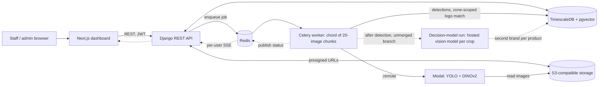

## Summary
### Resume bullets
- Designed and built a multi-tenant shelf-photo analytics platform end to end: one-pass YOLO
  product/logo/empty detection and DINOv2 brand matching on Modal serverless GPUs, Django REST API,
  and Next.js dashboards.
- Replaced in-process daemon-thread dispatch with a Celery + Redis job queue (chunked chord tasks,
  idempotent retries, row locks, stale-job reaper), so inference jobs survive restarts and
  out-of-memory kills.
- Moved server-sent progress events to a Redis pub/sub broker with per-user channels, fixing lost
  events across 5 web workers and closing a cross-tenant event leak.
- Built a benchmark system that imports labelled YOLO datasets, runs the production pipeline over
  them, and scores detection and brand recognition separately, with confusion matrices.
- Diagnosed a detection accuracy plateau by training YOLO11m-AMF and RF-DETR-small: both reached
  the same per-class profile (logo AP50 0.54 against product 0.92), tracing the limit to the data.
- Integrated a hosted vision decision model as a second brand recognizer beside logo matching,
  with additive storage, a read-time brand-source switch for charts and exports, and
  fingerprinted re-runs that skip unchanged crops.
### Remarks
- B1: traces to the system design, detection worker, logo indexing, analytics and admin
  bullets · breadth and sole ownership · frontend started from an open-source admin template;
  client on a trial, adoption scale unknown · roles: ML, backend, AI infra, full-stack.
- B2: traces to the durable job queue bullet · a decision recorded in an ADR with alternatives ·
  no measured failure rate before or after · roles: backend, AI infra.
- B3: traces to the distributed SSE broker bullet · "5 web workers" is the configured production
  count; the "~4 of 5 clients missed events" figure is derived, not measured, so it stays out ·
  roles: backend.
- B4: traces to the benchmark bullet · built tooling to measure the model honestly · no
  benchmark result figure is recorded; at ticket close (2026-08-24) no run had gone through real
  Modal inference and the migrations were not in production, so do not claim it ran in
  production until confirmed · roles: ML, MLOps.
- B5: traces to the model training and accuracy-plateau bullets · measured on 23 validation
  images (small set); a diagnosis, not an improvement · roles: ML.
- B6: traces to the decision-model brand recognizer bullets · an LLM-era
  integration with a recorded design decision (ADR-10) and failure isolation · caveat: on an
  unmerged branch, built in one day, not deployed and not yet compared with logo matching on
  real data; write "integrated" or "prototyped", never "shipped", and quote no accuracy until a
  comparison exists · roles: AI, backend, ML.
- Alternate bullet, replaced by B6 in this draft: "Rewrote shelf-level clustering on product
  bases with a median/MAD gap threshold and height floor, stopping over-segmentation that
  corrupted the Golden Line and fill-rate metrics." Traces to the shelf-level clustering bullet ·
  algorithmic fix with tests · constants are not tuned on labelled data (ground truth has no
  shelf level); do not claim an accuracy gain · roles: ML, backend.
- `1,015 products, 82% Unknown, 60% with no logo detected`: measured on 9 full-size photos in the
  live system; a diagnostic of recognition coverage, not a success metric. Use only to describe
  the unknown-logo investigation, for example "measured why most products stayed unrecognised".
- `147 / 139 / 82 products named at full / half / 720 px` and `36% vs 19% of logos named`:
  measured on 9 photos; supports a bullet such as "showed full-resolution photos named 79% more
  products than 720 px" if the user wants a resolution-study bullet.
- `NMS IoU 0.7 → 0.5: recall 0.608 → 0.667, mAP50 0.649 → 0.663`: measured on 23 validation
  images; a tuning finding. Not confirmed as the production setting, so left out.
- `mAP50 0.649 (YOLO11m-AMF) vs 0.613 (RF-DETR-small)`: measured; B5 makes the point with the
  per-class figures instead.
- `300–500 concurrent users`: a design target in a draft RFC, never load-tested. Write
  "designed for" only, or leave out.
- `5 × 20 → 5 × 12 database connections (~40 spare)`, `20 images per chunk`, `0.7 similarity
  threshold`, `k = 1.5, α = 0.5`: configured values; the bullets describe them without figures.
- Scope caveat: per-zone k-NN brand voting and the from-scratch redesign are specs and reports
  only, not code; do not claim them as built. The decision-model recognizer is code, but only on
  the unmerged `feat/decision-model-brand` branch (2026-11-24).
- Scope caveat: about 300 of the commits (all 19 of the decision-model commits) are co-authored
  with an AI coding assistant; the claims above rest on the design records and code in git.

## Context
A SaaS product for a retail-research client that collects smartphone photos of convenience-store
and supermarket shelves through field researchers and wants to sell a shelf analytics report to
FMCG brands. The client's metric list: share of shelf by facings, Golden Line (eye-level)
placement, out-of-stock and empty-slot detection, facing counts, price-tag OCR, adjacency, new
package alerts and package colour composition. The system detects products, logos and empty
slots in each photo, identifies brands by matching logo crops against a curated reference
catalogue, and shows per-survey analytics to two roles: staff (field accounts that own their
surveys) and admins (who curate zones, brands and reference logos). A PoC in a separate repo
(not ingested) preceded this monorepo; the monorepo is the SaaS rebuild. It runs on one AWS
t3.large host behind a Cloudflare Tunnel under PM2, with inference on Modal; the client was
trialling it in 2026-09. Work after 2026-09-16 lives only on unmerged branches: two reports and
small chart changes on `docs/unknown-logo-ux-consideration`, and, built on top of it on
2026-11-24, the decision-model brand recognizer on `feat/decision-model-brand`. ADR-10 records
that management decided to bring the decision model from an internal R&D project into this
product. [monorepo:docs/adr 100%]
[monorepo:docs/artifacts 100%] [monorepo:docs/deploy 100%] [TT-897] [TT-976]

## What I Did
- **Designed the SaaS system and its domain model**: surveys, collections, images, zones,
  brands, reference logos, product and logo detections, with staff/admin roles and
  owner-scoped data; Django REST API with JWT, presigned S3-compatible object storage (RustFS or
  AWS S3) and TimescaleDB with pgvector. [monorepo@4dfbfa63f] [monorepo@a12dda2cc]
  [monorepo@9ce777c] [monorepo:backend/src 100%] [TT-854] [TT-897]
- **Set up a one-pass detection model and its trainer**: a Textual TUI and CLI over Ultralytics
  for training one YOLO11 model with three classes (product, logo, empty), later YOLO11-AMF (a
  small-object variant adapted from a published paper) and an RF-DETR trainer, with ONNX export.
  [monorepo@10136f88a] [monorepo@71c09b5] [monorepo@a4b4415af] [monorepo@f161ef0bc]
  [monorepo@44678fc31] [monorepo:yolo_trainer 99%] [TT-809] [TT-1132]
- **Built the inference worker on Modal serverless**: batch functions download images by
  presigned URL, run YOLO, attach each logo to the product box containing its centre, embed the
  top logo crop with DINOv2-base (768-d CLS token) and return results; a second function embeds
  reference logos for indexing. Weights load as PyTorch or ONNX at the exported image size, and an
  RF-DETR app is selected per model architecture. [monorepo@c3a4d3b4c] [monorepo@67684ab35]
  [monorepo@c70c04763] [monorepo@041296b2e] [monorepo@15faebda4] [monorepo@bd0c773e9]
  [monorepo@647d4cf04] [monorepo:worker/src 100%]
- **Built brand matching**: each detected logo embedding is matched, within its zone only, to the
  nearest indexed reference logo by pgvector cosine distance, accepted above a per-zone
  similarity threshold; below it, the logo is Unknown. [monorepo@ae19bb1f7] [monorepo@7d6590591]
  [monorepo:backend/src 100%]
- **Built the analytics layer**: shelf-level assignment, share of shelf by facings, own brand vs
  competitor, Golden Line placement (an eye-level band by shelf count), fill rate by level, and
  own-centric adjacency (the neighbour on each of four sides, within one image), served as
  aggregation APIs and Next.js charts with Thai explainers, per-collection tabs, own-brand
  highlight, comparison views and export. [monorepo@0962a87a3] [monorepo@17a75df8e]
  [monorepo@10cf7b2bb] [monorepo@a8a7cf297] [monorepo@41d8a486a] [monorepo@760cf0e1d]
  [monorepo:frontend/src 100%] [TT-1172] [TT-1262] [TT-1269]
- **Rewrote shelf-level clustering (ADR-5)** after it reported more shelves than the photo had:
  cluster on the product base (`y_max`) instead of the box centre, and split rows only where a gap
  exceeds both `median + k·MAD` of the gaps and a fraction of median product height; constants
  are env-overridable and pure unit tests pin the behaviour. [monorepo@d0a54ee45]
  [monorepo:docs/adr 100%] [TT-1153]
- **Replaced daemon-thread dispatch with a Celery + Redis durable job queue (ADR-4)**: an
  orchestrator fans out one chunk task per 20-image batch in a chord; chunks are stateless
  (image-ID lists), idempotent (reprocess anything not `DONE`), soft-fail into a callback that
  derives status from DB rows, and take `select_for_update(skip_locked=True)` locks against
  double delivery; two routed queues, a `requeue_stale_tasks` reaper, and Celery beat for
  periodic purges. A DB-backed queue was rejected to spare the Postgres connection budget.
  [monorepo@c8afe3eed] [monorepo:docs/adr 100%] [TT-1145]
- **Moved the SSE broker to Redis pub/sub (ADR-2)**: the in-memory broker lost events across the
  5 production uvicorn workers and sent every user every collection's events; the new one keeps
  the broker interface, runs one async fan-out consumer per worker with a reconnect loop,
  subscribes each client to a per-user channel, fails open on publish errors, and authenticates
  streams by Authorization header. [monorepo@26c9dc8f3] [monorepo@d7d7bde5f]
  [monorepo:docs/adr 100%] [TT-1419]
- **Ran a scaling review (draft RFC for 300–500 concurrent users)** and acted on parts of it:
  right-sized the psycopg pool so workers × pool size leaves headroom under `max_connections`
  (ADR-3), split settings into components, removed a dead RabbitMQ scaffold, and added Redis and
  production restart policies to Compose. [monorepo@b86063ae5] [monorepo@aa6b148a6]
  [monorepo@de9241e38] [monorepo@167999763] [monorepo@17ff43c37] [monorepo:docs/artifacts 100%]
- **Closed object-level permission holes (BOLA/IDOR)** in the task-queue viewsets and removed a
  dead worker-callback endpoint that let any user write detections onto another tenant's
  images (ADR-1); later locked catalogue writes to admins. [monorepo@6fd8a65e9]
  [monorepo@2647e6fc4] [monorepo:docs/adr 100%] [TT-1415]
- **Built the unknown-logo review workflow (ADR-6)**: admins work a zone-filtered worklist of
  unmatched logo crops and import each as a new reference logo or dismiss it; import never
  rewrites survey numbers, and recognition changes only on a reprocess. Fixed EXIF orientation
  on image load in the worker and the crop builder. [monorepo@b43e0e014] [monorepo@54ed2a513]
  [monorepo:docs/adr 100%] [TT-1215]
- **Built the benchmark system**: import of YOLO-format ground-truth datasets through an upload
  wizard, a brand-labelling screen for ground-truth logos, runs of the production pipeline over a
  dataset, and scoring that keeps detection (precision, recall, F1, AP@50 per class, IoU 0.5) apart
  from brand recognition on matched pairs, with confusion matrices and every excluded logo
  reported. Benchmarks copy the zone's configuration and fingerprint the ground truth, so two
  runs are comparable only when both hashes agree. [monorepo@4cb819d77] [monorepo@ae7e4c530] [monorepo@2cebc4de9]
  [monorepo@ec3bb2d6e] [monorepo@3caee1e48] [monorepo@6b4476c64]
  [monorepo:backend/src 100%] [TT-1356]
- **Diagnosed the detection mAP plateau** with two training runs (YOLO11m-AMF, RF-DETR-small) and
  inference sweeps: product AP50 0.923 but logo 0.543, both architectures matching per class,
  so the limit is the 640 px source data and labelling, not the model; image size above 768
  hurt, and a lower NMS IoU raised recall. [monorepo:docs/artifacts 100%] [monorepo@cb7f11e65]
- **Measured why brands show Unknown on new full-size client photos**: ran 9 photos at full,
  half and 720 px and in the live system; resolution was one cause, but most products had no logo
  detected at all, and the rest matched no reference. [monorepo@8f92c346c]
  [monorepo:docs/artifacts 100%]
- **Evaluated requirements before building**: field-tested package colour composition on a real
  shelf photo and recommended not building it as specified (three methods disagreed and most
  pixels were fixtures); compared an external decision-model API with vector matching for brand
  recognition and proposed a staged cascade; specified per-zone k-NN brand voting weighted by
  `exp(similarity/τ)` (the ticket records "plan documented, not implemented"). None of these
  three was in the code at the time; the decision model was built later (see the next two
  bullets). [monorepo@00933d289]
  [monorepo@3c768f28d] [monorepo@c20e5bbc0] [monorepo:docs/artifacts 100%] [TT-1261]
- **Designed a second brand recognizer beside logo matching (ADR-10, unmerged branch)**: a hosted
  vision decision model picks each product crop's brand from a per-zone *brand set* of written
  packaging descriptions plus a catch-all *other*. Both recognizers always run; storage is
  additive only (a brand-set table, a prediction table with raw response, probabilities,
  confidence, tokens, cost and latency, and a per-collection run record), so no existing table,
  endpoint output or benchmark moves. The brand source is chosen at read time on survey
  aggregation and the CSV export, with a confidence cutoff applied on read so tuning it never
  re-runs anything; aggregations are cached per source, and the detection view shows both brands
  per product. Wrote the spec as user stories and vertical-slice tickets first.
  [monorepo@8078fe5] [monorepo@dbf6c66] [monorepo@e77d902] [monorepo@6ca7c97]
  [monorepo@e27df18] [monorepo:docs/adr 100%]
- **Built the decision-model run job**: it runs after detection in the Celery chord callback and
  from a separate "Run decision model" action that re-classifies existing detections only; API
  calls fan out on a thread pool while DB work stays on one thread; a fingerprint of model,
  question, ordered brand set, crop pixels and image send policy skips unchanged products; one
  failing call is recorded and counted, and eight consecutive API errors abort the run, which
  never fails the survey. Run status streams over the existing SSE channel. Ported the image send
  policy and client from the R&D project, added an admin brand-set editor (multi-select, reorder,
  describe later) and an idempotent import of brand sets from that project. Tests go through the
  HTTP API with the model provider faked at the HTTP-client boundary. [monorepo@103a9e1]
  [monorepo@6b42c5e] [monorepo@9a961bc] [monorepo@0988c21] [monorepo@db37664]
  [monorepo:backend/src 100%] [monorepo:frontend/src 100%]
- **Built the admin and account features**: user and permission management, zones with
  per-zone model configuration, a model hub for weight upload, brand and logo management,
  per-user notification inbox with a bell, admin announcement banner, queue and requeue
  controls with per-image status. [monorepo@6af0950ce] [monorepo@bd16390de] [monorepo@30ae80a30]
  [monorepo@7a3ab67b7] [monorepo:frontend/src 100%]
- **Ran deployment**: PM2 processes for web, Celery worker and beat, Docker for TimescaleDB and
  Redis, Cloudflare Tunnel for HTTPS, a written runbook, and a direct-to-host frontend instance
  to get model weights over 100 MB past the tunnel's upload cap. [monorepo@86c13942d]
  [monorepo:docs/deploy 100%] [TT-1291]
- **Kept design records**: ADRs, RFCs, plans, handoffs and an Obsidian knowledge base for each
  change, plus a Streamlit playground for YOLO and RF-DETR inference. [monorepo@1d8bbb892]
  [monorepo:docs/adr 100%] [monorepo:docs/artifacts 100%] [monorepo:poc/streamlit_app 100%]

## Numbers
| Value | Scope | Source |
| ----- | ----- | ------ |
| product AP50 0.923, logo 0.543, empty 0.480 (mAP50 0.649, mAP50-95 0.334) | YOLO11m-AMF, 23 validation images (measured) | [monorepo:docs/artifacts 100%] |
| mAP50 0.649 vs 0.613; logo AP50-95 0.214 vs 0.213 | YOLO11m-AMF vs RF-DETR-small on the same data (measured) | [monorepo:docs/artifacts 100%] |
| recall 0.608 → 0.667, mAP50 0.649 → 0.663 | NMS IoU 0.7 → 0.5, no retraining, 23 validation images (measured) | [monorepo:docs/artifacts 100%] |
| 147 / 139 / 82 products named | 9 client photos at full / half / 720 px, same model and references (measured) | [monorepo@8f92c346c] |
| 36% vs 19% of found logos named | same 9 photos, full size vs 720 px (measured) | [monorepo@8f92c346c] |
| 1,015 products; 60% no logo detected; 55% of found logos unmatched; 82% Unknown | live system, 9 full-size photos, 129 reference logos (measured) | [monorepo@8f92c346c] |
| 5 web workers | production uvicorn worker count (configured) | [monorepo:docs/adr 100%] |
| 5 × 20 → 5 × 12 DB connections of 100 | psycopg pool sizing (configured) | [monorepo@b86063ae5] |
| 20 images per chunk | Celery retry unit (configured) | [monorepo:docs/adr 100%] |
| 300–500 concurrent users | design target in a draft RFC (not load-tested) | [monorepo:docs/artifacts 100%] |

## Tools
tools: Python, uv, Django, Django REST Framework, JWT, Celery, Redis (pub/sub, broker), PostgreSQL /
TimescaleDB, pgvector, psycopg pool, Ultralytics YOLO11, YOLO11-AMF, RF-DETR, ONNX / onnxruntime,
Supervision, DINOv2 (Hugging Face Transformers), PyTorch, Modal (serverless GPU), RustFS / AWS S3,
OpenRouter (hosted vision decision model), httpx, Pillow,
Textual (TUI), Streamlit, Next.js, TypeScript, Tailwind CSS, shadcn/ui, bun, Playwright, Docker
Compose, PM2, Cloudflare Tunnel, AWS EC2, just, mise, pytest, ruff, Obsidian, Claude Code (custom
subagents and skills)
Studied, not used: Django Channels and Postgres LISTEN/NOTIFY (rejected for SSE), DB-backed queue
(rejected for jobs), pgbouncer (deferred), decision-model cascade filling logo-matching Unknowns
(proposed in a report, not adopted by ADR-10), k-NN brand voting (specified), ChromaDB (PoC only)

## Architecture

A staff user uploads a collection of shelf photos. The API enqueues one job; the Celery worker
fans it out into 20-image chunks that call Modal, where one detector finds products, logos and
empty slots and DINOv2 embeds each product's top logo. The worker matches each embedding to the
nearest reference logo in the collection's zone, assigns shelf levels, saves detections and
publishes progress over Redis to the user's SSE channel. Analytics endpoints aggregate saved
detections; admins curate the catalogue and the unknown-logo worklist, and run benchmarks
through the same pipeline. On the unmerged decision-model branch, a second job sends each
product crop to a hosted vision decision model with the zone's brand set and stores a second
brand per product; viewers pick which brand source the charts and exports read.

## Not mine
- The frontend scaffold: an open-source Next.js + shadcn/ui admin dashboard template, committed
  as the starting point. [monorepo@662043d]
- Third-party agent skills vendored under `.agents/skills` (installed, not written).
- One commit by a deploy account on the production host (UTF-8 config reading). [monorepo@a0e15cd]
- Training images and labels came from a Roboflow dataset; who labelled them is not recorded.
- The YOLO11-AMF architecture is from a published paper; the adaptation and training are mine.
- The vision decision model is a third-party hosted model; the client code and brand
  descriptions it uses were ported from my internal R&D project, a separate evidence file.

## Open questions
- Production status: is the client still on a trial, or a paying user? How many staff accounts,
  surveys or photos has the live system processed?
- Which model is in production now: YOLO11m-AMF (ONNX) or RF-DETR? Was NMS IoU 0.5 adopted?
- Benchmark results: has a benchmark run been scored on ground truth? Any precision / recall or
  brand-recognition accuracy figure to quote?
- Benchmark: TT-1356 says no run had gone through real Modal inference at 2026-08-24 and the
  branch was undeployed; it merged to main in 2026-09. Has it since run in production?
- Who labelled the training dataset and the benchmark ground truth: you, a teammate or the
  client?
- Did anyone else work on the project (frontend, deployment, client contact), given one
  committer in git?
- The PoC repo (2026-02 ~ 03: product detector, logo detector, DINOv2 + ChromaDB, Streamlit) was
  not ingested. Add it to mapping.yml or fold it in from your account?
- The analytics in 2026-07 onward came from a client requirements list; which of the 8 metrics
  did the client accept as delivered?
- Work on `docs/unknown-logo-ux-consideration` (RPT-9 to RPT-12, top-10 brand charts) is unmerged:
  were the reports sent to the client?
- The decision-model recognizer (2026-11-24) is on an unmerged branch: will it be merged and
  deployed, and has it been run on a real survey and compared with logo matching?
- Sending shelf crops to an external model provider: ADR-10 records a manager's approval; is
  that the client's approval too?
